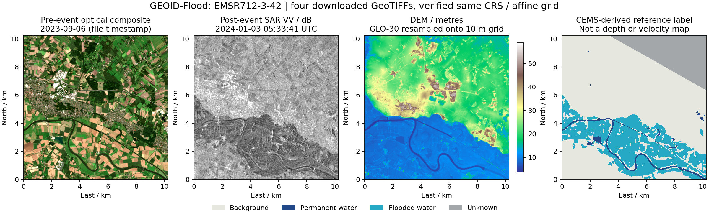
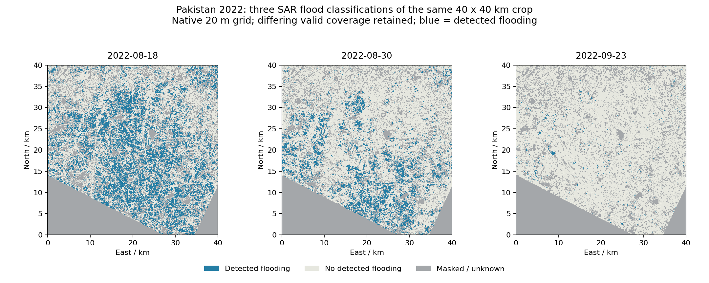

# 可快速映射的真实洪水空间数据筛选

核查日期：2026-10-21。此轮只筛选资料、下载小样本并验证空间网格，没有继续修改工作台界面，也没有运行洪水模拟。

更新：[Pakistan对应区域DEM已取得并对齐](pakistan-dem.md)，同一40公里窗口已有FABDEM与三期淹没GeoTIFF。下文“发布包没有DEM”描述TU Wien原包内容，此次已另配地形。

## 结论

已有可直接导入的真实空间数据。GEOID-Flood最贴近“影像、地形、现成淹没标签已对齐”的快速上图需求；TU Wien Pakistan 2022提供同一场洪水的多日期淹没分类栅格，更贴近过程回放。二者的完整性不同，不能互相替代。

| 资料 | 现成内容 | 时间能力 | 仍缺什么 |
|---|---|---|---|
| GEOID-Flood | 雷达灾前／后、灾前光学合成、DEM、洪水／常年水体／背景／未知标签，均为带坐标GeoTIFF | 每个地图块以灾前／灾后及参考标签为主，不能当作密集洪水过程 | 每时刻淹没标签、实测水深／流速；标签观测时刻须按catalog与源产品核对 |
| TU Wien Pakistan 2022 | 多日期洪水分类GeoTIFF、有效区、首次检测日期和洪水频率 | 文件名保留实际成像时刻，可按不等间隔回放 | 此发布包没有配套DEM、可见光影像、水位／深度／速度过程；需另配 |

遥感分类属于真实观测衍生产品，仍有分类误差，不是直接测深，也不是水动力模拟真值。

## GEOID-Flood：已打开四个实际图层

- [作者数据页](https://huggingface.co/datasets/links-ads/geoid-flood)
- [可按文件下载的sample目录](https://huggingface.co/datasets/links-ads/geoid-flood/tree/main/sample/geoid-flood)
- 核查样本 `EMSR712-3-42`，来源为德国2023年底至2024年初洪水的EMSR712。
- 淹没标签、DEM、光学和雷达四个GeoTIFF均为EPSG:32632、1024×1024、10米格距，原点约(501760,5877760)。仿射变换误差小于1e-7米，直接按行列叠合，不必自行从影像识别洪水。
- 单块覆盖10.24×10.24 km。标签像素：背景672,664；常年水体19,804；洪水221,685；未知134,423。未知值255单独保存。
- 光学文件为灾前合成，文件时间戳2023-09-06；雷达灾后文件2024-01-03 05:33:41。参考标签时间不能直接用雷达文件时间替代；作者另提供`tile_catalog.parquet`中的delineation时间，本轮尚未逐条解析。
- DEM是Copernicus GLO-30重采样到10米网格，并非原生10米或1米地形；它不能直接支撑1米精度的河床／墙／桥墩模拟。
- 全量约584 GB，但不需要全量下载；这个有效样本四个图层约35 MiB，样本文件可独立取用。
- 作者数据编制与标签采用CC BY 4.0，DEM另适用Copernicus WorldDEM-30许可。

上图左起：灾前光学合成、灾后雷达、DEM、参考淹没标签。青色为洪水、深蓝为常年水体、灰色为未知。预览仅做显示拉伸，没有生成或修补淹没标签。

## Pakistan 2022：已打开同一区域三个日期

- [TU Wien原始数据发布](https://researchdata.tuwien.at/records/zvvmh-nan78)，DOI `10.48436/zvvmh-nan78`，CC BY 4.0。
- 官方介绍时间范围为2022-08-10至09-23；实际ZIP清单不截断，共164个GeoTIFF，清单中的最早成像时间是08-18、最晚09-23。接入时以实际文件为准，不补出缺少日期。
- 文件含20米Equi7Grid坐标；0为未检测洪水、1为检测洪水、255为掩膜／未知。频率和首次检测两个统计图不能替代逐期分类。
- 完整时序ZIP约347.5 MiB；已验证发布端支持读取ZIP清单及单独下载其中某个GeoTIFF，不必先下载全部包。
- 已打开 `E015N027T3` 中2022-08-18 01:26:15、08-30 01:26:16、09-23 01:26:16三期同轨道D078产品。三幅均为15000×15000，原点(1500000,3000000)、20米北向网格，空间变换完全一致；三个实际文件合计约20.9 MiB。
- 下图为同一个40×40 km窗口，中心约24.869°N、68.592°E。为展示变化，窗口按三期共同有效区内的分类变化选择，不用作精度评估；原始掩膜仍逐期保留。各期有效区不同，不能直接把图内蓝色面积差当作全区域洪水面积变化。
- 这些是SAR算法识别的洪水范围，不是水位站测量，不提供水深或流速。观测间隔由卫星过境决定，不是每分钟、每日完整覆盖；各轨道／相邻条带需按实际覆盖合并。

## 当前可映射方式

GEOID样本可直接建立地形矩阵、常年水体、洪水范围和有效区；光学／雷达作为独立影像图层，不把影像亮度转成水深。为快速接入，可保留原生10米观测网格，先裁2公里见方，即200×200格。

Pakistan多期栅格可直接重投影到同一局部米制网格，按实际成像时刻建立观测帧；掩膜独立处理，尚无新观测时显示数据年龄，不通过前后帧混合制造中间真值。

两套数据均未提供全域逐时实测水深／流速。它们能支持淹没范围的地图展示、观测回放及范围残差，尚不能直接支持完整水深／流速残差。

## 本地复用

原始下载与核查JSON保存在本工作台的`.runtime/source-screening/`：

- `geoid-inventory.json`、`geoid-label-stats.json`、`geoid-selected-inspection.json`与对应GeoTIFF。
- `pakistan-zip-inventory.json`、`pakistan-inspection.json`、`pakistan-crop-audit.json`与对应GeoTIFF。

原始大文件留在忽略目录；本页和预览记录筛选结论，不改变上一版Harvey单站档案。
