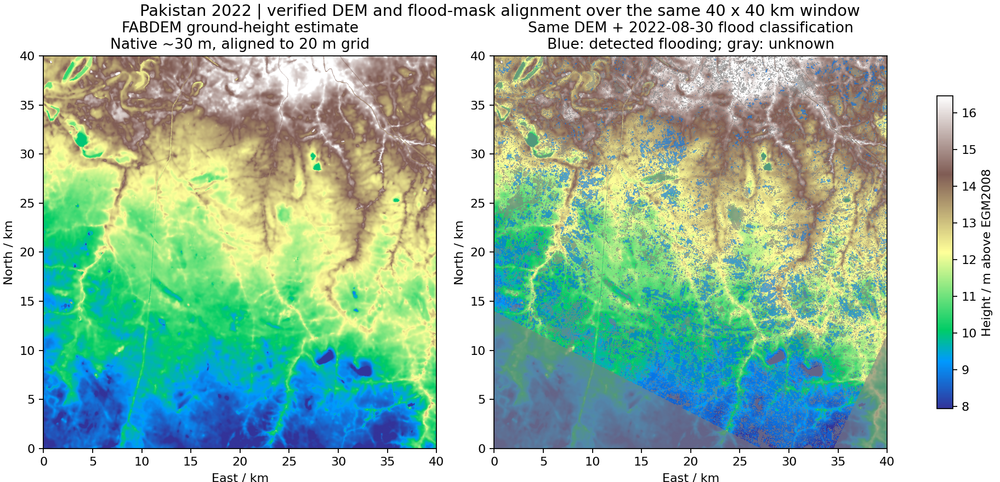

# Pakistan 2022 / TU Wien对应区域的DEM

核查日期：2026-10-21。已取得FABDEM v1.2，并与上一轮实际下载的三期TU Wien洪水分类完成空间对齐；未运行水动力模拟或修改工作台界面。

## 已完成的区域

- 仍使用上一轮的同一个40×40 km窗口，而非另选一片地形。
- 窗口中心约24.86853°N、68.59165°E；经纬度外包框为68.35817～68.82447°E、24.64730～25.08964°N。
- TU Wien Equi7 Asia投影下，范围为E=1,720,000～1,760,000 m、N=2,713,600～2,753,600 m。投影完整WKT保留在同目录JSON，不能把该投影误标成UTM。
- 所需原始DEM瓦片为`N24E068`与`N25E068`，二者均已取得。

## 首选数据：FABDEM v1.2

[布里斯托大学原始发布](https://research-information.bris.ac.uk/en/datasets/fabdem-v1-2/)；DOI `10.5523/bris.s5hqmjcdj8yo2ibzi9b4ew3sn`。

FABDEM从Copernicus GLO-30中估计并去除树木和建筑带来的高度偏差，更贴近裸地高程目标。它不是现场测绘的河床或建筑地下地面，当前也没有独立实测高程用于判断此处精度。

- 原生格距：1角秒，约30米，不是20米或1米测量。
- 原始水平坐标：WGS84 / EPSG:4326；高程单位米，垂直基准EGM2008 / EPSG:3855，均核对原始readme。
- 原始地形主要继承Copernicus的TanDEM-X 2011～2015年采集资料，局部填补可能更早；尚未核验本窗口逐像素采集时刻。
- v1.2在2023年1月发布；本次是事后历史资料整理。若实验要求严格重现2022年当时可用的资料，需换用当时已经发布的版本。
- 下载使用Fondazione LINKS公开COG镜像，保留原始大学发布来源、瓦片元数据、实际文件SHA-256及原始readme／许可。镜像目录日期不当作采集日期。
- 原始大学说明和所附许可文件为CC BY-NC-SA 4.0；镜像页面简述存在不同许可名称，本次以原始文件为准。用于后续分发时需保留原始署名和许可。

## 已准备的文件

数据文件位于仓库内的`flood-data-workbench/.runtime/source-screening/pakistan-dem/`：

| 文件 | 用途 |
|---|---|
| `N24E068_FABDEM_V1-2.tif`、`N25E068_FABDEM_V1-2.tif` | 原始下载的1度DEM瓦片 |
| `fabdem-40km-wgs84-native.tif` | 原生角秒网格的裁剪拼接，1600×1686格，含边缘缓冲 |
| `fabdem-40km-equi7-20m.tif` | 与洪水窗口同投影、同原点、同格距的DEM，2000×2000格，约9.2 MB |
| `flood-20220818-40km-20m.tif` | 8月18日分类窗口，原始整数像素直接裁剪 |
| `flood-20220830-40km-20m.tif` | 8月30日分类窗口，原始整数像素直接裁剪 |
| `flood-20220923-40km-20m.tif` | 9月23日分类窗口，原始整数像素直接裁剪 |
| `alignment.json`、`fabdem-sources.json` | 空间参数、来源URL、哈希、处理规则和检查结果 |

DEM采用双线性重投影到20米目标格；这是对原生约30米信息的上采样，不提高原始精度。源DEM裁剪同时保留。三期分类没有插值，0／1／255值逐位保留；255仍为未知，不自动变为干地。

检查通过：输出DEM与三期分类的坐标系、仿射变换、形状一致；写出再读入的像素与内存结果一致；三期分类与原始裁剪逐位相同。DEM共4,000,000格，全部有效，高程约1.39～22.17 m EGM2008。这些是数据完整性和配准检查，不是地形精度或洪水准确性验证。

[紧凑对齐元数据](pakistan-dem-alignment.json)

图左为对齐后的FABDEM，右为叠加8月30日洪水分类；右图蓝色为检测到的淹没，灰色为该期未知区。颜色仅作高程显示拉伸，不代表地表群系。

## 备用：Copernicus GLO-30

[官方数据说明](https://dataspace.copernicus.eu/explore-data/data-collections/copernicus-contributing-missions/collections-description/COP-DEM)与[免登录公开COG目录](https://registry.opendata.aws/copernicus-dem/)。已核实对应`N24E068`、`N25E068`瓦片的真实下载地址、文件大小和原始XML。为控制本轮工作量，停止了备用大瓦片下载；没有把未完成下载列为已取得数据。

GLO-30是包括建筑、基础设施和植被的DSM，可作来源对照；它不是独立裸地测量。与FABDEM同样不能恢复1米尺度的细沟渠、道路堤坎、桥墩或水下河床。

## 当前可支持什么

已经可以建立同一区域的静态高程和三期淹没观测图层，并进一步按同一网格裁剪小工作区。整个TU Wien南部巴基斯坦数据范围可按同样办法补齐DEM；本轮只处理上述40公里窗口，没有下载全域。

若进入区域洪水计算，仍需合理入出流／降雨、初始状态、糙率和河床／堤防资料。当前结果不证明数据已具备完整的真实洪水求解条件，也不把未提供的水深或流速补成观测。

FABDEM is produced using Copernicus WorldDEM-30 © DLR e.V. 2010-2014 and © Airbus Defence and Space GmbH 2014-2018 provided under COPERNICUS by the European Union and ESA; all rights reserved. The organisations in charge of the Copernicus programme by law or by delegation do not incur any liability for any use of the Copernicus WorldDEM-30.
