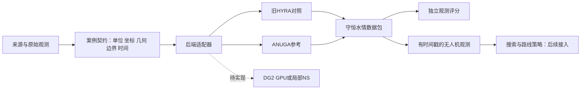

# HYRA新洪水平台：可替换后端与搜救接口

## 最新状态：独立参考完整事件已完成，漏淹仍待修复

2026-10-31，第91轮的独立5m LISFLOOD-FP8 SGC/local-inertia参考案例完成245700秒过程并通过内部水量、有限非负检查。固定实测湿区正例覆盖为88.56%，24884漏格保留；这不是整体准确率，且不是下面第81轮DG2失败案例的通过或生产后端升级。第92–95轮已定位漏淹及南部静态通路条件，历史几何/局部过程证据仍不足，暂无可采用的物理修复。

详见[完整事件审计](../terrain-workbench/docs/audit-round91-complete-20261031.md)、[南部漏淹诊断](../terrain-workbench/docs/audit-round95-southern-head-paths-20261031.md)及[本次研究快照范围](../terrain-workbench/docs/github-snapshot-20261031.md)。生产默认和原离线界面没有因本快照升级，未宣称现场救援适用。

## 历史失败保留：第81轮DG2长时程未通过

第81轮参考后端在模拟2179.0073秒触发负均值水深保护，未完成164000秒目标。第78–80轮几何、启动和采样检查没有证明现场精度提高。详见[失败收尾](../terrain-workbench/docs/failure-round81-20261030.md)。下文早期架构能力与测试记录按各自范围理解。


## 2026-10-30：搜救定性入口

当前效果验收只要求预登记的搜救定性判断与独立观测一致，不要求逐点数值精度；历史定量评分保留为内部诊断。数值守恒、有限非负、稳定性及坐标时间检查仍保留。以下旧版本能力和测试记录不等于当前实测验收。

本地打开 [搜救水情定性对照](review/qualitative.html)，可查看三站涨退/主峰先后、全部时段的证据状态，以及Carlisle真实事件的原始最大淹没记录和调查点。新入口是离线证据快照；旧模拟工作台仍保留，未将它替换为新的实时求解界面。

当前Okushiri部分时段涨退相反，主峰先后有颠倒，尚未全通过；Carlisle尚无同域模型对照。界面未知项不计通过，资料取得不计模拟通过。浏览器视觉/交互检查因内置浏览器拒绝本地file URL而跳过，静态检查通过。

重建：`python benchmarks/build_qualitative_review.py --base <outputs目录> --template review/qualitative-template.html --output review/qualitative.html`。这会核对固定来源和问题文案；换来源必须重新审核，不用于自动挑选最好结果。


状态：0.1研究架构原型，已贯通两个真实CPU求解后端与独立评分；尚未通过新后端实测验收。旧terrain-workbench保留为对照，网页仍使用旧入口。新平台不把自己的求解器作为必须保留的前提。



## 当前能做什么

- 完整输入契约：SI单位、局部东/北坐标、数组第0行在南侧、文件SHA256、证据类别/校准或留出角色、边界及时间窗。缺字段、单位错、未知物理字段和文件损坏拒绝执行。
- 旧HYRA适配器通过翻转行和南北动量符号接入；ANUGA4.1.0/DE1采用真实RK2。不同环境分别运行，不静默切换后端。
- 三角形到输出方格以面积加权投影水深和守恒动量；保存原生体积、输出体积、边界/源项体积及实际接受步。
- 测点统一取所在输出格的平均守恒状态，不宣称等同于点插值；干区速度无效标记，不冒充有观测的零流速。
- 原始Merewether完整800秒/1600时刻/40点档案核验与严格评分；原始观测文件须逐个哈希一致。不删点、不移时。
- 淹没评价分别记录TP/FN/FP/TN、未知观测、未判定湿区；未知不当干区，不输出易被干区抬高的整体准确率。
- 无人机观测接口只取请求时刻之前最近实际帧，并应用显式感知范围；未知为NaN/-1，可给阈值不确定带。它不替代航迹规划器。

## 明确的当前范围

v0.1求解入口仅支持矩形封闭工程验证案例，ANUGA适配暂要求平床。未实现的流量边界、建筑孔洞、水工结构、降雨等会报错，不能忽略后继续计算。Merewether目前接入的是既有结果的独立评分，不是新ANUGA全案例模拟。完整GPU洪水后端、DG2、NS耦合及优化的无人机规划均未实现；后端列表对此明确标记。

这项限制用于防止“换了名字却仍算旧算法”或“省略关键几何后获得漂亮分数”。下一工作单元是实际输入/几何/边界适配，见[重构路线](ARCHITECTURE.md)。

## 使用

使用各后端自己的Python；无需安装本包即可运行。旧环境具备NumPy/Numba，参考环境已安装ANUGA4.1.0；不要把两个环境混装。

```powershell
python run.py backends
python examples/make_cases.py <新的案例目录>
python run.py validate <案例目录>/lake/case.json
python run.py run <案例目录>/lake/case.json --backend legacy_hyra --legacy-lab <原terrain-lab目录> --output <新结果目录>
# 用reference-anuga-4.1.0环境的Python执行：
python run.py run <案例目录>/lake/case.json --backend anuga_cpu --output <另一新结果目录>
python run.py compare <旧后端结果> <ANUGA结果> --output <差异.json>
python run.py score-merewether <原完整实验结果目录> --source <原experiment目录> --output <评分.json>
python -m unittest discover -s tests -v
```

每次求解必须新建结果目录，失败保留status及日志，不覆盖重跑。run.json保存版本、源码/输入哈希、真实时间步和适用范围；fields.npz保存全部实际帧及水量账目。compare只表示软件差异，不将ANUGA当实验真值。

## 已执行验证

两个后端×静水/东西溃坝/南北溃坝/干床溃坝共8次实际小计算；都满足本轮有限/非负及封闭水量准入。19项接口/评分/损坏/时间因果测试通过。原Merewether基线仍2/40达标、RMSE约0.659064m/s；没有新的实测精度提高结论。

证据目录：本聊天outputs/round64。详细日志、首次失败、修复依据及原始场均保留。当前结果只支持新框架可运行，不支持现场安全用途。
