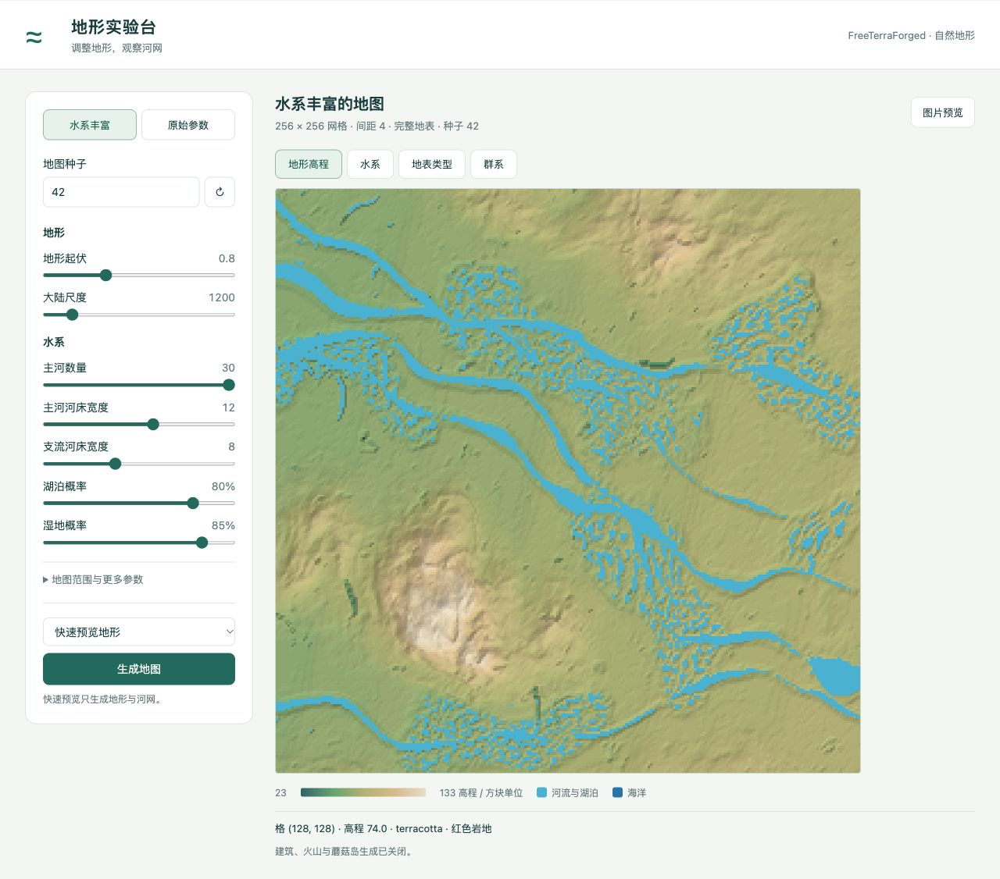

# 地形生成工作台

为洪水模拟准备合成网格地形。页面可以调整种子、地形起伏、大陆尺度、河流、湖泊、湿地和气候参数，查看二维高程、水系、地表类型与群系。



## 打开页面

需要 Python 3.9 或以上。仓库附带一张由原版完整区块流程生成的示例地图，不安装 Java 也可以查看。

```bash
cd terrain-workbench
python3 terrain-lab/launcher.py
```

也可以双击 macOS 的 `terrain-lab/启动页面.command`。页面地址为 <http://127.0.0.1:8766/>；保持启动服务的终端运行。

## 高程可视化

点击地图右上角的“高程可视化”，或打开 <http://127.0.0.1:8766/elevation.html>。界面读取当前地图，无新地图时使用内置示例。

- 三维地形支持拖动旋转、滚轮缩放、方向键旋转与加减键缩放；高程夸张只改变显示比例。
- 二维高程图支持点击查点和方向键移动选中点，显示等高线与剖面位置。
- 统计最低、最高、平均高程与地形高差；沿 X 方向查看指定行的原始高程剖面。
- 支持下载当前视图 PNG 和原始二维高程 JSON 矩阵。

完整地图读取实际地面高程；快速预览读取连续地形高程。所有高程沿用方块单位，未标定为米。浏览器不支持 WebGL 时自动使用二维视图。生成新地图后，点击“读取最新地图”更新。

## 动态洪水

洪水过程已融入 `terrain-lab/maps.html` 的多层地图，旧 `flood.html` 地址自动进入同一页面。[地图与洪水说明](terrain-lab/MULTILAYER.md)包含地图层、编辑、完整过程、时间轴与导出接口。

```bash
python3 -m pip install -r requirements.txt
python3 terrain-lab/launcher.py
```

默认读取当前生成地形。支持降雨、额外常量来水、变化水源、入渗、日常河流基流及预热。设置总时长后后台自动计算，页面连续播放已计算时段，支持暂停、倍速、回到起点和小数秒拖动。播放帧间插值仅用于显示，导出保留实际计算帧。

地图包括高程、独立地表类型、建筑、公共边阻水墙、逐格Manning糙率、水源编号和排水能力。四幅地图同时显示固定环境、当前水深与流向、流速、累计最大水深。建筑与阻水边封闭水流，排水受可用水量限制；水源按事件时间变化，全部进入水量收支。流向箭头附m/s数值，可调整密度、关闭箭头或数值，查点获得精确速度。

默认1方块=1米，是合成场景设定而非真实标定。新地图每方块一格：边长32—4096方块，对应同样行列数的网格，采样间距固定1方块。洪水直接沿用生成网格、原点和间距，不再降采样；旧地图保留已有采样间距，重新生成才获得每方块一格。完整地表读取实际地面和水面；快速模式读取连续高程和生成器水系。可关闭初始水体。

地图边长1024对应1,048,576格，4096对应16,777,216格；这些范围是配置上限，不代表实时计算能力。可先用128或256方块验证场景。完整地表仍限制边长不超过1024。大地图以二进制数组加载，ZIP中的地图JSON逐行写入，数值格式和网格不变。求解器减少重复重构和临时数组，未改变CFL、RK2或通量公式；性能验证入口为 `terrain-lab/benchmarks/benchmark_native_grid.py`。

海平面边界只让原始海洋最外侧面与固定外海双向交换，其他边缘只出流。另有自由出流和封闭模式；全自由出流会把海洋当作有限水体。外海水位恒定，没有潮汐或风暴增水。

默认日常基流总量5 m³/s，按原始连通河段最高有效水面附近补给，按原始河段面积分配。无有效河道则跳过。预热只使用基流和设定入渗，最多默认600秒；每60秒检查水深和速度变化，两次连续均不超过0.01m与0.01m/s且至少120秒，才标为达到稳定阈值。达到时限未收敛会明确显示。洪水零时刻保留预热水深和动量，重新开始累计收支，基流继续补给。

ZIP保存固定地图、实际时间帧、最终水情、公共边通量、基流／海岸元数据和独立预热收支。当前显示JSON会标记帧间插值。水动力采用原生方格有限体积、MUSCL二阶重构、hydrostatic reconstruction与配套地形源项、SSP-RK2、自适应CFL和Manning摩阻。默认通量为Rusanov，KNP可在洪水页面的“水动力求解设置”中选择；低弗劳德数修正可选，默认关闭。面板同时支持空间阶数、时间推进及高级数值参数；设置随场景JSON保存，修改后应用地图或重新模拟生效。干湿交界退化为一阶，排空限流及实际源汇量进入收支。方法依据 [Audusse et al. (2004)](https://doi.org/10.1137/S1064827503431090)，通量与重构设计参考ANUGA，代码为本地方格实现。[数值说明](terrain-lab/MULTILAYER.md#数值方法与实验配置)与[解析对比实验](docs/flood-numerics-comparison.md)记录配置和结果。真实洪水仍需校准；当前尚无桥涵和完整土壤模型，粗网格仍会丢失狭窄河槽等结构。

```bash
cd terrain-lab
python3 -m unittest discover -s tests
node tests/test_map_playback.mjs
```

外源洪水可选择生成时标注的河流入口，或在没有河流的位置手动强制来水。支持多个点独立流量过程、开始／结束时刻和启停；日常基流与外源洪水分别统计。交点方向是原始地形／水面的局部推断，待确认交点不自动注水。入口元数据和 `M_forcing` 保存稳定编号、坐标、映射权重及每点累计量，场景可导出、再次导入与修改，用于后续强化学习的外源条件设置。具体操作和接口见 [多层地图说明](terrain-lab/MULTILAYER.md#外源洪水与上游来水)。

## 生成新地图

安装 Java 21，并设置 `JAVA_HOME`，或者保证系统能找到 Java 21。首次生成需要联网下载 Gradle、Minecraft、Fabric 等构建依赖。

调整页面参数后点击“生成地图”：

- **快速预览地形**：读取原版连续地形与河网；不生成实际方块和群系。
- **完整地表与群系**：执行原版完整区块流程，再读取地面方块、水面和生物群系；耗时更长。

每次生成的数据保存在 `terrain-lab/generated/<生成编号>/raw/`；`terrain-lab/current.json` 指向最新地图。这些运行数据和构建缓存不会提交进仓库。工作台只导出显示、水系识别与洪水所需的7个原版字段；独立生成器请求不指定 `fields` 时仍导出全部原版Cell字段。

模拟地图关闭建筑结构、火山与蘑菇岛，并跳过为游戏世界高度设计的山峰压缩。完整地表按生成地形自动扩大垂直空间；超出底层方块引擎容量时明确报错，保留未截断的二维高程。图例显示当次地图的实际高程范围。

## 导出高程矩阵

导出当前地图；尚未生成新地图时导出内置示例：

```bash
python3 terrain-lab/export_height_matrix.py
```

结果位于 `terrain-lab/exports/height-matrix.json`，文件本身是二维数值数组。`height-metadata.json` 记录种子、形状、坐标、间距与高程定义。

如需 NumPy 格式：

```bash
python3 -m pip install -r requirements.txt
python3 terrain-lab/export_height_matrix.py --npy
```

```python
import numpy as np
H = np.load('terrain-lab/exports/height-matrix.npy', allow_pickle=False)
height_at_cell = H[0, 0]
```

矩阵顺序为 `H[行, 列] = H[z, x]`：行从地图上方到下方，列从左到右。索引从 0 开始；坐标满足 `x = origin_x + 列 × step`、`z = origin_z + 行 × step`。水域格子记录水底高程，不是水面高度。单位沿用生成器的方块单位，尚未标定为米。

## 目录与来源

- `terrain-lab/`：本地页面、服务、参数预设与矩阵导出。
- `freeterraforged-reproduction/`：Java 原版生成器与导出适配层。
- `terrain-lab/example/`：裁剪为页面所需字段的实际生成示例；工作台新生成地图保存所需的7个原版字段。

上游 FreeTerraForged 固定在提交 `c5d322f5e44539ca6d3a6059c5de440af9abcfe6`，保留完整源码及 MIT 许可证。`freeterraforged-reproduction/upstream-manifest.json` 记录逐文件校验值，可检查：

```bash
python3 freeterraforged-reproduction/run.py verify-source
```

生成器的更多用法见 [生成器说明](freeterraforged-reproduction/README.md)。项目原有 Apache-2.0 许可证保留；上游第三方源码继续遵循其 [MIT 许可证](freeterraforged-reproduction/upstream/LICENSE)。
