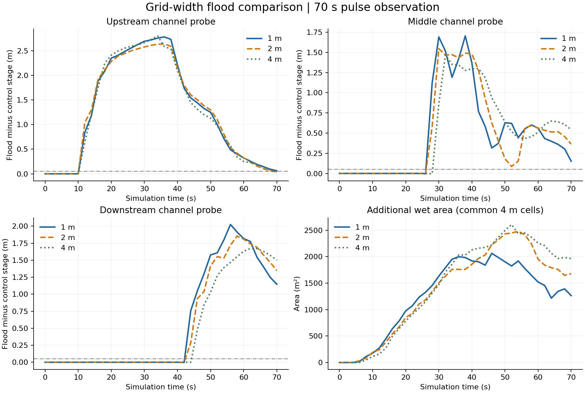
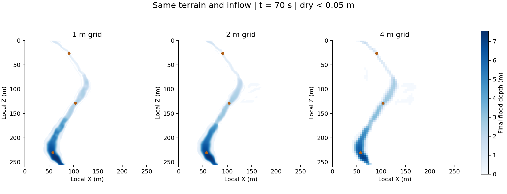

# 短时洪水网格对照

当前原始地图 [256, 256]，每格1米。正式观察 70 秒，每2秒记录；每档先预热20秒，再从相同预热状态分别运行10 m³/s对照和洪水脉冲。

峰值来水200 m³/s是合成压力输入，不对应某一重现期。无降雨、入渗、额外地物或人员；边界为开边界。

1米仅为数值比较基准，不是实测真值。初始地图为连续地形预览，20秒预热不代表达到稳态；配对对照用于分离共同的初始调整。

| 格宽 | 两分支及预热耗时(s) | 中游脉冲最大抬升(m) | 下游到达(s) | 最大新增湿面积(m²) | 末时刻湿区深度MAE(m) |
|---|---:|---:|---:|---:|---:|
| 1 m | 118.69 | 1.7040 | 44.0 | 2064 | 0.0000 |
| 2 m | 16.27 | 1.5458 | 44.0 | 2480 | 0.1798 |
| 4 m | 2.38 | 1.4672 | 46.0 | 2608 | 0.3543 |

到达：洪水减对照水位连续两帧达到5厘米；采样间隔2秒。新增湿面积：同一时刻洪水有水而对照干燥，统一按4米格平均水深>=5厘米计算。MAE同样在共同4米格上计算。

小地图和短时单脉冲结果不能证明任意地图或长时间过程的精度。见 config.json、summary.json、各档时间序列及NPZ原始场。

## Observation findings

All statements below describe this one short synthetic pulse, relative to the 1 m numerical run.
- 2 m: middle-probe peak pulse rise 9.3% lower; maximum additional wet area 20.2% larger; measured runtime 7.3x faster.
- 4 m: middle-probe peak pulse rise 13.9% lower; maximum additional wet area 26.4% larger; measured runtime 49.8x faster.
- Middle/downstream response is smoother on coarser grids. Secondary peaks differ; these observations do not establish which oscillations are physically correct.
- Probe coordinates are fixed in metres; each grid supplies its containing-cell average, so point differences include spatial representation as well as propagation.
- The pulse has reached the downstream probe by 70 s, but downstream recession is incomplete. This is not a full-event flood-extent evaluation.
- All six branches have matched prescribed input volumes, finite nonnegative depths and absolute mass residual below 1e-7 m3; no numerical water adjustment was used.
- Output arrays and JSON have been cross-checked; see validation.json.
