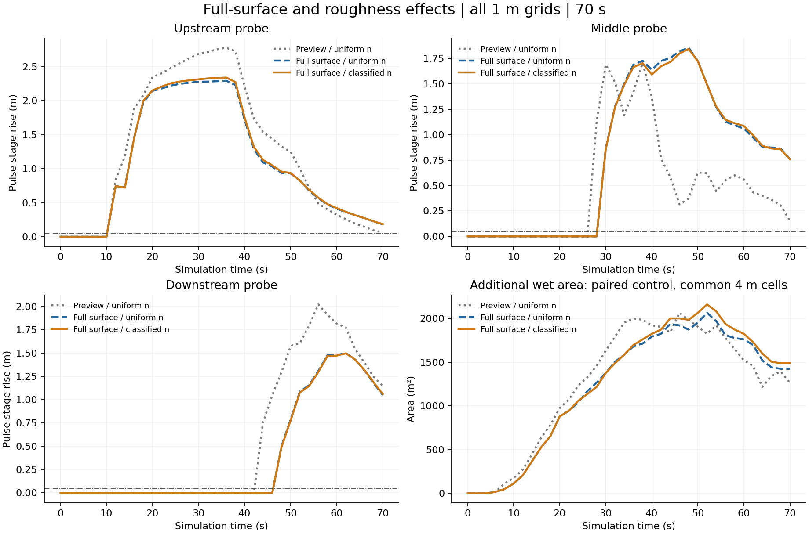
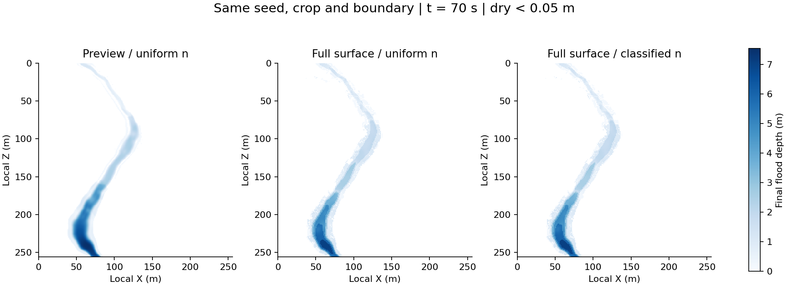
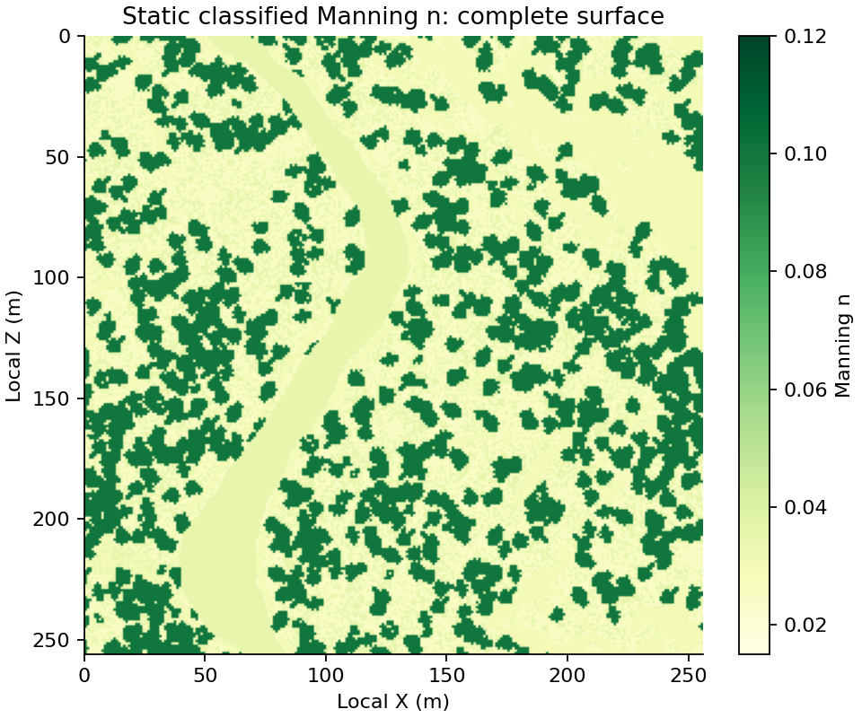
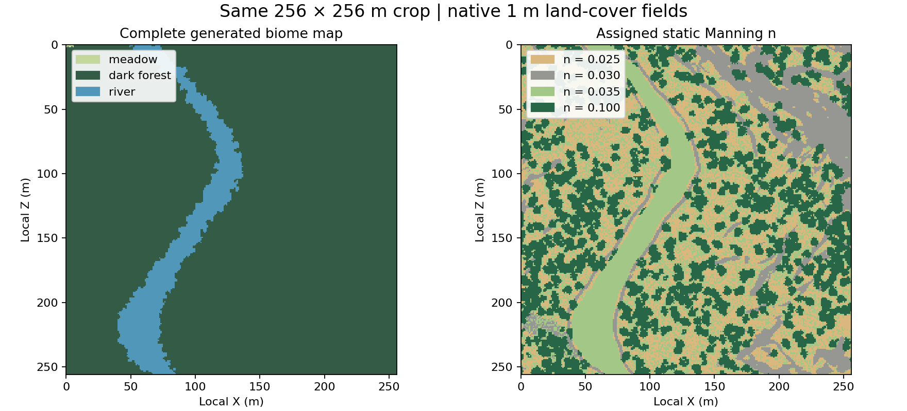

# 完整地表与静态糙率的1米洪水对照

同一原始地图：种子3346354700，起点(8512,9536)，256×256米。所有计算格宽1米，20秒预热，正式共同观察70秒，每2秒记录。

三组为上次预览地形统一n=0.035、完整地表统一n=0.035、完整地表分类n。新两组均包含10 m³/s配对对照和最高200 m³/s脉冲。固定原入口几何/方向、原探针位置、时间过程及数值方法。

| 组别 | 中游脉冲峰值(m) | 下游到达(s) | 最大新增湿区(m²) | 预热与两分支耗时(s) |
|---|---:|---:|---:|---:|
| Preview / uniform n | 1.7040 | 44.0 | 2064 | 118.69 |
| Full surface / uniform n | 1.8544 | 48.0 | 2064 | 119.22 |
| Full surface / classified n | 1.8433 | 48.0 | 2160 | 120.33 |

到达指相对本组对照水位连续两帧抬升5厘米。新增湿区统一按4米格平均水深≥5厘米、且本组对照干燥计算。

预览→完整地表同时改变河床和初始水体，不能把总差异都归因于糙率。完整地表统一→分类只改变糙率及其预热影响。20秒不保证稳态，1米并非实测真值，本结果不证明分类参数已经率定。

## 地表与核验

完整地表的群系、地面材料和植被标记均已参与分类，未知回退格数为 0。

| 地表类型 | Manning n | 格数 | 面积比例 |
|---|---:|---:|---:|
| 天然河槽 | 0.035 | 5367 | 8.19% |
| 裸土与黏土 | 0.025 | 16660 | 25.42% |
| 砂质地表 | 0.025 | 33 | 0.05% |
| 砂砾 | 0.035 | 9 | 0.01% |
| 裸岩 | 0.030 | 8643 | 13.19% |
| 草本地表 | 0.035 | 12961 | 19.78% |
| 树木覆盖 | 0.100 | 21863 | 33.36% |

四条新计算分支的最大水量残差为 4.55e-11 m³，数值补水均为零；保存的水深有限且非负，完整地表两组河床逐格相同、时间与入口累计供水一致。全部检查见 validation.json。

完整地图已写入 current.json。生成器的原始七个字段与上次一致；实际河床取完整生成后的地面顶面，不含树冠。高程平均绝对变化 0.548 米，因此不能把相对旧图的变化全部解释为糙率效应。

本次观察：分类糙率相对完整地表统一糙率，末时共同湿区水深平均绝对差为 0.88 厘米。脉冲抬水达到 5 厘米的 7044 个原生格中，1519 格的糙率不同于 0.035；本场洪水对全图高糙率区域的检验有限。新增湿区不是随糙率增大必然缩小，局部壅水与横向扩散可能增加湿区；这里只报告本图本次来水的实测计算差异。

群系、地面和覆盖数据来自原始地形生成流程；本次因 Java 21 的临时 JAR 可写检查异常，使用本机 Java 24 启动已构建的导出器，未修改地形算法，原始字段一致性已核验。

复现洪水对照：`python benchmarks/compare_surface_roughness.py --terrain-id generated/surface-df3682282712/raw --baseline .runtime/grid-observation-20261019 --output .runtime/surface-comparison-20261019 --wall-budget 360`；核验与地表图：`python benchmarks/inspect_surface_comparison.py .runtime/surface-comparison-20261019`。使用现有 .runtime/rivgraph-env 中的 Python 与加速依赖。
