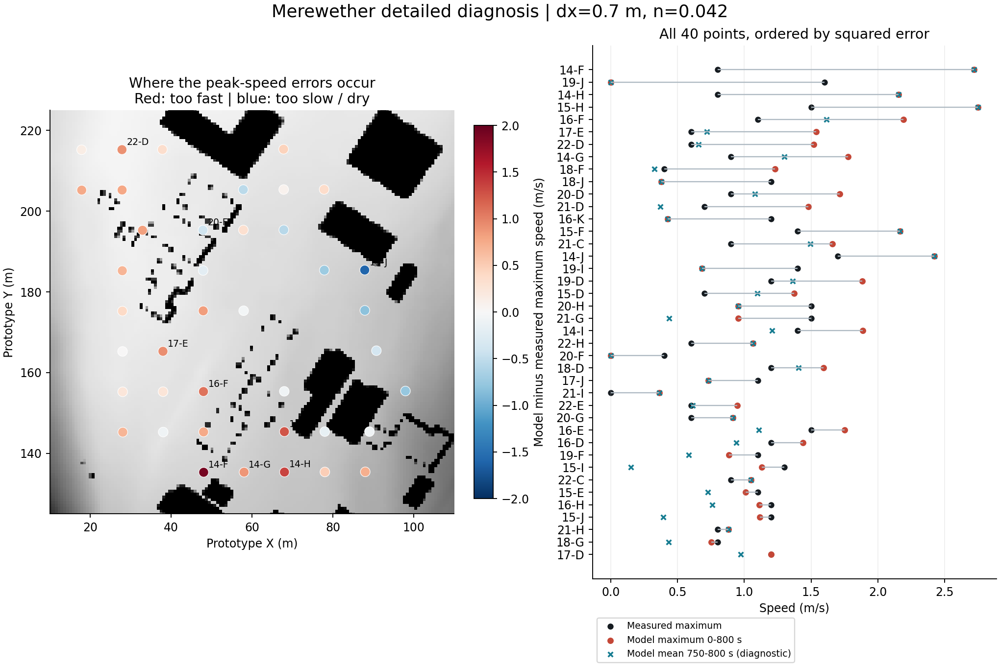
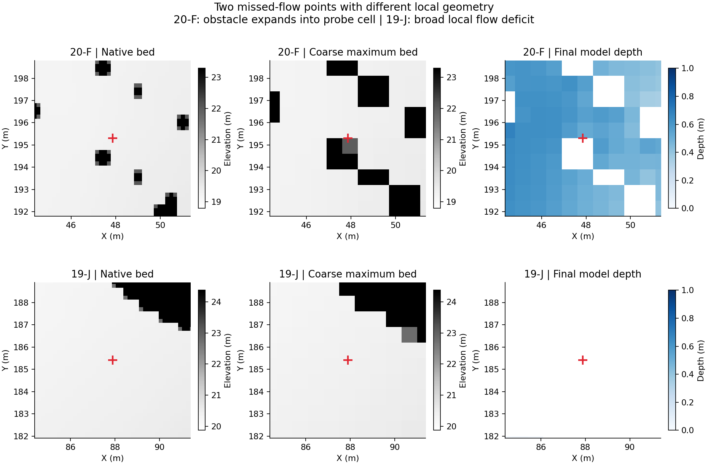
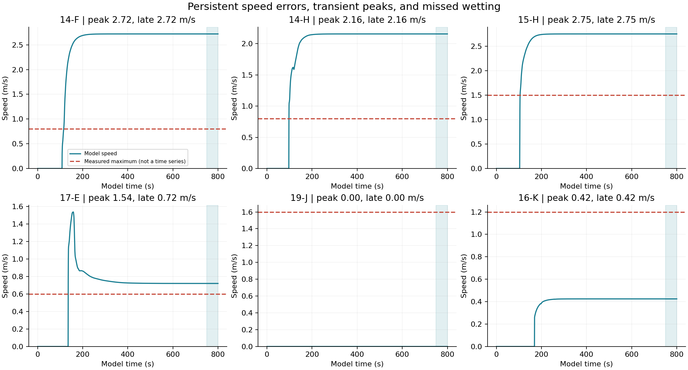
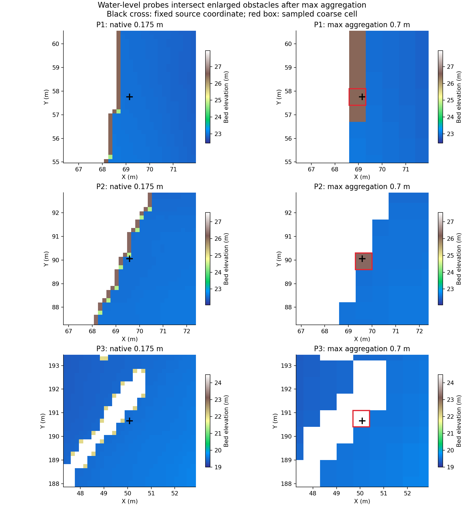
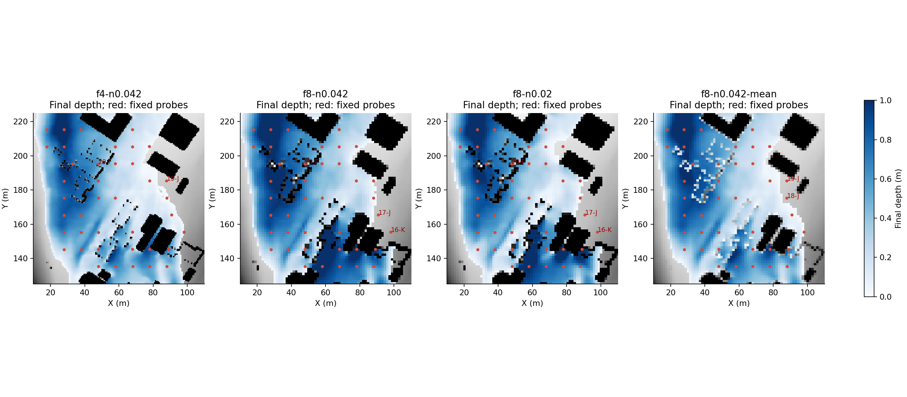

# Merewether：逐测点差距与误差来源诊断（2026-10-20）

本报告拆分已有三组800秒计算，并增加一组仅改变地形合并规则的对照。**已确认“最高高程合并”会把部分水位测点所在的低地变成建筑高程；流速还同时存在持续过快、起涨峰值过高和局部漏淹。当前不能把全部偏差归结为糙率或求解器。**

## 1. 比较口径与资料边界

40个固定位置的实验最大流速／方向来自 [Zenodo 6914888 Test 4](https://zenodo.org/records/6914888)。主评分沿用完整0–800秒最大速度矢量，与[原论文第22–23页、图12](https://eprints.whiterose.ac.uk/id/eprint/197348/1/2210.16972.pdf)的提取方法对应。最大速度发生时取同一对u/v，不拼接不同时间的分量。方向误差为模型减实测，包裹到±180°，只对双方速度≥0.05 m/s的点计算。

750–800秒模型速度平均值用于区分持续误差和起涨瞬态；实验没有逐时速度记录，不能把它替换为最大值主评分。水深、入水时间和峰值时间均是模型诊断量，**没有相应实验逐时真值，不能称为水深误差、到达时间误差**。没有使用论文其他求解器的预测值作为观测。

| 配置 | 最大速度RMSE | 最大速度MAE | 最大速度偏差 | 方向MAE(°) | 后期均速诊断RMSE | 未达1cm点数 |
|---|---:|---:|---:|---:|---:|---:|
| f4-n0.042 | 0.738 | 0.599 | +0.275 | 27.6 | 0.688 | 2 |
| f8-n0.042 | 0.764 | 0.559 | +0.222 | 30.5 | 0.778 | 3 |
| f8-n0.02 | 1.335 | 1.115 | +0.876 | 26.1 | 1.002 | 4 |
| f8-n0.042-mean | 0.734 | 0.612 | +0.276 | 28.2 | 0.682 | 2 |

速度单位均为m/s。主配置观测非零速度均值为1.046 m/s；速度矢量RMSE为0.966 m/s。单看速度大小会忽略水流走错方向的问题。所有40点仍进入主速度评分，未剔除干点或异常点。

## 2. 差距集中在哪些点

主配置误差最大的5点贡献了总平方误差的 **49.7%**，前10点贡献67.5%。绝对速度误差≤0.25 m/s的点有10个，>0.5 m/s的点有21个。因此优先检查少数局部流路比统一调整全域参数更有针对性。

| 点位 | 实测最大 | 模型最大 | 模型后期均速 | 最大速度误差 | 方向误差(°) | 最大水深(m) | 模型峰值时刻(s) | 平方误差占比 |
|---|---:|---:|---:|---:|---:|---:|---:|---:|
| 14-F | 0.80 | 2.72 | 2.72 | +1.92 | -23.7 | 0.300 | 669.5 | 16.9% |
| 19-J | 1.60 | 0.00 | 0.00 | -1.60 | — | 0.000 | 0 | 11.7% |
| 14-H | 0.80 | 2.16 | 2.16 | +1.36 | -17.7 | 0.437 | 460.5 | 8.4% |
| 15-H | 1.50 | 2.75 | 2.75 | +1.25 | -16.6 | 0.285 | 664 | 7.2% |
| 16-F | 1.10 | 2.19 | 1.61 | +1.09 | -4.6 | 0.301 | 184 | 5.5% |
| 17-E | 0.60 | 1.54 | 0.72 | +0.94 | -9.6 | 0.696 | 158 | 4.0% |
| 22-D | 0.60 | 1.52 | 0.66 | +0.92 | +6.5 | 1.047 | 207 | 3.9% |
| 14-G | 0.90 | 1.78 | 1.30 | +0.88 | +42.8 | 0.658 | 123 | 3.5% |
| 18-F | 0.40 | 1.23 | 0.33 | +0.83 | -1.8 | 0.561 | 156 | 3.2% |
| 18-J | 1.20 | 0.38 | 0.38 | -0.82 | +2.8 | 0.031 | 636 | 3.1% |
| 20-D | 0.90 | 1.71 | 1.08 | +0.81 | -16.5 | 0.809 | 184.5 | 3.0% |
| 21-D | 0.70 | 1.48 | 0.37 | +0.78 | +22.8 | 0.974 | 178.5 | 2.8% |

“—”表示方向无意义，未参与方向指标。无有效进水点的速度保持为零，不将0秒解释成实际到达或峰值时刻。完整40点见 [points-f4-n0.042.csv](points-f4-n0.042.csv)，含原始／粗格高程、速度分量、方向、模型入水时刻、最后50秒速度波动和误差贡献。其他配置也有同结构CSV，另有所有配置的逐点差值表 [paired-point-changes.csv](paired-point-changes.csv)。

按南向北的测点区域分组（地理分组固定，不按误差选区）：

| 区域 | 点数 | 最大速度RMSE | 偏差 | 平方误差占比 |
|---|---:|---:|---:|---:|
| upstream_y135_160 | 16 | 0.852 | +0.527 | 53.3% |
| middle_y160_190 | 11 | 0.747 | -0.085 | 28.1% |
| downstream_y190_216 | 13 | 0.558 | +0.269 | 18.6% |

## 3. 三类不同的流速问题

**持续过快。** 14-F实测0.8 m/s，模型最大及后期均速都约2.72 m/s；14-H、15-H也在后期保留明显高估。这些点不能用“只是在涨水时出现一次尖峰”解释。14-F的采样格高程只比原始测点高约1.3厘米，说明该处的直接高程抬升解释不了整个速度误差；上游分流、附近障碍开口、动量和数值处理仍需分离验证。

**起涨阶段的局部峰值过高。** 17-E最大约1.54 m/s、后期约0.72 m/s，实测最大0.6 m/s；22-D最大约1.52 m/s、后期约0.66 m/s，实测0.6 m/s。主配置有12点的最大速度超过后期均速0.5 m/s以上。但论文同样对全时段最大值评分，不能因后期更接近就把起涨峰值删除。

**有实验流速的位置没有形成有效水流。** 主配置漏淹非零速度点为19-J, 20-F；方向误差绝对值>45°的点为15-J, 17-J, 19-F, 20-G, 20-H, 21-H。19-J的实测为1.6 m/s，模型始终未达到1厘米水深。该点原始地面已经较高，合并只额外抬高约2厘米，所以不能仅凭干点认定是该格的最大值合并直接封住了它；也可能是邻近通道的连通与分流失真。必须检查其周围流路，而不是自动移动测点。

20-F则不同：它的原始测点地面19.291米、粗格高程21.978米，被抬高2.687米，最后干燥，但2米邻域仍有湿格。均值合并对照中该点恢复进水、最大流速约1.211 m/s，高于实测0.4 m/s。几何表示对该点有直接影响，但恢复进水后仍有速度误差。19-J在均值组仍不进水，不能用同一解释概括两者。

最后50秒有0点速度极差超过0.1 m/s，40点中最大的极差为0.000156 m/s；这些测点后期已基本稳定，持续速度误差无法解释为“还没跑到稳定”。这只核对了40个位置，不代替全域收敛。逐时图中的实测虚线只是一个最大值水平，不代表实测时间曲线。

**方向错误不能被速度大小接近掩盖。** 例如15-J的速度大小只差约0.085 m/s，最大速度矢量的方向却相差77.8°。以下角度均在原数据提供的旋转局部x/y坐标系中，以+x为0°、逆时针增加；不是地理正北方位角。无法从现有最大值记录判断方向误差是否在整个时段持续。

| 点位 | 实测速度 | 模型速度 | 实测方向(°) | 模型方向(°) | 有符号方向误差(°) |
|---|---:|---:|---:|---:|---:|
| 20-H | 1.50 | 0.95 | 172.2 | 77.6 | -94.6 |
| 19-F | 1.10 | 0.88 | 191.2 | 99.3 | -91.9 |
| 15-J | 1.20 | 1.12 | 117.2 | 39.4 | -77.8 |
| 20-G | 0.60 | 0.91 | 127.2 | 68.0 | -59.2 |
| 17-J | 1.10 | 0.73 | 77.2 | 128.1 | +50.9 |
| 21-H | 0.80 | 0.88 | 124.2 | 77.9 | -46.3 |

## 4. 已确认的地形表示问题

四个水位点的位置来自同一数据包，原始0.175米DEM的采样高度与0.7米粗格逐格对应；没有人为平移或寻找更低的邻格。结果是前三点被同一粗格内的高障碍抬高：

| 水位点 | 原始测点地面(m) | 粗格高程(m) | 抬升(m) | 800秒水深(m) |
|---|---:|---:|---:|---:|
| P1 | 22.956 | 26.487 | +3.531 | 0.000 |
| P2 | 22.546 | 26.269 | +3.723 | 0.000 |
| P3 | 19.494 | 24.739 | +5.244 | 0.000 |
| P4 | 17.839 | 17.844 | +0.005 | 0.468 |

这证明前三点的干燥首先受粗格表示破坏影响，不能将“干地的地面高程”作为水面与论文曲线直接相减。它也不证明全部坐标和原始观测已经充分核验。原包没有精确实测水位数值，本报告仍不算水位RMSE。

0.7米网格宽度是0.35米侧墩的2倍、0.52米角墩的1.35倍；1.4米则为4倍和2.69倍。相邻墩和窄缝很容易在合并后变粗或闭合。对原始125≤y≤225米的桥墩区域逐原始像素回投核算：0.7米最高值合并将 **480.0 m²（3.94%）** 的地面抬高超过0.5米。这是地形变化量，不是实验淹没面积误差，也不能当作全部新增建筑面积。

## 5. 单因素对照与可以得出的结论

原三组把网格宽度、糙率分别改变；新组保持1.4米、n=0.042、同一来水和求解器，仅由最高高程改成块内平均高程。新增算例计算预算240秒，实际时间、完整性、输入与求解器哈希在 configuration-comparison.json 中记录。均值可能降低／淹没细桥墩，**用于检验合并规则的敏感性，不作为正式修复**。完整结果汇总见上表及summary.json。

均值组完整跑完800秒，实际主计算108.6秒。与同宽最高值组相比，RMSE约降低4.0%，MAE却从0.559升到0.612 m/s；40点中16点绝对速度误差减小、24点增大或持平。14-F从3.519降到2.652 m/s，仍明显高于实测0.8；20-F从干燥变为进水，但19-J反而从0.346 m/s变为干燥。说明合并方式会改变分流和局部进水，整体指标小幅下降不代表问题已解决。P1–P3在均值组也仍干燥，均值不能恢复贴近墙边的真实地面。

同宽n从0.042降到0.02使最大速度RMSE从0.764升到1.335 m/s，说明减小阻力会加重本轮总体高估；不能据此推出所有点都该增加糙率。0.7米相对1.4米的RMSE只小降、MAE却上升，而且漏淹点身份改变，尚未达到网格收敛。

## 6. 下一步优先级与可区分的假设

1. **先解决细障碍与地面不能共用一个粗格最高值的问题。** 优先保留可通水地面，再用已有独立阻水边或子网格开口表示墙和桥墩；入口、通道有效宽度和测点落格应自动检查。不能简单改成均值来抹掉障碍。
2. **做原生0.175米与0.35米的几何体检，然后做有预算的精度对照。** 原生完整域约153万格，不能沿用当前95,700格的耗时预期。若只截取桥墩区，上游水位／动量需由独立核验的全域边界提供，不能拿现有错误边界截图作为证明。短窗口只能验证局部数值行为，不可冒称完成800秒最大速度验证。
3. **在几何明确后检查持续过快的点和方向错误。** 保持地形、n、边界不变，对照Rusanov通量与更低扩散的实现、局部重构、静水保持和窄通道测试。当前没有独立试验能定量分摊通量算法、湍流缺失、入流动量闭合的各自贡献，不直接判定需要更换算法。
4. **最后再考虑率定空间糙率。** 用一部分独立水位／流速资料率定，保留另一部分验证；本实验路基材料不应套用自然群系分类来填平所有误差。补齐原始水位数值和测量不确定性后再给通过阈值。

## 7. 证据与复现

`benchmarks/analyze_merewether.py`只读取已保存结果和原始DEM。用原始像素重建粗格并严格核对数组、从逐时记录重新提取40点最大值、检查速度口径与方向样本、核验时间窗口与水量、固定点身份与坐标；全部检查见validation.json。源文件哈希和各组场景差异见configuration-comparison.json。

输出summary.json、stage-geometry.csv、各配置逐点CSV、paired-point-changes.csv与五张图。evidence-provenance.json记录分析脚本、原始DEM、观测CSV、各组result/series/final的SHA-256；新增对照的紧凑原始结果及配置保存在control-mean/。2米邻域速度范围只作网格落点敏感性诊断，不改变主评分、不选择最接近观测的邻格。未对图12进行精确数字化，未把文献L1-norm直接与本项目速度MAE相比。
