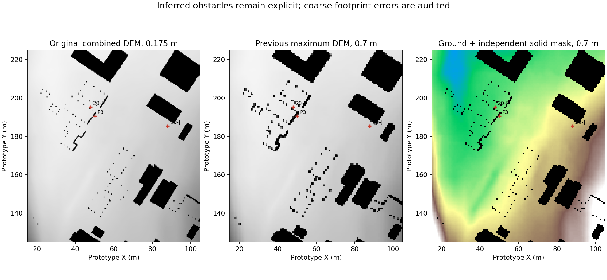
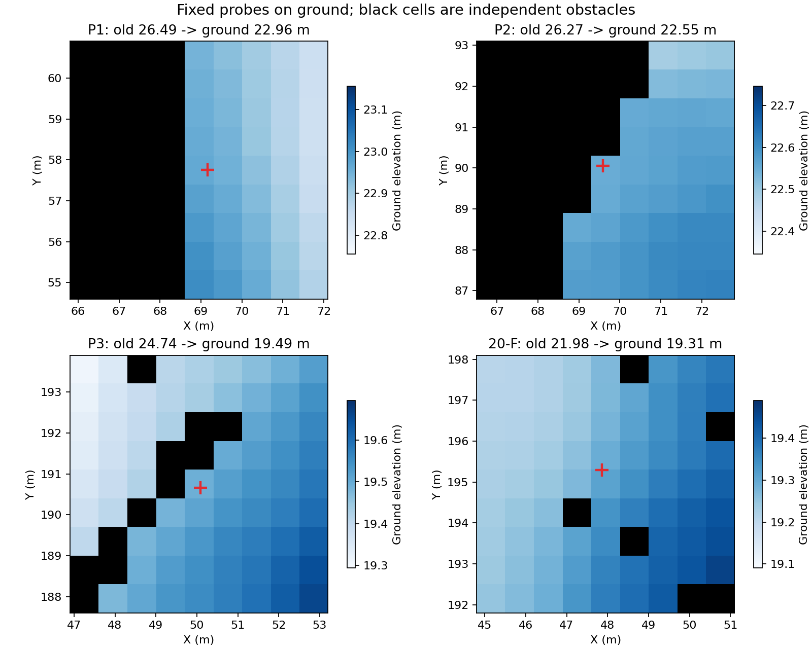
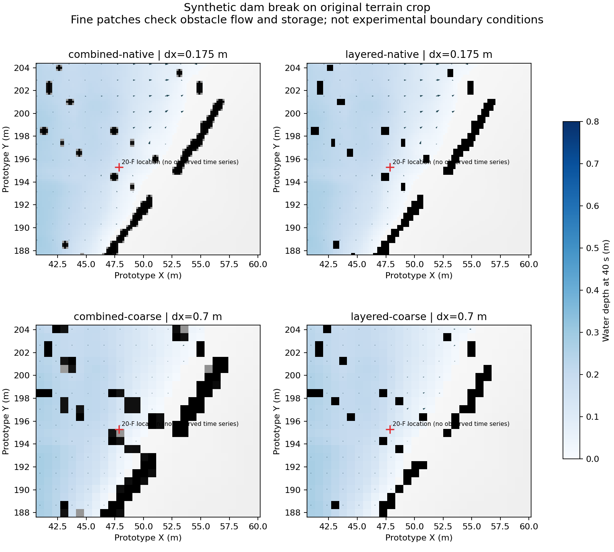
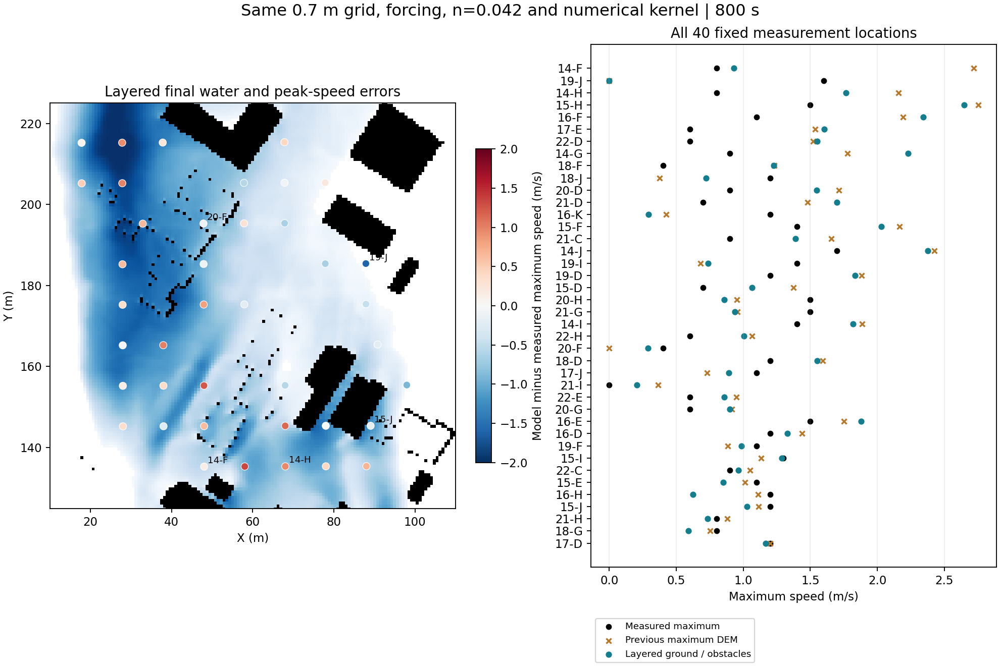
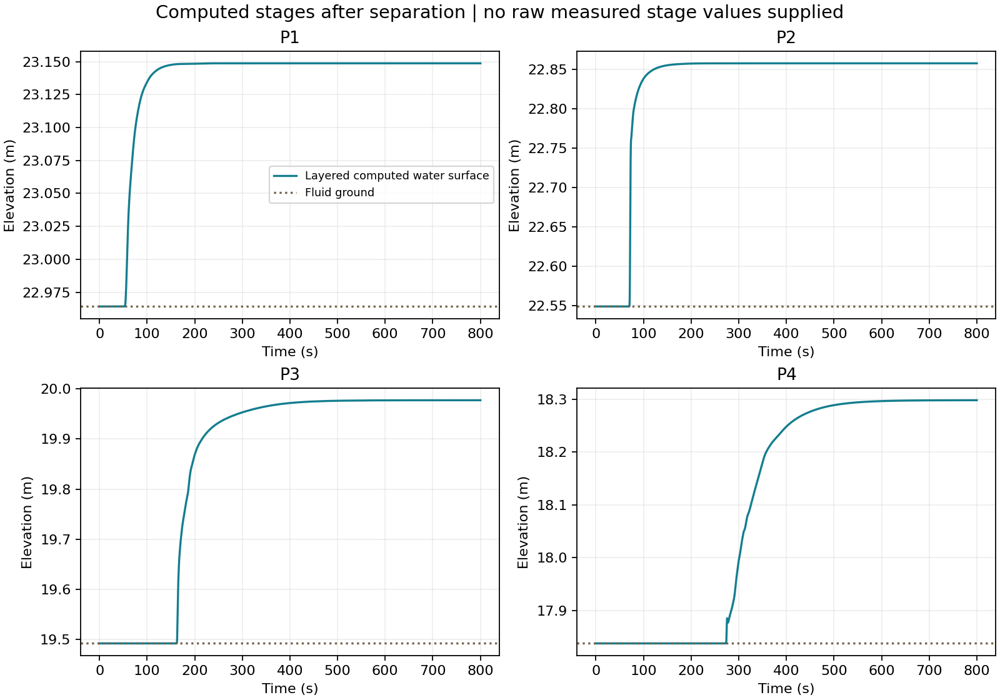

# Merewether 地面与障碍分层：第一版实现与同条件对照

完成了地面／障碍分层导入、几何检查、0.175米局部绕流检查及0.7米全域800秒对照。原始DEM、旧基线、回放和求解器方程保留。当前版本使用独立整格不透水占地，**没有实现粗格内部的部分通水、子网格阻力或全域局部加密耦合**。

## 数据表示与来源

原包只提供叠加障碍的DEM，没有独立裸地或墙／墩轮廓。另一份已下载DEM与本包逐像素一致，不能作为独立裸地。第一版按DEM中反复出现的30米人工平台及9×9像素开运算残差>0.75米提取障碍；平台边缘两像素范围作同阈值补充。阈值和规则在运行水流前固定，未使用40点速度或水位来拟合。

保留原始表面、推断障碍掩膜、地面高程、估计地面标记。障碍下面采用最近已知地面估计，**不是实测裸地**；未标为障碍的原始地面保持逐位不变。不能把此规则用于任意DEM：30米是本实验数据特征，其他地图应提供独立障碍掩膜。尚未自动区分墙、建筑和桥墩的语义。

粗格地面只平均原始非障碍地面；阻水占地单独按覆盖过半取整格，每个将消失的小障碍保留最大重叠格。这保证每个连通障碍至少有表示，但不保证原始宽度、空隙和连通性。覆盖比例单独保存供诊断，求解器不使用比例通量。

独立wall_x／wall_y接口仍可导入已知墙线，本包没有可靠墙线，所以没有从建筑边缘擅自生成新的墙。墙及占地的阻水守恒有独立测试。

## 几何检查

原始提取障碍面积5889.62 m²，共193个8邻域连通对象。0.7米整格表示额外封闭原始地面304.90 m²，遗漏原始障碍占地200.84 m²；61个细对象依靠保留一个粗格避免消失。所有对象至少有格表示，并不等于几何精确。

0.175／0.35／0.7／1.4米的面积、对象丢失／分裂、原始与粗格测点落障碍及南侧入口的4邻域几何可达性见geometry.json及geometry-probes.csv。可达性只检查障碍拓扑，不代表给定水位下能进水或具有正确过流能力。已知测点不平移、不挖槽。

在0.7米分层地图中P1、P2、P3、20-F均位于可通水格。0.35米的P2、1.4米的P2／P3仍落入整格障碍；这说明网格相位与障碍取整仍重要，不能只按格宽排序。再次合并此地图会破坏已审计的占地，因此导入流程要求按目标格宽重新生成，阻止工作台直接二次合并。

## 原始格宽局部检查

在原始坐标x=[40.6,60.2]、y=[187.6,204.4]米裁剪地形，0.175米为96×112格。使用封闭边界、左侧2.8米宽初始水面19.8米的人工溃坝，计算40秒；比较原始叠加高程与分层障碍，同时运行0.7米对照。总计算预算120秒，实际14.0秒。

四组均保持非负、有限和水量守恒，固体格储水为零。这个检查验证原始地面和桥墩占地可直接参与细格计算；**裁剪边界为人工条件，不能用这些结果给Merewether实验精度打分，也没有与全域粗格双向耦合**。没有启用复制父格高程的旧加密路径。

原始0.175米两组最终水深最大差为2.22e-16米，说明在这组未漫顶条件下，显式固体障碍能保持原高程障碍的细格水流行为。四组固定相同初始水面，粗格初始水量随地形表示变化，未人为缩放水量来拼成相同起点；实际初始体积和20-F坐标处水深都保存在patch.json。该检查不能证明其他水位下等价，尤其不覆盖漫顶。

## 全域800秒同条件对照

使用同一0.7米格宽、95,700格、n=0.042、南侧38米来水、总流量19.6992 m³/s、北侧自由出流及其余封闭边界；同一Rusanov/MUSCL/RK2/CFL0.4内核，内核哈希与基线一致。完整跑到800秒，主计算740.5秒，预算900秒。配置、实际固体占地、阻水边及运行源代码快照随本地结果保存。主比较仍使用40个固定点0–800秒最大速度，不以局部检查或后期均速替换。

| 指标 | 原最高值DEM | 分层地面／障碍 |
|---|---:|---:|
| 最大速度RMSE(m/s) | 0.738 | 0.659 |
| 最大速度MAE(m/s) | 0.599 | 0.529 |
| 最大速度偏差(m/s) | +0.275 | +0.198 |
| 方向MAE(°) | 27.6 | 24.2 |
| 有效方向点数 | 37 | 38 |
| 最大水深未达1cm点数 | 2 | 1 |

25/40点的绝对速度误差减小，其他点增大或持平。没有删掉干点和方向无定义点。方向只对实验和模型速度都≥0.05 m/s者评分，样本身份见paired-points.csv。模型后期均速取750–800秒，仅供诊断。

为避免方向有效点数改变影响解释，另对两组共同有效的37点比较：方向MAE从27.60°降至24.46°。新增有效方向点不会被当成同一固定样本的误差下降。

这组地形表示变更使速度RMSE降低约10.7%，MAE降低约11.7%。14-F从2.721降到0.930 m/s，接近实测0.8；20-F恢复有效进水，最大速度0.288 m/s、实测0.4。19-J仍未达到1厘米水深；14-H和15-H仍持续过快。14-G反而从1.776升到2.229 m/s（实测0.9），17-E的起涨峰值也略增。因此只支持部分局部流路改善，不把全域误差归因于单一问题。此对照同时改变了地面合并和障碍栅格表示，尚未单独分离两者的贡献。

| 点位 | 实测最大(m/s) | 旧最大(m/s) | 分层最大(m/s) | 分层后期均速(m/s) | 分层最大水深(m) |
|---|---:|---:|---:|---:|---:|
| 14-F | 0.80 | 2.72 | 0.93 | 0.93 | 0.284 |
| 14-H | 0.80 | 2.16 | 1.77 | 1.77 | 0.399 |
| 15-H | 1.50 | 2.75 | 2.65 | 2.65 | 0.310 |
| 17-E | 0.60 | 1.54 | 1.60 | 0.87 | 0.641 |
| 15-J | 1.20 | 1.12 | 1.03 | 0.40 | 0.620 |
| 19-J | 1.60 | 0.00 | 0.00 | 0.00 | 0.000 |
| 20-F | 0.40 | 0.00 | 0.29 | 0.17 | 0.498 |

| 水位点 | 地面高程(m) | 800秒水深(m) | 800秒计算水面(m) |
|---|---:|---:|---:|
| P1 | 22.964 | 0.185 | 23.149 |
| P2 | 22.549 | 0.309 | 22.858 |
| P3 | 19.492 | 0.485 | 19.977 |
| P4 | 17.838 | 0.461 | 18.298 |

这些水位是计算值，数据包未给出精确实测水位数值，仍不算水位RMSE。模型入水和峰值时刻也没有实验逐时真值可评分。

## 当前完成范围与后续

数据分层、独立不透水障碍接入、几何检查、原始格宽局部计算和完整粗格对照已完成。分层使地面与阻水作用能够分别检查，但推断轮廓、整格取整和遗漏开口仍限制精度。改善幅度只能支持这组配置，不能据此认定模拟器已通过真实洪水验证。

如果继续，优先取得独立墙／墩轮廓，修正几何中实际发现的封口、漏口；再在计算预算允许时做真实地形的全域细格或守恒局部加密。粗格部分通水属于储水／通量／阻力模型变更，应另做守恒、静水、窄通道与同条件实验，不把当前覆盖比例直接乘到通量上。

复现命令见上级merewether.md。validation.json检查完整窗口、固定测点、同一来水、参数、来源与内核、重新提取最大值、RMSE、水量、糙率及固体无储水。provenance.json记录源数据和输入结果哈希；full-run/归档紧凑结果与配置；原始DEM、大型场、局部原始场和回放留在本地忽略目录。

本地工作台已检查800秒回放、n=0.042、95,700格、固定格宽提示以及地形页独立“阻水占地”切换。界面截图见ui-replay.png、ui-obstacles.png。
