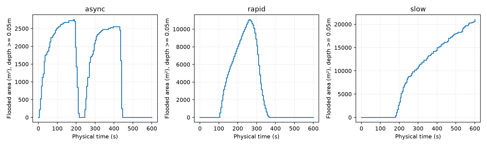
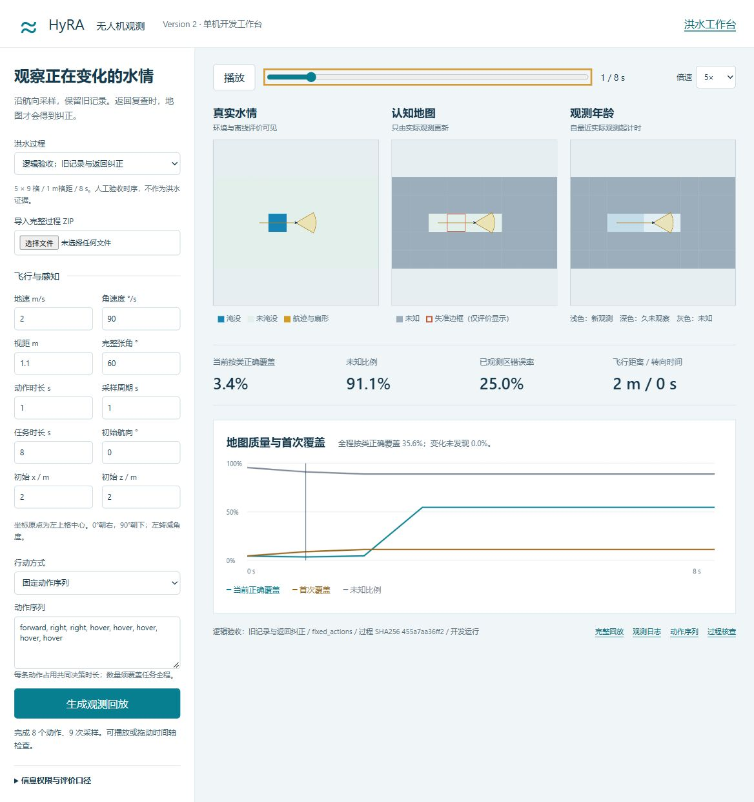
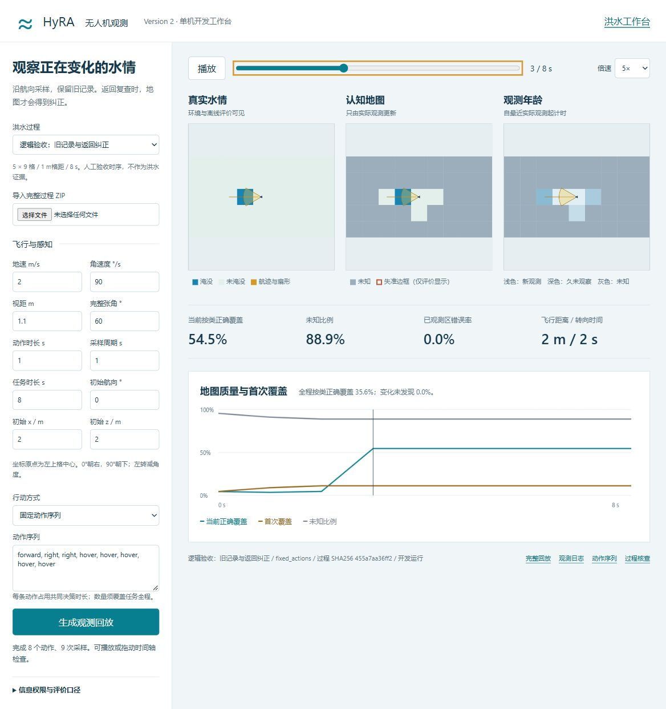
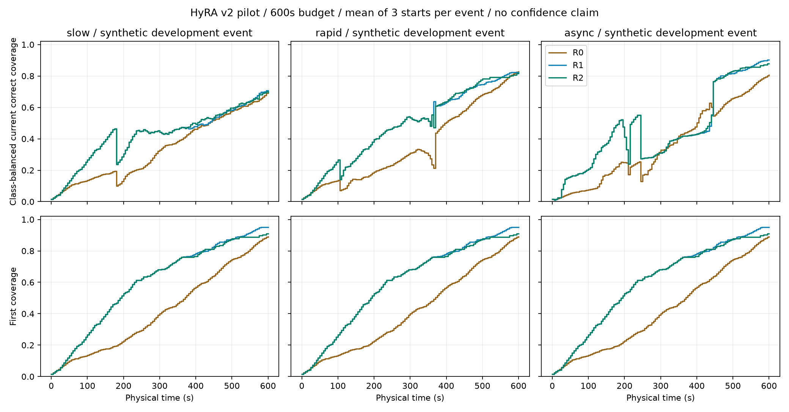
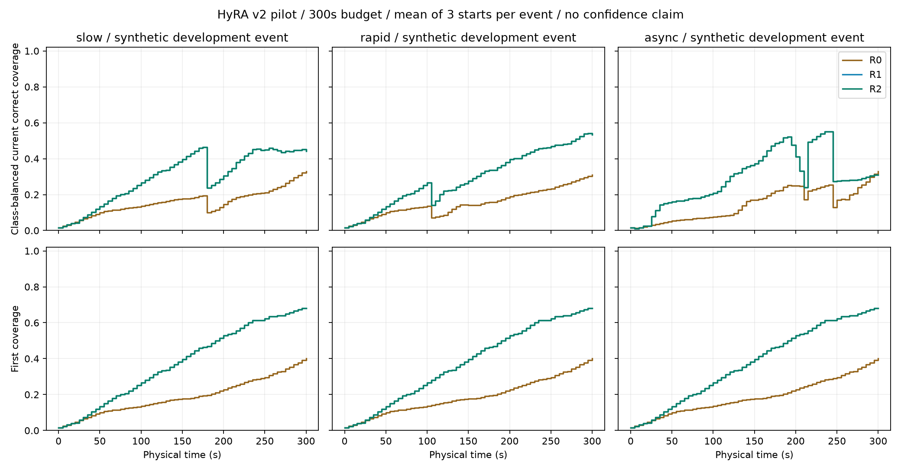

# HyRA version2：P0—P2 单机MVP开发记录

日期：2026-10-25。基线提交：`249d781543d91c0202389300777f796a95150395`。状态：P0接口核查、P1原型与P2起步试跑已完成；正式尺度与场景充分性仍需后续开发验证。P3及其后阶段未完成。

## 范围与入口

新增独立 `uav-workbench`，读取已有洪水导出格式；未修改洪水求解器、地形生成器或历史实验。保留既有地图回放体系，并在新页面同步展示真实水情、认知图、观测年龄、轨迹、扇形与质量曲线。

接口和重跑命令见[README](../README.md)。当前页面：<http://127.0.0.1:8767/>。

## P0：过程与物理边界

原方案联调候选`maps-dca2287a0ca2`：32×32、5m格距、0—600秒、5秒记录间隔、121帧，每帧16384字节。所有帧已读取，水深有限且非负；0.05m阈值下共有263格发生过二值状态变化。未启用基流预热，原因`no_active_baseflow`，不以`converged=false`单独判失败。该本地缓存不作为新克隆的必需文件。

另外用原浅水方程求解器生成三类开发过程，全部32×32、5m格距、121个实际帧。高程、来源、排水及初始条件随ZIP与配方保存。它们是合成测试条件，未率定真实洪水；“缓变/快速/异步”是配方设计意图，需要继续用响应曲线量化适用范围。

| 过程 | 设计条件 | 发生过变化的格数 | 最大绝对水量残差 m³ | 数值补水 m³ |
|---|---|---:|---:|---:|
| slow | 浅盆地、600mm/h持续降雨，作为合成积水压力条件 | 840 | 5.68e-12 | 0 |
| rapid | 坡地局部30m³/s短时来水，100—220秒 | 444 | 5.12e-12 | 0 |
| async | 隔水双区分别在0—180、240—420秒来水，均12m³/s | 214 | 9.95e-12 | 0 |

上述收支仅检查数值一致性，不能代替现实物理验证。初始均干燥，无基流、无预热；排水按格设置，受实际可用水量约束。三配方、三个起点和两套任务预算不构成54个独立洪水事件。

## P1：六项原型验收

| 验收项 | 证据 |
|---|---|
| 同动作、同状态确定性，悬停无位移 | `test_determinism_hover_and_clock` |
| 转向改变视野，机后不自动探索 | `test_turn_changes_view_without_observing_behind` |
| 飞行途中多次采样，姿态与动作内时刻明确 | `test_inflight_sampling_keeps_intermediate_pose_and_offset` |
| 仅合法可见、已到达观测更新记录 | `test_observation_footprints_and_timestamps_are_legal`及乱序/未来消息检查 |
| 视野外保留旧记录，返回才纠正 | `test_out_of_view_change_stays_old_until_revisit`与固定动作演示 |
| 可逐帧核对真值、认知图、足迹、姿态与时间 | 浏览器运行、时间轴、播放及下方截图 |

固定演示保留在[演示回放](evidence/20261025/p1-fixed-replay.json)与[动作序列](evidence/20261025/p1-actions.json)。它使用独立人工小网格，不计入洪水实验。目标格为0基索引(行2,列3)：t=1实际状态改变且机后不可见，仍记录t=0干燥；t=3原地转回后观测到淹没，发现延迟2秒。

## P2：预算与规则策略比较

初版参数：1架、地速2.5m/s、角速度9°/s、视距25m、完整张角90°、动作10秒、采样5秒、淹没阈值0.05m、短历史4条。R2年龄权重0.5。任务预算300/600秒两档；地形、水情过程和传感器设置均不缩放。

三个起点依次为局部米制`(0,0,0°)`、`(155,155,180°)`、`(0,155,270°)`。先登记运行矩阵，再运行全部组合；每档27次，共54次，无失败。300秒档用于保留资源不足边界，600秒档作为后续诊断候选；尚未将其称为正式测试尺度。

600秒下，主指标为三起点的事件内均值，单位百分比：

| 开发过程 | R0 全程正确覆盖 | R1 全程正确覆盖 | R2 全程正确覆盖 | R2−R1 百分点 |
|---|---:|---:|---:|---:|
| slow | 33.245 | 42.024 | 42.330 | +0.306 |
| rapid | 35.704 | 48.409 | 48.582 | +0.173 |
| async | 35.775 | 46.048 | 46.021 | −0.027 |

300秒下R1/R2轨迹相同，最终首次覆盖均为68.1%左右。600秒下R1最终首次覆盖95.0%，R2为91.0%，说明复查开始占用首次探索资源。R2最终已观测区错误率在三个事件均低于R1，但主指标改善很小且方向不完全一致，不支持“年龄策略稳定优越”。R0在部分起点截止前未达到90%覆盖，索引保留null，不删除这些运行。R0尚是初步航线，后续需检查航线效率及更强规则基线。

重访间隔只统计“离开视野后返回”的观测间隙；连续驻留的每5秒采样单独报告。变化发现以格点反复涨退的状态段为单位，未发现项保留，受限延迟计至下一变化或任务截止。主指标按实际帧采样时间做左矩形积分；末端状态不增加虚假时长。

## 证据与复核

- [预登记参数、方法、起点及家族](evidence/20261025/plan.json)
- [54次最终运行索引](evidence/20261025/index.json)
- [逐运行指标、事件内汇总与版本](evidence/20261025/pilot-summary.json)
- [slow核查](evidence/20261025/slow-audit.json)、[rapid核查](evidence/20261025/rapid-audit.json)、[async核查](evidence/20261025/async-audit.json)
- 完整轨迹与固定观测回放在本地`generated/p2-pilot-20261025-final/<run_id>/`，由README命令重建。轻量索引保留，完整批量日志不入库。
- 早期`generated/p2-pilot-20261025`与`-v2`目录仅保留为修正前记录。最终版修正重访统计的连续驻留混入问题，并使P0核查明确区分结构正确与物理验证。不得将三批重复运行叠加计算样本量。

代码逐文件摘要保存于运行manifest。Git HEAD是未改动前的仓库基线，不冒充本次新代码已提交。基础16项测试通过；JavaScript语法检查通过；浏览器已核查生成回放、时间轴、播放、逻辑演示及390px窄屏，无横向溢出。

## 当前结论与下一阶段

单机观测闭环可用，开发场景能够表现未知区域、失准旧记录和行动成本之间的取舍。现有结果未检验洪涝联系B3，更不能支持人员搜寻或真实洪水效果结论。

下一阶段需要另准备六个过程，三机制各有拟合与开发留出过程，使用不同母地形并成组划分；固定R0/R1/R2观测记录后，再比较强历史、距离联系、洪涝联系及消融。当前三个过程不能通过切时间窗充当新的留出事件。P3门槛未满足，尚不接入正式多机训练。
