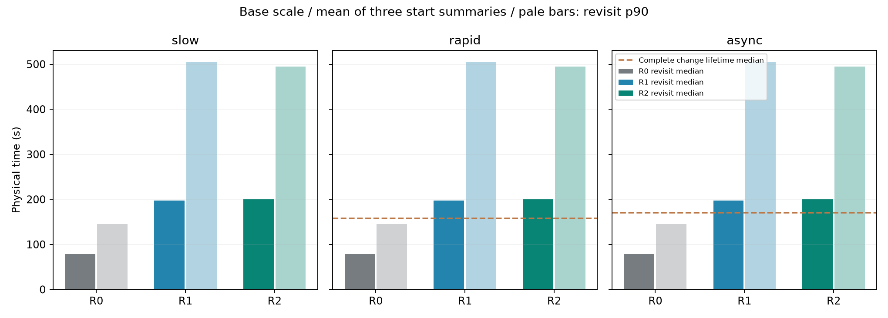
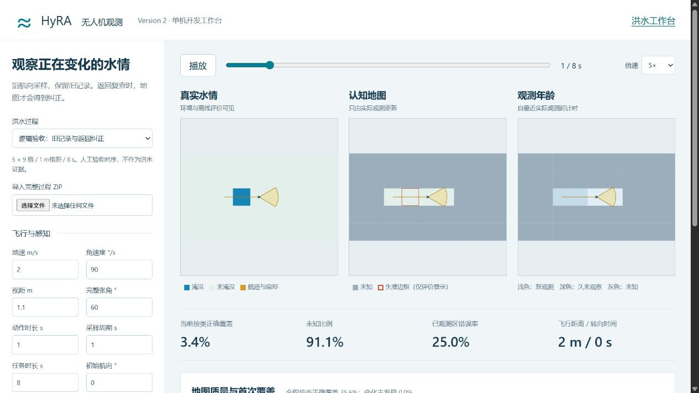
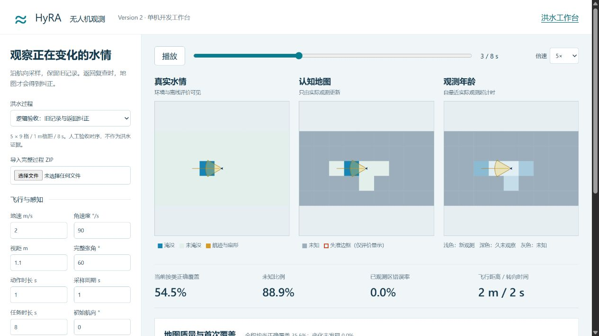
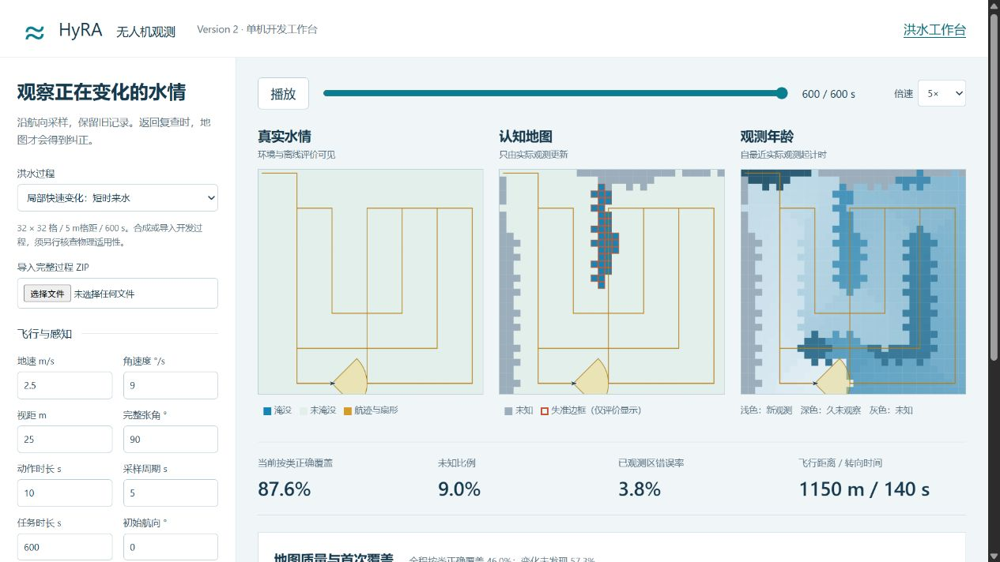

# P1/P2交付前工程复核

当前目录结构保持不变，洪水与无人机仍为并列工作台。此复核不增加研究事件，也不替代P3表征比较。

## 逐帧核查

对正式尺度实验的全部81条回放重新读取对应原始ZIP，核对实际帧时刻、真值、观测格与标签、方向扇形、认知标签与观测时间、每个沿途姿态，以及实际飞行距离和付费转向。全部通过。每条运行均有60个决策动作；采样次数随5秒/2.5秒设置为121/241。

可复现入口：`python tools/engineering_audit.py`。[逐运行结果](evidence/20261025-final-engineering/replay-audit.json)保留所有起点及未达到90%覆盖的运行。

| 方法 | 核查运行数 | 平均飞行距离m | 平均转向s | 达90%首次覆盖的运行 |
|---|---:|---:|---:|---:|
| R0 | 27 | 1183.33 | 126.67 | 15 |
| R1 | 27 | 1200.00 | 120.00 | 27 |
| R2 | 27 | 1150.00 | 140.00 | 18 |

所有方法的边界截断空耗均仅为浮点误差量级。R0约21%的预算用于转向，覆盖不足不能归因于边界卡死；其固定扫描航线依然比几何前瞻探索慢，细格离散也会改变航点跟踪。没有把R0称为最优扫描器，也没有删除不利起点。冻结尺度中的R0覆盖要求只针对5米/5秒基准设置，81次合并表包含敏感性设置，不能混淆两者。

## 水情变化与重访预算

另从冻结基准设置的27条运行提取变化段与真实返回间隔，见[完整比较](evidence/20261025-final-engineering/dynamic-tradeoff.json)，复现命令`python tools/dynamic_tradeoff.py`。

快速过程有444个两次真实状态改变之间的完整段，中位寿命157.5秒；异步过程214个，中位寿命170秒。慢变过程只有一次涨水，840个末段全部在截止处截断，不能用其302.5秒受限窗口中位数冒充完整状态寿命。快速及异步的末段也单列，没有删除。

R1/R2在优先探索后，条件返回间隔中位数约200秒，长尾接近500秒；动态状态的部分完整寿命更短，存在实际错过变化的机会。R0局部返回较频繁，但首次覆盖较慢。返回间隔只描述已经离开并实际返回的格点，不包含从未返回的记录；机器可读表同时报告known_never_returned_cells、首次覆盖及变化未发现率，不能把短返回间隔单独解释为全域地图质量更好。三机制各只有一个物理过程，27条路线不能充当27个独立水情事件。

## 确定性与网页复核

截至本次收尾复核，33项测试通过，包含六项P1行为、未知/错误/单类评价、物理时间积分、重复变化和未发现项、满覆盖后飞离失准再返回纠正、同刻共享去重、隐藏真值隔离，以及非线性实验的家族隔离和部分评分保护。

浏览器重新启动工作台并生成两条完整回放：

- 人工逻辑验收：8动作、9采样，运行`e68b72f4c938`。t=1已观测区错误率25%；t=3返回后降至0%，期间没有隐藏刷新。
- 实际浅水方程快速过程R2：60动作、121采样，运行`efa0a12bc19b`，截止600秒，飞行1150米、转向140秒。网页时间轴、播放、观测/动作/完整回放下载链接均可用，浏览器警告与错误日志为空。

上述水动力过程属于合成开发资料；工程核验通过不等于真实洪水率定通过，不构成B3有效或人员搜寻收益证据。

另已完成两工作台同时运行、恢复历史过程、浏览器下载完整ZIP、无人机端重新导入及600秒R2任务的端到端联调；三份ZIP字节哈希完全相同。操作与截图见[启动和复现](REPRODUCE.md)。

两个原本机服务退出后已恢复，并重新取得HTTP 200及既有导入回放600秒完整性记录，见[服务健康检查](evidence/20261025-final-engineering/service-health.json)。此项只证明可访问性，浏览器交互证据仍以上述实际截图与日志为准。
