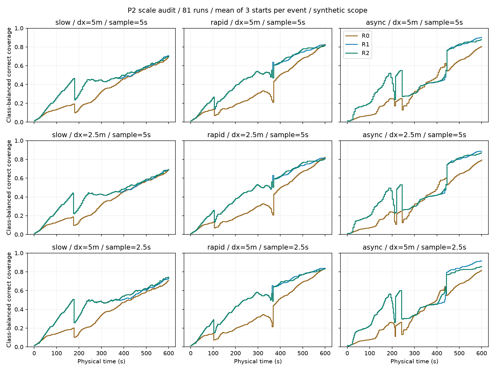
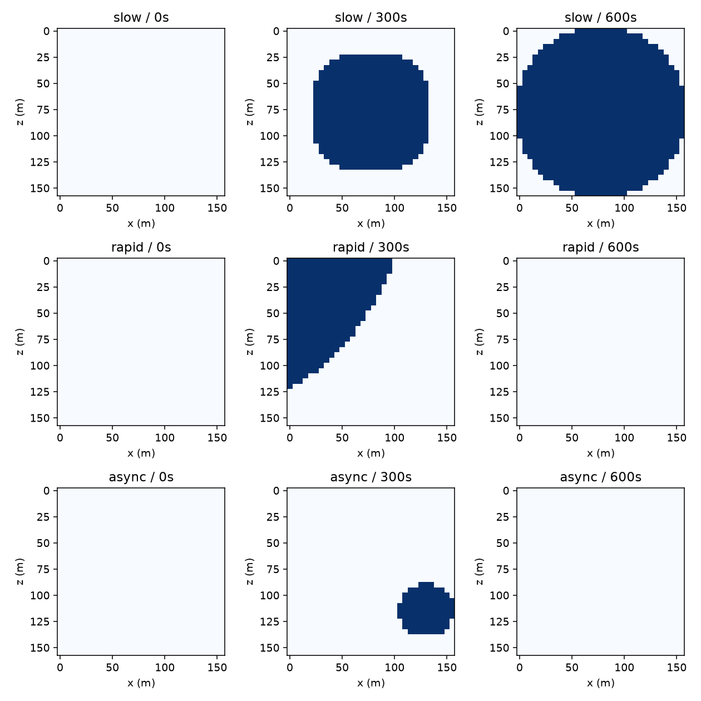

# P1/P2补充验收与开发尺度冻结

日期：2026-10-25。适用范围：本仓库合成水动力与单机观测开发，不代表真实洪水率定、全域分辨率充分性或P3机制成立。

## 预登记、输入和完整运行

先保存[选型计划](evidence/20261025-p2-formal/plan.json)，再运行三类过程×三个策略×三个起点×三种网格/采样设置，共81次。不同格距重新计算浅水方程，不缩放水情图像；细格下相同水源总流量按原格覆盖的四个细格分配，每格排水容量除以4，阻水边位置和160米物理域不变。绝对起点保持一致，细格局部坐标作1.25米补偿。

三种设置为5米/5秒、2.5米/5秒、5米/2.5秒。300/600秒任务预算的既有54次试跑仍单独保存，不重复计数为新事件。全部81次均完成，失败运行零项。[完整索引](evidence/20261025-p2-formal/index.json)。

## 空间与时间敏感性

共同格比较将2×2细格的实际水深面积平均后，以同一0.05米阈值生成标签；这检查共同尺度水情，不保证细格中每个子格都与粗格标签相同。密帧比较只使用共同实际时刻，没有插值。

| 过程 | 2.5米重算的最大共同格标签差异 | 最大淹没面积比例差 | 2.5秒重算的最大共同时刻标签差异 |
|---|---:|---:|---:|
| slow | 1.563% | 1.563% | 0.781% |
| rapid | 2.246% | 2.246% | 0.098% |
| async | 2.930% | 1.758% | 0.098% |

预登记工程容差：共同格标签及面积差不超过5%，共同实际时刻标签差不超过2%。本轮全部满足。所有新过程最大绝对水量残差不超过1.19e-11m³。[逐过程差异](evidence/20261025-p2-formal/comparison.json)、[全帧与物理字段核查](evidence/20261025-p2-formal/audits.json)。容差是本次合成开发的工程取舍，不是通用水动力精度标准。





同时归档[策略质量及首次覆盖敏感性](evidence/20261025-p2-formal/policy-sensitivity.json)。网格细化改变观测格中心与航点离散，策略差异不全部归因于水动力误差。

## 冻结决定

300秒预算下仍有大面积未知；600秒下R1的全部三个起点可达90%首次覆盖，R0每个过程至少两个起点可达90%，未达到者保留null。此选择只看覆盖、重访、水情变化和资源，不涉及B3是否获胜。

冻结的后续开发参数：物理域[-2.5,157.5]米×[-2.5,157.5]米；32×32、5米格距、5秒实际帧及采样；1架无人机、2.5m/s、9°/s、25米视距、90°完整张角；10秒动作、600秒任务；阈值0.05米、短历史4条、R2年龄权重0.5。[机器可读冻结决定](evidence/20261025-p2-formal/decision.json)。

R0未强制达到100%，未删除不达标起点。开发场景保留未知区、会失准的旧记录及有代价的复查，满足开展P3排序研究的任务取舍条件。其保证限于这组三类合成过程；新地形仍需按相同规则检查。

## P1/P2工程补充

- 核心六项P1测试沿用，新增固定传感设置下“初始100%覆盖→飞离后旧记录失准→返回后纠正”的测试，覆盖率达满后评价器仍继续工作。
- `merge_arrived`对同刻多机记录按代理编号确定性处理，旧记录不能覆盖新记录；这是共享接口工程准备，不代表已完成P4多机策略。
- `TaskEnv.reset/step`返回合法观测与明确终止/截断字段；奖励默认值仅用于接口检查，正式P4奖励仍需在其开发阶段登记。
- `run_episode`在运行异常/中断时归档最后有效回放、动作、轨迹、观测、原因与时刻；取消测试确认未将中断写成完成。
- 25项测试通过。原网页及轨迹回放视觉证据仍保留，最终目标交付前需再次核验服务与页面。

## 复现

```sh
cd uav-workbench
python -m unittest discover -s tests -v
python -c "from hyra_uav.scales import formal_scales; formal_scales('generated/my-formal-scale')"
python -m pip install -r report-requirements.txt
python tools/scales_report.py generated/my-formal-scale generated/my-scale-report
```

原始新计算过程和81条回放在本地`generated/p2-formal-20261025/`。新运行必须采用新输出目录，不覆盖旧试跑。当前已具备P1/P2核心工程与合成开发尺度证据，P3强非线性与有效消融仍在推进。
