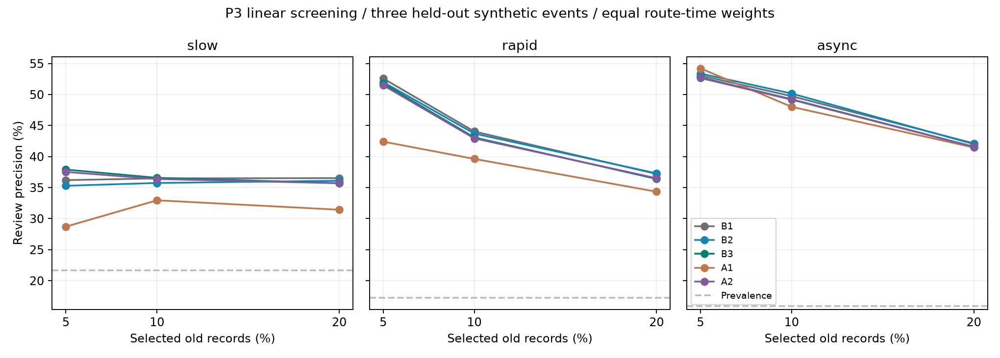

# HyRA version2：P3固定回放首轮线性筛查

日期：2026-10-25。结论：**本轮没有证明洪涝候选联系超越历史、年龄和距离基线，P3不通过升级门槛，不开展完整P4训练。** 已完成的是数据准备、固定回放和小预算线性筛查；强非线性基线验证与有效的错误联系消融尚未完成，不能将本轮称为完整P3机制确认。

## 问题与预登记

同样存在旧记录的格点，静态地形/阻隔组织的实际变化证据，能否改善旧标签失准的复查排序？完整问题仍需在同年龄段、同原始证据下评价。

在生成过程、收集轨迹和拟合模型之前写入[计划](evidence/20261025-p3/plan.json)。冻结配置为600秒任务、10秒决策、5秒采样、地速2.5m/s、角速度9°/s、视距25m、90°张角、4条短历史；其余运动与观测语义沿用P0—P2。没有依据留出结果调参。

## 六个新母地形与18条回放

本轮不复用P2的三个过程，不通过切分时间窗造留出事件。三个拟合母地形和三个开发留出母地形采用不同构造，所有过程由既有浅水方程求解器计算，均为32×32、5米格距、0—600秒、121个实际帧。

| 机制 | 拟合母地形 | 开发留出母地形 |
|---|---|---|
| 缓变积水 | wave-basin：波状盆地 | terraced-basin：台阶盆地 |
| 局部快速变化 | inclined-channel：起伏坡地 | saddle-valley：鞍形地形 |
| 分区异步涨退 | curved-valley：曲线谷地 | cross-ridge：横向脊地 |

六个高程数组摘要不同，家族ID不跨集合；这些仍是少量人为设计的合成配方，并非六个真实洪水独立样本。来水、降雨和排水为开发假设，未做实测率定。静态地形算法与水动力内核均未改动。

各过程固定R0/R1/R2各一条轨迹，均从(0,0,0°)出发，共18条。所有观测与回放先保存并计算SHA256，再统一生成特征和标签；报告前重新核验18个文件摘要全部一致。对应[输入核查](evidence/20261025-p3/input-audits.json)、[划分与回放索引](evidence/20261025-p3/replay-index.json)、[冻结记录](evidence/20261025-p3/freeze.json)。

## 样本、权限与候选联系

只在10、20、…、590秒的决策时刻采样；600秒端点不增加时间权重。在处理当时已到达观测后，候选集合为“已有记录且该时刻未直接刷新”的格子。未知格不当作失准记录。格点标签为旧记录与当时真值是否不同，真值仅用于拟合标签和评分。

特征由合法到达记录重建：短历史标签/掩码/年龄、最后标签、质量，以及同一位置两次实际观测的变化符号、变化观测距今时间和两观测间隔。不会用真实变化时刻代替实际观测变化时刻。候选格共用几何最近的16个证据源，原始证据与静态先验在B1/B2/B3/A2之间相同。

候选洪涝联系为静态四邻域地形路径代价，单边成本为 `dx × (1 + |高程差|/0.05m)`，实体墙与建筑切断联系，路径成本上限50米；从共同16源池中选取可达且成本最低的至多8源。构图只读取静态高程、墙和建筑，不使用任何开发留出水情。该规则是待检验的工程启发式，尚不是经验证的洪水因果联系。

## 五组同预算筛查

| 组 | 表征差异 |
|---|---|
| B1 | 目标及全部共同源的原始短历史与静态信息，加均匀聚合 |
| B2 | 相同原始信息，加按普通距离衰减聚合 |
| B3 | 相同原始信息，加静态候选洪涝联系聚合 |
| A1 | B3删除原始短历史标签与显式变化通道，保留最近标签/年龄/质量 |
| A2 | B3的聚合图换为匹配度数和距离环的错误联系 |

五组各自拟合标准化岭回归，统一正则系数10、392维输入、393个名义可学习参数，标准化仅在拟合集拟合。每个拟合时刻共同均匀抽取至多64个候选，五组用完全相同的33,114个样本，其中6,023个失准正例；没有按标签挑选样本，也未调参。输出只称未校准风险分数，不能解释成概率。

B1能访问同一批邻区原始历史，避免仅用自身年龄充当弱对照；但它仍是轻量线性模型，不能代表完整强非线性历史模型。A1同时删去了旧历史标签，信息与有效自由度均减少，故其差异不能单独隔离“变化通道”的作用；这也是筛查阶段的限制。名义参数维数相等不等于有效模型容量完全相同。

## 开发留出结果

每时刻先按固定规则排序，选取比例向上取整，并列时按格点编号升序；事件内先时间平均，再对三条轨迹等权平均。无正例的召回为不适用并登记计数；候选为空的指标同样保留不适用，原始明细不删除。留出评估使用全部候选，不沿用拟合抽样。

主指标为前10%候选中的复查精确率，单位百分比：

| 开发留出事件 | B1历史/年龄 | B2距离 | B3候选洪涝联系 | A1删变化历史 | A2错误联系 | B3−B1 百分点 | B3−B2 百分点 |
|---|---:|---:|---:|---:|---:|---:|---:|
| 缓变 | 36.490 | 35.755 | 36.580 | 32.959 | 36.386 | +0.089 | +0.825 |
| 快速 | 44.053 | 43.718 | 43.090 | 39.632 | 42.939 | −0.962 | −0.628 |
| 异步 | 49.740 | 50.168 | 49.247 | 48.028 | 49.177 | −0.493 | −0.921 |



前10%召回率、正例率、前5%和20%结果见[逐事件结果](evidence/20261025-p3/summary.json)；按0—60、60—180、180秒以上记录年龄分层的精确率与空候选计数见[年龄分层](evidence/20261025-p3/age-bands.json)。五组拟合维数、样本与耗时见[训练记录](evidence/20261025-p3/fit-summary.json)。

没有把轨迹、格点、窗口和随机种子当作额外独立事件，没有对三个留出事件提供夸大的显著性或泛化置信区间。

## 错误联系消融的不足

A2使用有向双边交换，保留节点入度、出度及每个目标的距离环分布，并限制所有边留在共同证据池中。图核验全部满足这些匹配条件，但约束过强：留出三图只完成13、16、6次成功交换，邻接槽位差异仅约0.317%、0.391%、0.146%。因此A2几乎保留原结构，**不能将B3略胜A2作为联系机制有效的证据**。[构图审计](evidence/20261025-p3/graph-audit.json)。

本轮发现此问题后没有针对已评分的留出事件改图并重报“独立确认”；保留本轮原结果。下一轮需先在拟合集检查错误图实际扰动强度，明确需要放宽的匹配约束并预登记，再使用新的开发留出过程。

## 结论与停止条件

本轮B3在两个动态留出事件同时落后于B1、B2，故未达到进入完整P4方法开发的依据。B3优于A1仅提示历史/变化信息可能有用，不能证明候选联系超越普通记忆与距离；A2扰动不足，机制归因也不充分。

保留单机基础系统，下一轮优先检查静态联系是否表达了积水连通与变化传播、扩大共同原始证据池及提高错误联系扰动的可行性，同时补充同信息的非线性历史基线。先在拟合集做这些工程检查，再另留新事件；不在这三份已评分事件上继续挑参数维持正结果。当前既不能判定洪涝联系普遍无效，也不能声称已经改善地图或人员搜寻收益。

## 重跑与文件位置

```sh
cd uav-workbench
python -m unittest discover -s tests -v
python run.py p3 --output generated/my-p3
python -m pip install -r report-requirements.txt
python tools/p3_report.py generated/my-p3 generated/my-p3-report
```

输出目录必须为新目录。完整六个过程、18条固定回放、五组模型与逐时刻评分保留于本地`generated/p3-20261025/`；本报告只归档轻量索引、摘要及图表。训练与评估代码SHA256在plan/freeze中一致；测试初次发现的错误图测试用例不可交换问题已修正为可交换的环形图，随后22项测试全部通过。未改动生产构图规则来迎合该测试或留出结果。
