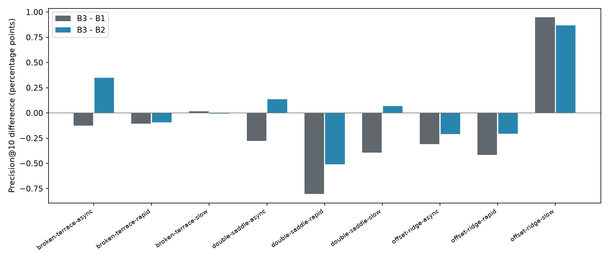
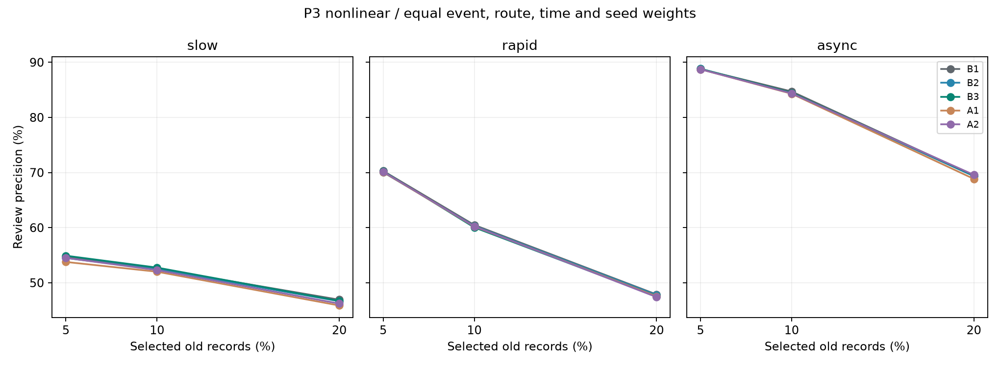

# P3非线性第一轮结果（2026-10-25）

完整评分完成，预登记升级门槛未通过。B3的事件等权Precision@10%为65.755%，B1为65.919%，B2为65.711%；相对B1为−0.163个百分点，相对B2为+0.044个百分点。只有1/9个事件同时正向，快速变化机制相对两基线均为负，当前不进入P4。

该结果支持“本轮候选静态联系尚未显示超越强历史和距离的稳定增量”，不证明所有洪涝联系都无用。九个事件分属三个新母地形家族，同家族的三机制相关；路线、时刻、训练种子均不增加独立事件数。来水仍沿用三类合成模板，没有跨实测事件或新来水时程的推广结论。

## 逐事件主结果

单位：Precision为百分数，差异为百分点。各时刻先评分，再在路线、种子和事件内等权汇总。

| 新留出事件 | B1 | B2 | B3 | B3−B1 | B3−B2 |
|---|---:|---:|---:|---:|---:|
| broken-terrace-async | 85.344 | 84.871 | 85.218 | -0.126 | +0.347 |
| broken-terrace-rapid | 58.758 | 58.742 | 58.650 | -0.108 | -0.092 |
| broken-terrace-slow | 49.923 | 49.946 | 49.940 | +0.017 | -0.006 |
| double-saddle-async | 86.594 | 86.180 | 86.316 | -0.278 | +0.136 |
| double-saddle-rapid | 63.249 | 62.955 | 62.444 | -0.805 | -0.511 |
| double-saddle-slow | 49.018 | 48.555 | 48.623 | -0.395 | +0.068 |
| offset-ridge-async | 82.189 | 82.089 | 81.879 | -0.310 | -0.209 |
| offset-ridge-rapid | 59.440 | 59.229 | 59.023 | -0.416 | -0.206 |
| offset-ridge-slow | 58.753 | 58.835 | 59.703 | +0.950 | +0.868 |

## 机制与消融

| 机制 | B3−B1百分点 | B3−B2百分点 |
|---|---:|---:|
| slow | +0.191 | +0.310 |
| rapid | -0.443 | -0.270 |
| async | -0.238 | +0.091 |

A2在9/9个留出事件均达到有效扰动要求：算子总变差约0.119—0.183，改变正权重约77.0%—78.7%；支持、未加权度数和按距离分层的向外权重质量完全一致。向内权重差异L1约7.53%—9.26%，已经单独披露。B3相对A2仅+0.126个百分点，低于登记的+0.5个百分点；不能用它替代相对强基线的检验。

B3相对第一轮A1为+0.256个百分点，但该A1只删除显式传播变化，原始历史仍可重建变化，属于有限的表征消融。最终验收仍需[严格A1](P3_STRICT_ABLATION_REVIEW.md)，不得将这一项写成完全去除变化证据已经通过。

## 信息、预算及完整性

五组分别拟合，相同1448维输入目标、共同33588个拟合样本和6058个失准正例；B1能访问目标及64邻区原始短历史、掩码、质量和相同静态先验。每组两个候选、64棵选型树，选择后按三个种子分别拟合128棵树，所有组均选择叶节点最少样本5。共10次选型与15个最终模型，没有在新留出上重新选模。树容量为节点/阈值/叶存储值，不冒充相同数量的神经网络独立可训练参数。

| 组 | 每模型平均树节点 | 最终三种子拟合秒 | 选型秒 |
|---|---:|---:|---:|
| B1 | 333785 | 367.1 | 125.4 |
| B2 | 330625 | 357.4 | 126.8 |
| B3 | 329552 | 334.1 | 119.3 |
| A1 | 325859 | 332.4 | 116.1 |
| A2 | 328742 | 337.0 | 112.7 |

全部54条固定回放已对原始水动力ZIP重新逐帧核查；18个母地形数组互异，拟合/选型/留出家族互斥。模型及输入冻结后才生成新留出水情。评分286740行，与预期完全相同；540项事件/比例/年龄组汇总均保留，空候选及无正例NA数量也在机器可读表中。完整数据与模型位于本地generated/p3-nonlinear-round1，轻量证据与冻结源码在下列索引。

- [全部事件、年龄分层、NA和门槛](evidence/20261025-p3-nonlinear-round1/summary.json)
- [事件指标CSV](evidence/20261025-p3-nonlinear-round1/event-metrics.csv)
- [家族级差异](evidence/20261025-p3-nonlinear-round1/family-differences.json)
- [训练种子描述性波动](evidence/20261025-p3-nonlinear-round1/seed-event-metrics.json)
- [实际容量和耗时](evidence/20261025-p3-nonlinear-round1/capacity-budget.json)
- [数据划分和54条运行索引](evidence/20261025-p3-nonlinear-round1/index.json)
- [原始帧全量核查](evidence/20261025-p3-nonlinear-round1/input-audit-final/replay-audit.json)
- [冻结源码与环境](evidence/20261025-p3-nonlinear-round1/runtime-provenance.json)
- [预登记与方法边界](P3_NONLINEAR_PROTOCOL_20261025.md)
- [启动与复现命令](REPRODUCE.md)

## 下一轮范围

使用剩余第二轮额度补齐严格“只保留最新观测”的A1，并在新的拟合、选型、留出母地形上重复同一B3候选；不依据第一轮留出调整构图尺度、聚合、树预算或选择门槛。完整历史B1/B2/B3/A2的信息保持一致，A1的信息减少属于明示消融。第二轮结束后按既定停止规则交付支持、负向或不确定结论，不增加第三轮。
