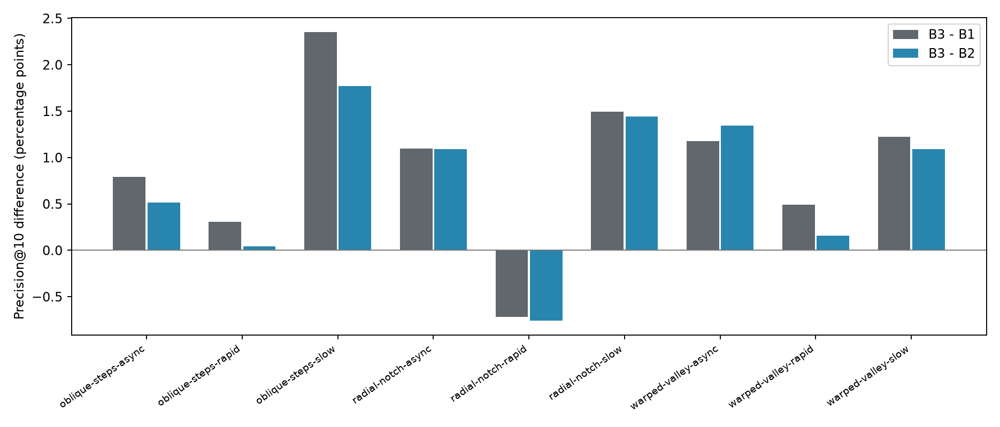
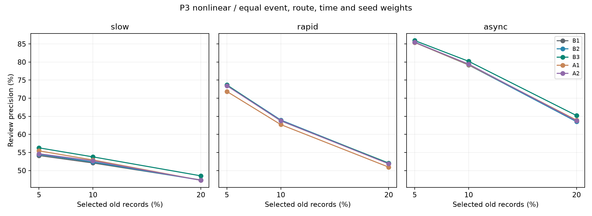

# P3 非线性第2轮结果（2026-10-25）

完整训练和留出评分已完成；预登记升级门槛未通过。B3 相对 B1 为 +0.914 个百分点，相对 B2 为 +0.744 个百分点；8/9 个事件同时正向。

| 方法 | 事件等权 Precision@10% |
|---|---:|
| B1 | 65.008% |
| B2 | 65.178% |
| B3 | 65.921% |
| A1 | 64.970% |
| A2 | 65.297% |

## 逐事件差异

| 事件 | B3−B1 百分点 | B3−B2 百分点 | B3−A1 百分点 | B3−A2 百分点 |
|---|---:|---:|---:|---:|
| r2-holdout-oblique-steps-async | +0.793 | +0.513 | +0.597 | +0.535 |
| r2-holdout-oblique-steps-rapid | +0.310 | +0.040 | +1.184 | +0.417 |
| r2-holdout-oblique-steps-slow | +2.351 | +1.770 | -0.048 | +1.894 |
| r2-holdout-radial-notch-async | +1.097 | +1.092 | +0.442 | +0.714 |
| r2-holdout-radial-notch-rapid | -0.718 | -0.759 | +1.765 | -0.872 |
| r2-holdout-radial-notch-slow | +1.493 | +1.443 | +1.285 | +0.966 |
| r2-holdout-warped-valley-async | +1.179 | +1.345 | +1.735 | +1.098 |
| r2-holdout-warped-valley-rapid | +0.491 | +0.158 | +0.264 | +0.419 |
| r2-holdout-warped-valley-slow | +1.226 | +1.092 | +1.339 | +0.447 |

## 机制、消融与预算

| 变化机制 | B3−B1 百分点 | B3−B2 百分点 |
|---|---:|---:|
| slow | +1.690 | +1.435 |
| rapid | +0.028 | -0.187 |
| async | +1.023 | +0.983 |

A2 在 9/9 个事件达到登记扰动门槛；算子总变差范围 0.084—0.154，正权重改变比例 72.9%—78.7%。支持、未加权度数及按距离分层的向外权重质量匹配；向内加权质量未精确匹配，其差异在 case-audits.json 披露。

本轮 A1 为目标与全部邻区只保留最新观测的严格消融，过去标签和推导变化均移除。它故意减少历史信息；不能声称五组原始信息完全相同。B1/B2/B3/A2 的原始历史与静态先验一致。

每组两个候选、64 棵树选型，最终三个种子各 128 棵树，10 次选型拟合和 15 个最终模型。所有最终拟合仅用拟合集，选型集不加入最终训练。模型维数均为 1448；实际树节点数不同并完整披露，不能称相同独立神经参数数。全量缓存、候选资格、标签、历史、严格 A1 和实际模型已由独立审计器检查。

评分 286740 行、540 项事件/年龄/比例汇总，空候选和无正例 NA 保留。九个留出事件只属于三个母地形家族；同家族事件相关，路线与种子不能充当额外独立事件。来水采用三类合成开发模板，结果不代表真实洪水或任意来水泛化。

运行中发生一次会话中断，保留 interruptions 记录；已保存模型复用，未完成的相同配置拟合重试，没有追加候选或留出选模。报告的完成拟合耗时不含中断前未完成尝试的未知开销。

## 证据与复现

- [完整摘要](evidence/20261025-p3-nonlinear-round2/summary.json)
- [实际缓存与模型审计](evidence/20261025-p3-nonlinear-round2/input-audit-final/cache-model-audit.json)
- [实际帧与运动审计](evidence/20261025-p3-nonlinear-round2/input-audit-final/replay-audit.json)
- [独立评分聚合审计](evidence/20261025-p3-closeout/round2-score-audit.json)
- [实际容量与预算](evidence/20261025-p3-nonlinear-round2/capacity-budget.json)
- [启动与复现命令](REPRODUCE.md)

本轮为原 P3 的第二轮和最后一轮。结合两轮结果作阶段结论，不再自动新增第三轮。用户另行授权的 Sur-QMIX 与物理辅助世界模型属于独立扩展，不能冒充原 P3 已通过或改写其结果。

## 实际选型与容量限制

| 组 | 选中 min_samples_leaf | 平均树节点数 |
|---|---:|---:|
| B1 | 20 | 158912 |
| B2 | 20 | 158521 |
| B3 | 5 | 326184 |
| A1 | 5 | 354266 |
| A2 | 20 | 157897 |

候选空间、树数、深度上限和选型机会相同，但选中叶节点约束不同，实际容量并不相同。本轮 B3 比 B1/B2 约多一倍树节点；增量包含相同选型协议下的模型复杂度差异，不能直接全部归因于地形联系组织。此项作为解释限制保留，不在已知留出上补调参或重选模型。

第二轮在慢变和异步事件上呈现正向增量；唯一未满足的登记条件为快速机制对B2的平均差异仍为负。radial-notch-rapid 的负向差异保留，不将其删除或以其余8事件代替完整结果。
