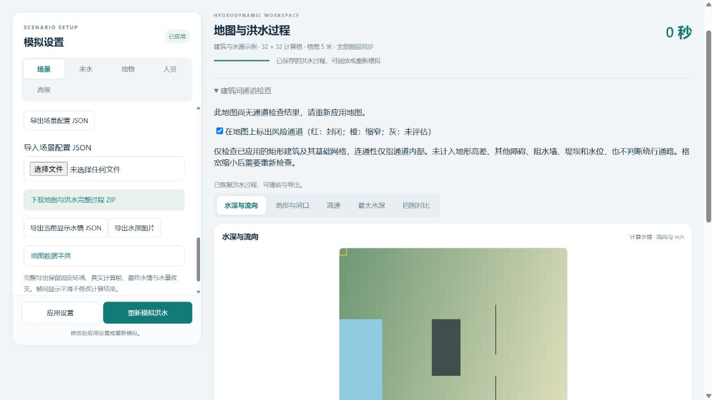
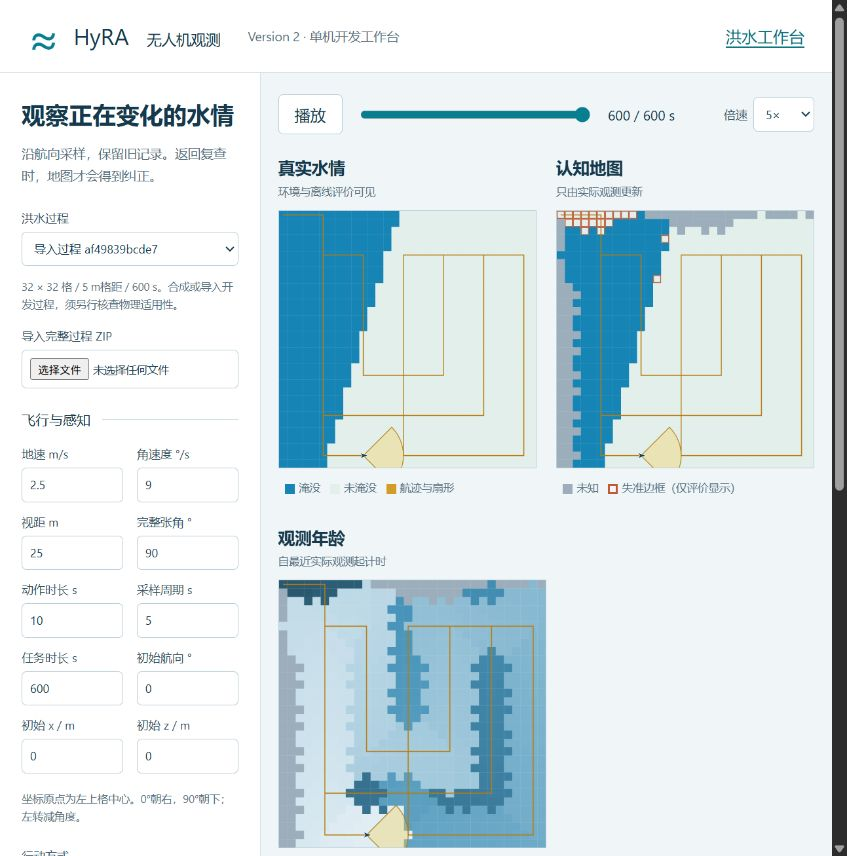

# 启动、联调和复现

2026年10月29日更新：现行八方向网页使用 `python console_app.py`（或 `python -m hyra_workbench`）；`python run.py serve` 仍保留为历史四动作服务。代码结构和统一检查见[代码导航](CODE_MAP.md)。

当前结构保持洪水工作台、真实数据工作台、无人机工作台并列。以下命令中的`python`指已安装对应依赖的Python解释器。本机科学运行实际使用Python 3.12.14、NumPy 2.3.5；研究库版本和源码归档随每轮结果保存。

## 两个工作台同时运行

终端一，从仓库根目录启动既有洪水服务：

```sh
cd terrain-workbench/terrain-lab
python server.py --port 8766
```

终端二，从仓库根目录启动无人机服务：

```sh
cd uav-workbench
python -m pip install -r requirements.txt
python console_app.py --port 8767
```

Windows无人机端也可直接运行`uav-workbench/启动工作台.ps1`，它选择已有含NumPy的解释器。服务均监听本机127.0.0.1。洪水页面为`http://127.0.0.1:8766/maps.html`，无人机页面为`http://127.0.0.1:8767/`。

当前以完整过程ZIP连接两个独立网页：洪水端先计算实际帧并导出，无人机端读取同一物理时间轴。现行八方向页面可运行匹配契约的双机规则核查与已发布模型回放；历史单机规则页面及clean actor命令行按对应版本复现，共享各自登记的实际时间/观测契约。多机训练不要求把无人机和洪水代码合并到一个目录。

现行联调：在洪水端生成完整过程后，无人机页面刷新场景列表，选择“洪水工作台”下的原始网格过程，核对格距、任务时长后运行规则核查。现行服务不开放旧 `/api/import` 导入接口；以下2026年10月25日阶段证据记录的是当时的手动ZIP导入流程。外部ZIP可先用 `python run.py audit <路径>` 离线检查，不能把完成检查等同于真实水文率定。

## 本次实际联调证据

已恢复方案指定的`maps-dca2287a0ca2`历史过程，下载后从浏览器导入无人机工作台。原ZIP、浏览器下载件、导入存档三者SHA256完全相同：`af49839bcde744218aeec44938ede3734b770fa1c223788c40d9e2a176e9f902`。

导入运行`6114cf6038f0`完成60动作、121采样、600秒，实际飞行1150米、转向140秒；全程按类当前正确覆盖49.9%，截止正确覆盖85.1%、未知9.0%、已观测区错误2.1%。这些是联调描述，不是B3机制结果。浏览器警告与错误日志为空。[字节一致性记录](evidence/20261025-final-engineering/zip-handoff.json)。





## 工程与研究复现

```sh
cd uav-workbench
python -m pip install -r requirements.txt -r research-requirements.txt -r report-requirements.txt
python -m unittest discover -s tests -v
python run.py demo --scene logic-demo --output generated/new-fixed-demo
python tools/engineering_audit.py
python tools/dynamic_tradeoff.py
```

上述最后两项检查本机已有正式尺度回放。独立克隆没有`generated/`时，先重建工程前置资料：

```sh
python tools/bootstrap_research.py --build
python -m hyra_uav.strong_study prepare generated/p3-nonlinear-round1 --round 1
python -m hyra_uav.strong_study fit generated/p3-nonlinear-round1
python -m hyra_uav.strong_study evaluate generated/p3-nonlinear-round1
python tools/strong_report.py generated/p3-nonlinear-round1 generated/reproduced-report
```

当前已有研究登记的副本保留历史并从原目录续跑；bootstrap拒绝重置登记，已经冻结的模型禁止重选。科学复现使用对应轮的冻结源码及依赖版本；后续实现有变动时，用独立副本解压该轮的`frozen-sources.zip`恢复可执行源码。源码归档只保存执行文件，完整洪水工作台及基础资料仍由仓库提供。

长时任务可在已启动拟合后另运行`python tools/finish_study.py generated/p3-nonlinear-round1`，等待全部模型冻结，再自动评分、核查54条实际回放、生成报告。已有接续任务时不要重复启动；它不拟合模型、不调整预算、不启动下一机制轮。中断后先核验原任务真实退出状态，再按分片和模型哈希续跑。


## 两轮完整审计与总索引

本机两轮科学运行均已完成，禁止重新拟合或重选已有模型。只读审计可重复执行：

```sh
python tools/study_input_audit.py generated/p3-nonlinear-round1 --output generated/p3-nonlinear-round1/input-audit-final/cache-model-audit.json --expected 54 --models
python tools/study_input_audit.py generated/p3-nonlinear-round2 --output generated/p3-nonlinear-round2/input-audit-final/cache-model-audit.json --expected 54 --models
python tools/p3_closeout.py
python tools/experiment_index.py
```

第一项分别重建每轮全部1,249,152行样本，核对实际帧标签、候选资格、历史和聚合特征，并读取实际森林检查配置及容量。第二轮额外检查严格A1。`p3_closeout.py`独立检查两轮各286740行评分与540项事件汇总，重算所有门槛，核查源代码归档及36个母地形无重复；它只归档报告，不训练或调参。

从头复现第二轮时，在**独立、干净的研究克隆**中先按第一轮归档完成第一轮。随后在该克隆恢复第二轮归档源码，保留第一轮登记、摘要和历史，继续运行：

```sh
python -m hyra_uav.strong_study prepare generated/p3-nonlinear-round2 --round 2
python -m hyra_uav.strong_study fit generated/p3-nonlinear-round2
python -m hyra_uav.strong_study evaluate generated/p3-nonlinear-round2
python tools/engineering_audit.py --source generated/p3-nonlinear-round2 --output generated/p3-nonlinear-round2/input-audit-final --expected 54
python tools/strong_report.py generated/p3-nonlinear-round2 generated/reproduced-round2-report
```

冻结源码的恢复对象是归档内的 uav-workbench 与 terrain-workbench 路径。恢复前核对归档SHA256和逐文件manifest，保持研究源文件集合一致；不要在当前工作副本覆盖源码，不将新功能文件混入旧冻结包。第一轮与第二轮分别使用其归档和环境。旧结果是参考，重建的模型、容器ZIP字节和浮点结果可能存在环境差异，不承诺逐位相同或相同排序。

原P3审计使用Python 3.12及局部研究依赖；Sur-QMIX与独立物理辅助训练使用另一已存在的Python 3.14/PyTorch环境，不能混同。后者默认sys.path漏载D:/Lib/site-packages，由项目runtime模块仅在该Python3.14进程内补入，不修改系统环境。

## 独立物理辅助研究：本机解释器

从仓库的`uav-workbench`目录运行。以下用PowerShell变量区分两个已验证解释器：

```powershell
$learningPython = 'D:/Scripts/python.exe'
$analysisPython = 'C:/Users/Tang Guangxin/.cache/codex-runtimes/codex-primary-runtime/dependencies/python/python.exe'
```

训练环境为Python3.14.2、NumPy2.4.6、PyTorch2.14.0+cu130，已在RTX5060 Laptop上验证CUDA前向、反向和恢复。分析/画图环境为Python3.12.14、NumPy2.3.5及项目局部Matplotlib。其他机器安装`learning-requirements.txt`所需依赖并选择适合本机的PyTorch/CUDA构建；宽松requirements表示接口范围，正式结果的实际版本以formal-plan及环境证据为准。不同设备/库版本不保证逐位一致。

在当前工作副本中，训练与三个接续程序已经启动。先用宿主机进程查询核对PID和完整命令行，并看对应日志；锁文件、状态JSON或观察超时不能证明进程退出。进程信息入口：`generated/sciml-formal-process.json`、`sciml-finish-process.json`、`sciml-final-audits-process.json`、`sciml-report-process.json`。不要重复启动已有流程，也不要在运行时修改冻结的科学源码或已登记接续工具。

## 当前研究的中断恢复与只读验收

训练每回合保存不可变回放分片、恢复版本和原子latest指针，包含优化器、网络、NumPy/Torch/CUDA RNG与辅助采样RNG；检查点绑定实际源码、数据和前驱哈希。已完成的任务只读返回，不重训、不重选。先确认原训练进程确实退出；若有遗留锁，核对锁内PID/命令行与实际退出证据后，才能清理该锁。

```powershell
# 仅在原训练已退出、来源哈希未变、锁已按实际退出状态处理后执行。
& $learningPython -u tools/resume_sciml.py generated/sciml-round1

# 全部12个选定模型冻结后，按既有评价登记继续。
# 生成/读取九个新留出水情；完成结果只校验读取，不重拟合。
& $learningPython tools/evaluate_sciml.py evaluate generated/sciml-round1

# 完整只读验收；未满足各自完成条件时会报错。
& $learningPython tools/audit_sciml_data.py --include-holdout
& $learningPython tools/audit_sciml_training.py generated/sciml-round1
& $learningPython tools/audit_sciml_transitions.py generated/sciml-round1
& $learningPython tools/audit_sciml_trajectories.py generated/sciml-round1
& $learningPython tools/audit_sciml_forecasts.py generated/sciml-round1
& $learningPython tools/audit_sciml_targets.py generated/sciml-round1
& $analysisPython tools/audit_sciml_statistics.py generated/sciml-round1
& $analysisPython tools/report_sciml.py generated/sciml-round1
& $analysisPython tools/experiment_index.py
```

训练转移审计重建全部144万联合决策转移，可能持续较久；已完成任务有绑定源码和历史哈希的缓存。135条闭环回放审计重建每个实际5秒运动、视野、观测和共享记忆；9720条预测审计从相同规则路线的独立合法历史重新推理、另行计分。统计审计核查精确域、时间→路线→种子→事件聚合、NA与全部门槛；目标网络审计核对实际复制快照、优化器状态和辅助采样RNG。报告生成不等于最终交付：图像需要视觉核验，全部产物与目标条款还需逐项验收。

## 在独立新副本从头复现本轮

不得在当前工作副本重置登记、删除历史、重选模型或追加轮次。在独立的新复现副本中，以记录的Git基线和对应源码归档为基础，保留并列目录；不带入本工作副本的generated、运行锁及research/rounds.json、research/sciml_rounds.json等本次运行登记。原始登记与结果随证据归档保留。`formal-frozen-sources.zip`含正式科学源码；旧Sur贯通用其自己的归档，资源试跑原始版本用pilot-frozen-sources.zip，不能混用后续源码冒称历史逐位复现。

原Sur贯通计划严格核对三个原始fixture ZIP的字节哈希，需从本地交付的原ZIP恢复；重新生成或重新打包的ZIP可能字节不同。物理算子验证读取这些实际帧，独立SciML正式数据则按自己的登记重新计算，不复用这些旧事件作为确认留出。

在新副本、依赖与三个fixture准备好后：

```powershell
# 先运行core确定性测试与学习/物理/恢复测试。
& $analysisPython -m unittest discover -s tests -v
# 学习测试中的部分实际集成验收需要正式计划/拟合资料；数据生成后运行完整套件。
& $learningPython tools/validate_physics_operator.py
& $learningPython -m hyra_learning.sciml_data generated/sciml-round1
& $learningPython tools/audit_sciml_data.py
& $learningPython -u -m hyra_learning.sciml_study pilot generated/sciml-round1
& $learningPython -m hyra_learning.sciml_study freeze generated/sciml-round1
& $learningPython -m unittest discover -s learning_tests -v
& $learningPython tools/evaluate_sciml.py register generated/sciml-round1
& $learningPython -u tools/resume_sciml.py generated/sciml-round1
& $learningPython tools/evaluate_sciml.py evaluate generated/sciml-round1
```

随后执行上一节全部审计和报告命令。数据生成首先只有9拟合、3选型事件，九个确认事件直到全部12个选定检查点冻结后才生成。每组2000回合、3种子、十次选模机会，不根据测试结果延长；最大机制轮数仍为1。源文件清单中包含绝对路径，跨目录从头复现会建立新的本地manifest，不能把旧机器绝对路径直接当作新副本的执行计划。

## 运行导出的策略

正式评价导出12组clean actor，目录为`generated/sciml-round1/deployment/<method>-s<seed>/`。入口核对actor.pt与actor.json哈希，拒绝将完整训练检查点当作部署模型。洪水真值由仿真环境持有，actor只收合法地图编码、机位、前一动作和循环状态；不加载辅助世界模型或mixer。

```powershell
& $learningPython tools/run_team_policy.py `
  --model generated/sciml-round1/deployment/Sur-QMIX-Physics-s11/actor.pt `
  --source '完整洪水过程ZIP的绝对路径' `
  --output generated/new-team-replay.json --device cpu
```

输出包含完整两机动作、实际观测、共享地图、变化区间和成本，可再用独立审计核对。原网页的单机回放格式与两机poses列表不同，不能直接把两机JSON当作原单机网页回放。当前CLI拟合集工程实测证据见`docs/evidence/20261025-sciml-development/actor-cli-fit-validation.json`，不计入确认性结果。

安全接续入口tools/resume_sciml.py会检查真实锁属主进程，并在12模型已冻结时只核对哈希后退出。冻结的原生训练入口保留原样；完成后勿重新直接调用它，以免在留出索引已追加后重写原训练输入摘要。
