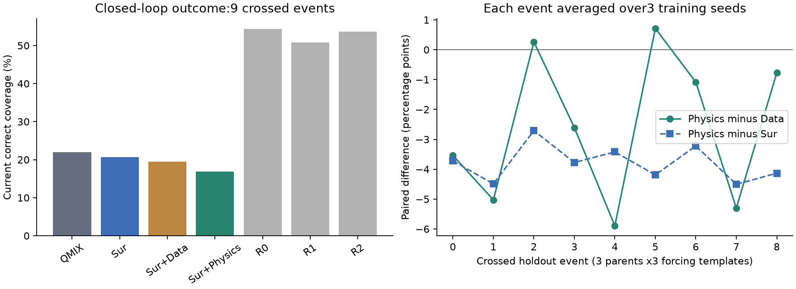
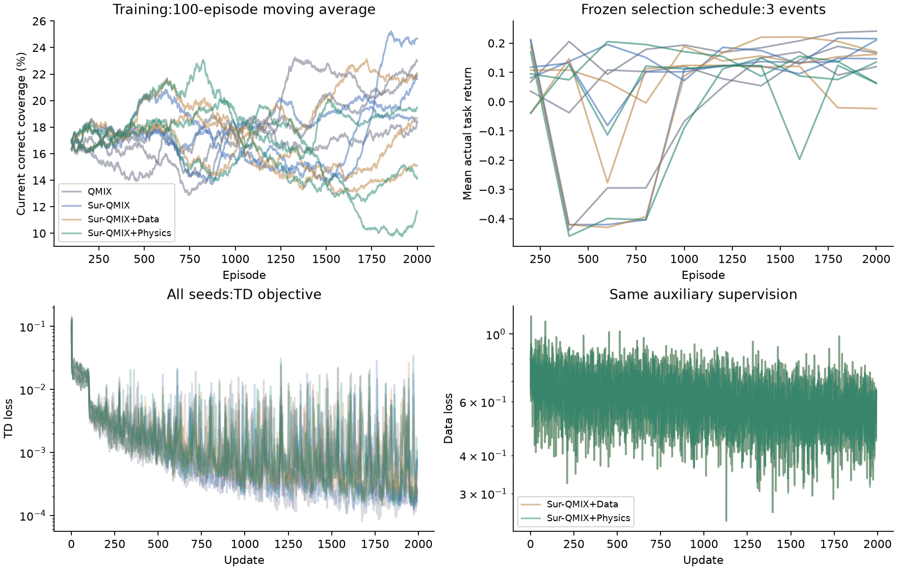

# 独立物理辅助世界模型首轮：最终实验结果

本轮未达到预登记闭环收益门槛。

四组×三个种子×2000回合已按冻结预算完成。新留出为三个母地形与三种来水模板交叉的九事件。全部144万训练转移、108条模型与27条规则回放、9720条共同路线预测及21个水情事件标签已通过独立审计。结论仅适用于本轮合成设置。

| 方法 | 全程当前正确覆盖 % | 平均距离 m | 平均转向 s | 平均碰撞 | 未发现变化比例 | 截断变化延迟 s |
|---|---:|---:|---:|---:|---:|---:|
| QMIX | 21.996 | 526.3 | 264.4 | 4.296 | 0.913 | 120.9 |
| Sur-QMIX | 20.647 | 483.1 | 510.7 | 0.889 | 0.919 | 121.4 |
| Sur-QMIX+Data | 19.434 | 454.1 | 339.3 | 2.333 | 0.939 | 121.6 |
| Sur-QMIX+Physics | 16.850 | 439.6 | 93.0 | 0.889 | 0.948 | 125.0 |
| R0 | 54.387 | 2350.0 | 260.0 | 0.000 | 0.536 | 86.9 |
| R1 | 50.815 | 1505.0 | 160.0 | 0.000 | 0.855 | 109.5 |
| R2 | 53.636 | 2100.0 | 360.0 | 0.000 | 0.608 | 87.4 |

物理组相对 Data、Sur、QMIX 的主指标均值差分别为 -2.583、-3.797、-5.146 个百分点。同时优于 Data 与 Sur 的事件为 0/9。未通过项：mean_Physics_Data, mean_Physics_Sur, simultaneous_positive_events, each_forcing_positive。

| 母地形 | Physics−Data pp | Physics−Sur pp |
|---|---:|---:|
| branching-gully | -2.767 | -3.641 |
| constricted-neck | -2.596 | -3.795 |
| diagonal-islands | -2.387 | -3.954 |

物理辅助策略的平均主指标仍低于本轮最好的规则基线；不能据本轮结果将它视作当前最佳部署策略。

## 预测和物理一致性

以下对相同规则轨迹先做时间平均，再做路线、训练种子、事件平均。未知/陈旧子集为空时保留NA，不填零。物理残差及预测误差改善不能替代上表中的实际任务收益。

| 辅助组 | 10秒深度 MAE m | 未知区 MAE m | 陈旧区 MAE m | 湿干均衡错误 | 动量 MAE m²/s | 局部方程率损失 | 全域体积率差绝对值 m³/s |
|---|---:|---:|---:|---:|---:|---:|---:|
| Sur-QMIX+Data | 0.056613 | 0.060496 | 0.062104 | 0.373638 | 0.018991 | 0.022523 | 42.780309 |
| Sur-QMIX+Physics | 0.051160 | 0.053262 | 0.056802 | 0.368519 | 0.018894 | 0.016265 | 58.323963 |

体积率差为局部深度率差先作空间有符号求和后取绝对值，局部误差可相互抵消；不等于逐格绝对残差之和。局部方程率损失另含水深与两个动量分量。算子已单独对实际求解器验证。

## 训练与计算开销

十二个任务中 10 个触发登记的后段漂移描述阈值。2000回合或曲线趋平本身都不证明收敛；弱策略/不稳定学习限制机制归因。详见机器可读逐任务漂移。

| 方法 | 三种子运行段合计 s | CUDA峰值 reserved MiB | 进程峰值 MiB |
|---|---:|---:|---:|
| QMIX | 2447.0 | 102.0 | 1957.3 |
| Sur-QMIX | 3029.7 | 102.0 | 2014.7 |
| Sur-QMIX+Data | 3631.3 | 160.0 | 2167.3 |
| Sur-QMIX+Physics | 4065.7 | 218.0 | 2206.4 |

运行段时间包含检查点与选型，启动/加载另有开销；本机同时进行只读审计，不能将观测到的墙钟差解释为严格隔离的速度排名。原生进程内存峰值为同一顺序训练进程的累计高水位，后续方法可能继承前组峰值，不能据此比较各方法独立RAM开销；CUDA峰值按任务重置。actor/mixer容量各组一致，两辅助组head结构和标签相同，物理组额外计算方程约束。

## 边界与交付

本轮只有三个确认母地形和三个来水模板；九事件存在交叉依赖，三个训练种子用于随机性检查，不能增加独立地形样本数。本轮门槛不是显著性检验，也不证明真实洪水适用性。保留负结果与不确定性，不追加机制轮次。Sur-QMIX是明确记录差异的适配版，不能称完整复现原论文性能。

- [登记与信息权限](SCIML_PROTOCOL_20261025.md)
- [全部逐事件分析与资源](evidence/20261025-sciml-final/analysis.json)
- [训练预算与初始化审计](evidence/20261025-sciml-development/training-audit-final.json)
- [全部训练转移重建](evidence/20261025-sciml-development/transition-audit-final.json)
- [全部实际闭环轨迹审计](evidence/20261025-sciml-development/trajectory-audit-final.json)
- [全部预测重算](evidence/20261025-sciml-development/forecast-audit-final.json)
- [全部水情标签审计](evidence/20261025-sciml-development/data-audit-final.json)
- [运行和复现命令](REPRODUCE.md)

两张实际导出图已完成视觉核验，见visual-qa.json。完整源码/日志/模型交付索引与逐项目标验收另行核查，不能只凭本报告标记整体目标完成。

## 结论解释与审计修正

物理约束组的10秒深度MAE及局部方程率损失有所下降，但闭环正确覆盖下降，全域体积率差反而增大。预测改善未转化为决策收益。本轮不支持将该机制作为当前默认策略；三个已测规则均明显高于学习策略。10/12任务存在登记的后段漂移，不能据此否定科学机器学习的一般价值或断言充分训练后仍无效。首轮按预登记收束，不追加训练或机制。

原预测审计在一个体积率指标上因CUDA channels-last切片求和次序失败。经具体时刻复现，差异为9.313e-7；审计端改为与冻结评价一致的连续深度通道归约，原rtol=2e-5/atol=2e-7未改变。全部9720条预测重新核对通过，旧代码、旧错误日志及局部缓存保留；冻结模型、数据、评价脚本、门槛均未改。修正说明见generated/sciml-round1/audit-amendments/forecast-reduction-correction.json。
