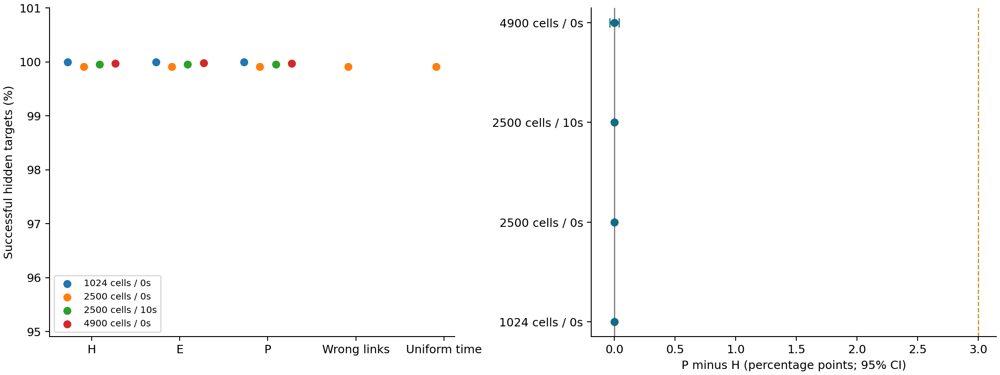
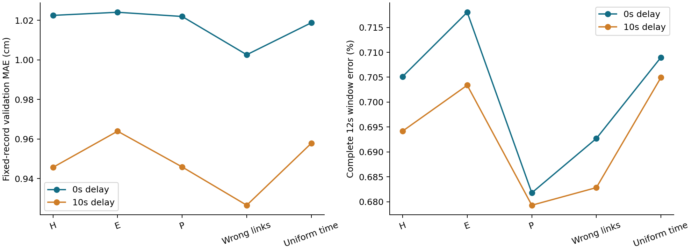

# 实验三：1k–5k格地图下的多无人机闭环搜救

## 研究问题

检验在相同合法原始观测、模型容量、训练预算和中央规划器下，物理约束的信息联系与时间衰减是否使P比强历史或统计联系基线多完成搜救任务。

## 实验设计

采用6个设计、24个训练、12个验证和36个独立测试家族。每个训练、验证或测试家族预分配一种水情，12种水情在各划分内平衡；分配不参考方法结果。任务从真实物理时刻0秒开始，持续1200秒。开发阶段的450/600秒起始分析不作为正式条件。

32/50/70边长对应1024/2500/4900格，配置4/10/20机及12/30/60个隐藏目标。每个家族使用两套目标和噪声配置、三个训练种子。2500格五组比较，端点与10秒延迟扩展比较H/E/P，共2376＋648＝3024回合。

## 执行方法

五组使用相同的37,070参数骨干、完整60秒合法历史与60秒预测有效期。15个模型按同一预算训练，在验证集上选择检查点。H/E中一次选定的主要基线为 **H**；冻结后不按测试结果重选。统计联系和物理联系只使用训练家族拟合，其中18家族拟合、6家族校验联系。

独立真值与名义ANUGA场使用5米计算网格、1秒输出；传感在实际途中位置每5秒采样5×5窗口。规划器每10秒及新证据事件更新，以100毫秒为统一时限。服务必须完整12秒不超过0.8米，失败耗完整服务时间，只有成功才扣载荷。规划是有界候选优化，不保证全局最优。

先在家族内平均两套布局，再对家族和训练种子分别成对重采样10,000次。报告百分点增量及95%区间；格子、时间点和布局均不作为独立家族。2500格、零延迟是主要检验组，端点与延迟扩展分别报告条件性结果，不替代主实验判定。区间下界大于0是主要判定，增加3个百分点是单列工程目标。

## 结果

| 格数 | 延迟 | P完成率 | B*完成率 | P多完成服务次数 | P−B*（百分点） | 95%区间 | 达到3百分点 |
|---:|---:|---:|---:|---:|---:|---:|:---:|
| 1024 | 0s | 100.000% | 100.000% | +0 | +0.000 | [+0.000, +0.000] | 否 |
| 2500 | 0s | 99.907% | 99.907% | +0 | +0.000 | [+0.000, +0.000] | 否 |
| 2500 | 10s | 99.954% | 99.954% | +0 | +0.000 | [+0.000, +0.000] | 否 |
| 4900 | 0s | 99.969% | 99.969% | +0 | +0.000 | [-0.039, +0.039] | 否 |

服务次数之差是在每个组的216个配对回合中累计的完成差，包含训练种子和布局重复，不代表相同数量的独立现实被救人员。

主实验B*在6480次隐藏目标执行机会中有6次未完成；即使全部补足，以本次基线为参照的最大增量也仅为0.0926个百分点。3个百分点工程目标仍按预定规则单列判定；观察到的高基线完成率限制了本次设计的增益空间。

布局平均后的家族×训练种子配对差值全部为0，因而本次经验重采样区间退化为[0,0]；这不构成其他场景中方法普遍等效的证明。

固定路线误差来自12个验证家族的相同记录回放，两个通信延迟各覆盖全部15模型及两套布局。私有水深标签只用于前向预测之后的评分；下面的误差点不作为独立统计样本。

### 全部失败与执行代价

| 格数/延迟 | 方法 | 未发现 | 无真实窗口 | 发现太晚 | 窗口误判 | 执行失败 | 资源/时间耗尽 |
|---|---|---:|---:|---:|---:|---:|---:|
| 1024/0s | H | 0 | 0 | 0 | 0 | 0 | 0 |
| 1024/0s | E | 0 | 0 | 0 | 0 | 0 | 0 |
| 1024/0s | P | 0 | 0 | 0 | 0 | 0 | 0 |
| 2500/0s | H | 0 | 0 | 0 | 0 | 0 | 6 |
| 2500/0s | E | 0 | 0 | 0 | 0 | 0 | 6 |
| 2500/0s | P | 0 | 0 | 0 | 0 | 0 | 6 |
| 2500/0s | P_wrong_links | 0 | 0 | 0 | 0 | 0 | 6 |
| 2500/0s | P_uniform_time | 0 | 0 | 0 | 0 | 0 | 6 |
| 2500/10s | H | 0 | 0 | 0 | 0 | 0 | 3 |
| 2500/10s | E | 0 | 0 | 0 | 0 | 0 | 3 |
| 2500/10s | P | 0 | 0 | 0 | 0 | 0 | 3 |
| 4900/0s | H | 0 | 0 | 0 | 0 | 0 | 4 |
| 4900/0s | E | 0 | 0 | 0 | 0 | 0 | 3 |
| 4900/0s | P | 0 | 0 | 0 | 0 | 0 | 4 |

失败类别为互斥的描述性归因，全部隐藏目标均保留在分母中。无真实服务窗口、未发现和负收益条件均未筛除。

| 格数/延迟 | 方法 | 覆盖率 | 平均飞行(m) | 超时次数 | 平均回合规划中位数(ms) | CPU峰值(MiB) | GPU峰值(MiB) |
|---|---|---:|---:|---:|---:|---:|---:|
| 1024/0s | H | 100.00% | 3826.5 | 0 | 0.94 | 1893.1 | 77.7 |
| 1024/0s | E | 100.00% | 3829.3 | 0 | 0.94 | 1893.1 | 77.7 |
| 1024/0s | P | 100.00% | 3829.3 | 0 | 0.95 | 1893.1 | 77.7 |
| 2500/0s | H | 100.00% | 10380.6 | 0 | 5.15 | 1893.1 | 129.1 |
| 2500/0s | E | 100.00% | 10380.6 | 0 | 5.22 | 1893.1 | 129.1 |
| 2500/0s | P | 100.00% | 10380.6 | 0 | 5.16 | 1893.1 | 129.1 |
| 2500/0s | P_wrong_links | 100.00% | 10380.6 | 0 | 5.17 | 1893.1 | 129.1 |
| 2500/0s | P_uniform_time | 100.00% | 10380.6 | 0 | 5.17 | 1893.1 | 129.1 |
| 2500/10s | H | 100.00% | 12194.2 | 0 | 13.19 | 1893.1 | 129.1 |
| 2500/10s | E | 100.00% | 12194.2 | 0 | 13.09 | 1893.1 | 129.1 |
| 2500/10s | P | 100.00% | 12194.2 | 0 | 13.28 | 1893.1 | 129.1 |
| 4900/0s | H | 100.00% | 20821.2 | 7 | 20.87 | 1893.1 | 212.0 |
| 4900/0s | E | 100.00% | 20812.8 | 5 | 20.83 | 1893.1 | 212.0 |
| 4900/0s | P | 100.00% | 20903.4 | 4 | 20.90 | 1893.1 | 212.0 |

CPU峰值为执行进程累计峰值，GPU值为执行回合期间分配峰值，包含常驻模型；它们不是每回合独立的内存样本。重复搜索量、回合p95、最大规划耗时和全部逐回合数据见`raw_statistics.json`。

### 服务时序与机会空间

| 格数/延迟 | 方法 | 最后成功服务时间中位数(s) | 全部任务在任何目标初始安全窗口关闭前完成的回合 |
|---|---|---:|---:|
| 1024/0s | P | 213.7 | 216/216 |
| 1024/0s | H | 213.7 | 216/216 |
| 2500/0s | P | 249.0 | 210/216 |
| 2500/0s | H | 249.0 | 210/216 |
| 2500/10s | P | 407.7 | 213/216 |
| 2500/10s | H | 407.7 | 213/216 |
| 4900/0s | P | 246.4 | 212/216 |
| 4900/0s | H | 246.3 | 212/216 |

该表仅在事后用全部隐藏目标的真实完整服务窗口核对机会空间。若大部分任务在窗口普遍收紧前就已完成，信息改善难以转化为额外服务；这用于解释当前条件的天花板，不说明更困难或不同时间尺度的搜救中信息无效。

### 改派实际服务差与数值方向

原3024回合之外，P与B*各执行同目标、同噪声和同权重的改派策略干预，共1728回合；另外在独立10米/2秒水动力场上复跑P与B*，共1728回合。改派干预仅针对不与周期规划重合的新证据事件，将仍可行的已有任务改派推迟至下一次周期规划；失效计划的安全处置及周期规划照常进行。因此测量的是这类及时改派的累计策略效果，不是全部水情信息的总贡献，也不累加逐次改派的虚构收益。

| 格数/延迟 | 方法 | 完整改派−推迟改派（百分点，95%区间） | 干预次数 | 干预前已有差异的配对 |
|---|---|---|---:|---:|
| 1024/0s | P | +0.000 [+0.000, +0.000] | 60 | 0 |
| 1024/0s | H | +0.000 [+0.000, +0.000] | 60 | 1 |
| 2500/0s | P | +0.000 [+0.000, +0.000] | 258 | 0 |
| 2500/0s | H | +0.000 [+0.000, +0.000] | 258 | 0 |
| 2500/10s | P | +0.046 [+0.000, +0.139] | 138 | 1 |
| 2500/10s | H | +0.046 [+0.000, +0.139] | 138 | 0 |
| 4900/0s | P | -0.008 [-0.046, +0.000] | 936 | 12 |
| 4900/0s | H | -0.015 [-0.054, +0.000] | 948 | 4 |

若配对在第一次策略干预前已有执行差异，该组的总体差值不能解释为隔离的改派因果收益。计时超时和候选求解可能造成这种差异；原始对照和前缀检查全部保留。

| 格数/延迟 | 5米/1秒 P−B* | 10米/2秒 P−B* | 方向一致 |
|---|---:|---:|:---:|
| 1024/0s | +0.000 | +0.000 | 是 |
| 2500/0s | +0.000 | +0.000 | 是 |
| 2500/10s | +0.000 | +0.000 | 是 |
| 4900/0s | +0.000 | +0.000 | 是 |

## 结论

- 1024格、0秒延迟：各方法均达到100%完成率，当前任务存在天花板，未提供可检验的额外救援收益。
- 2500格、0秒延迟：P相对B*的配对区间未能支持稳定正收益，不能宣称HyRA提高了救援完成率。
- 2500格、10秒延迟：P相对B*的配对区间未能支持稳定正收益，不能宣称HyRA提高了救援完成率。
- 4900格、0秒延迟：P相对B*的配对区间未能支持稳定正收益，不能宣称HyRA提高了救援完成率。

消融比较及全部12种水情的描述性子组区间见`raw_statistics.json`。仅优于错联系或均匀时间权重，不能替代P相对B*的主要判定；三个家族组成的水情子组不用于重新筛选场景或宣布主要优越性。

本报告保留无增益、天花板、失败和方向不稳定的结果。训练、固定回放、验证、正式测试与诊断的原始统计分别存档；工程真值前沿诊断不与训练模型效果混用。

## 复核与复现

独立交付目录保留代码、冻结配置、全部检查点、联系规则、划分清单、原始统计、观测与预测记录以及被引用的水动力场。原始JSON字节不改写，移动目录后在读取时映射原绝对路径。

在交付目录运行 `python scripts/verify_bundle.py --audit-primary`，先核验每个文件的SHA-256及冻结证据，再独立重算全部正式服务评分。训练命令为 `python scripts/train_models.py --data-run <共同数据目录>`；测试单次登记和原目录精确续跑规则由 `scripts/run_formal_test.py` 执行。
