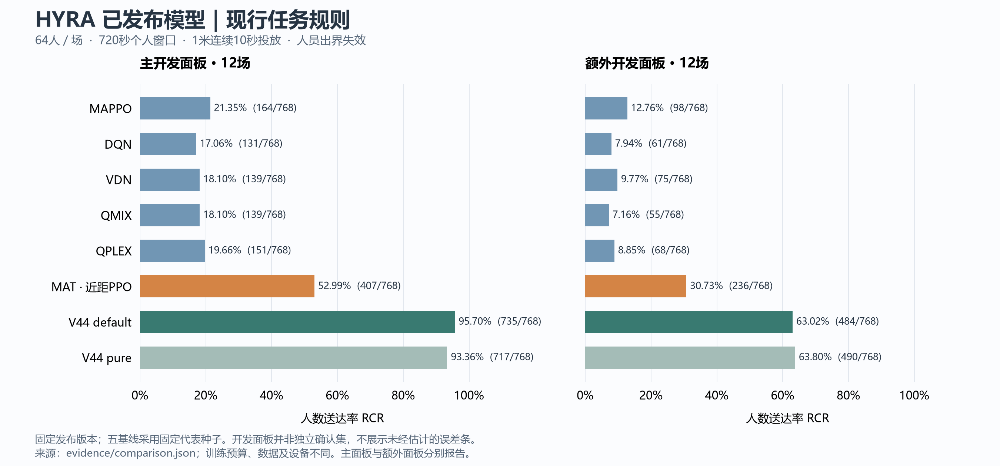

# 基线模型

本目录统一按 **64人、4机、2400秒、首次落水后720秒、1米连续10秒投放、人员出界失效** 的现行规则整理。先读 [完整实验报告](实验报告.md)，细则见 [地图与任务协议](HYRA无人机洪水搜救与物资投放实验协议-定稿-20261105.md)。

## 当前发布模型

均为固定发布版本，每面板12场、768人次。五基线的三训练种子结果另列于完整报告，避免混用分母。这些是开发数据，尚不是协议要求的180场独立确认。

| 模型 | 主面板送达 | 额外面板送达 | 定位 |
|---|---:|---:|---|
| [MAPPO](MAPPO/README.md) | 164/768 | 98/768 | 策略梯度基线 |
| [DQN](DQN/README.md) | 131/768 | 61/768 | 个体价值基线 |
| [VDN](VDN/README.md) | 139/768 | 75/768 | 求和价值基线 |
| [QMIX](QMIX/README.md) | 139/768 | 55/768 | 单调混合基线 |
| [QPLEX](QPLEX/README.md) | 151/768 | 68/768 | 价值／优势混合基线 |
| [MAT 近距 PPO 1024](MAT/README.md) | 407/768 | 236/768 | 当前选定学习策略 |
| [V44 default](V44/README.md) | 735/768 | 484/768 | 当前工程方案 |
| V44 pure | 717/768 | 490/768 | 强纯规划参照 |

## 内容索引

- [完整实验报告](实验报告.md)：地图协定、训练／验证／开发数据构成、最终结构、训练链、超参数及选择依据、指标与复现边界。
- 框架图：[MAPPO](figures/mappo-framework.png)、[DQN／VDN／QMIX／QPLEX](figures/q-family-framework.png)、[MAT](figures/mat-framework.png)、[V44](figures/v44-framework.png)。
- [MAT 改进记录](MAT/IMPROVEMENTS.md)：各轮收益、选模与未晋级尝试。
- [逐场证据](evidence/case-results.json)、[指标 CSV](evidence/comparison.csv)、[数据集划分](evidence/datasets.json)、[训练配置](evidence/training-configs.json)、[版本登记](evidence/model-registry.json)。
- [训练运行时](training_runtime/README.md)：完整检查点获取和续训；轻量推理权重不含完整训练状态。
- [图表说明与重建](figures/README.md)、[清理登记](evidence/cleanup.json)：旧报告移除原因与历史追溯。

DQN、VDN 的11月9日公开目标评分候选单列于报告第8节，未替换默认权重。V44原研究回放包含碰边停留变体，不能用其成绩代替上表。各方法训练预算、数据与设备不完全相同，本表不声称同预算算法排名。
