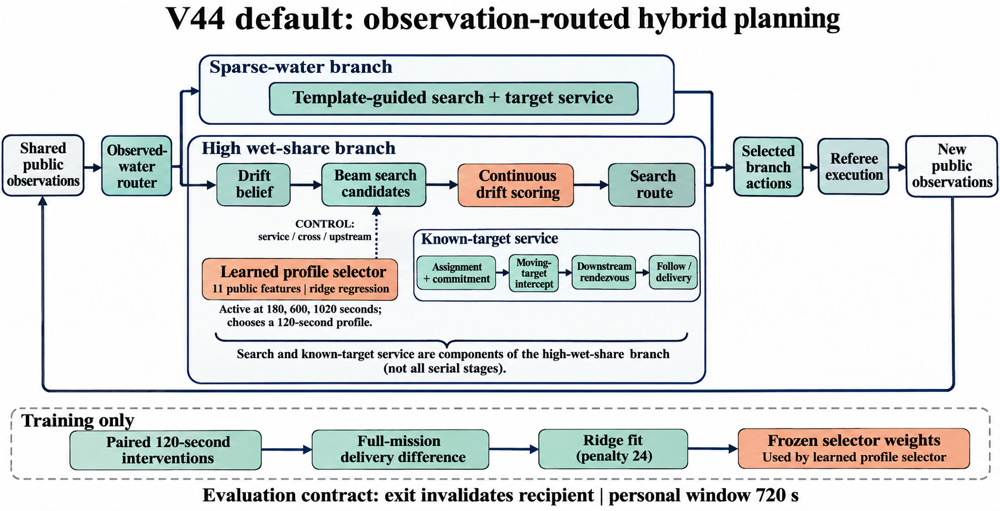

# V44 无人机洪水搜救与物资投放

V44 default 是公开观测驱动的混合规划系统，包含水情路由、模板／漂移搜索、既有学习评分、目标分派与拦截，不对应一次端到端神经网络训练。统一设计、数据来源、超参数和评价定义见 [完整实验报告](../实验报告.md)。



## 现行协议结果

每场4机、64人、2400秒；首次落水后个人窗口720秒；20米前向180°视野；同机同人在1米内连续10秒完成投放。**人员出界失效，仍计入分母。**

| 开发面板 | 总人次 | default | pure |
|---|---:|---:|---:|
| 主面板12场 | 768 | 735（95.70%） | 717（93.36%） |
| 额外面板12场 | 768 | 484（63.02%） | 490（63.80%） |
| 固定单图 | 64 | 50 | 45 |

两面板两策略的冲突数均为0。default在额外面板少于pure 6人，两者还有多处规划结构差异，不是只开关一个学习模块的消融。以上未完成正式180场独立确认；协议目标是学习相对最强纯规划的**相对增益超过15%**，不是15个百分点。

逐场结果和原裁判核验见 [结果证据](../evidence/case-results.json)与[核验记录](../evidence/official-replay-verification.json)。默认策略使用 `runtime/uav-downstream-meet-v44/model.py` 的 `load_model()`；pure使用 `NoveltyBeam("service")`。现行评测必须使用出界失效人员轨迹。

## 原研究回放的范围

随包 `replay.py` 复现的是**碰边停留**条件下default、提前送达、终局派单和pure四种策略，不是上表的评测入口。`runtime/inputs.json` 的120场包含32拟合、16选型、24普通补测、40混合复核、8新普通图，也不是所有基线的共同训练集。

保留代码、原始数据、权重和结果JSON用于追溯。七份不适用现行协议的报告正文已移除，路径、差异及历史blob见 [清理登记](../evidence/cleanup.json)；统一报告保留候选负结果。

若需复现历史变体，已验证平台为Windows x64、Python3.12.14、NumPy2.3.5，在本目录运行：

```powershell
python -m pip install -r requirements.txt
git lfs pull --include="基线模型/V44/原始数据/*.zip"
python restore_inputs.py --group all
python replay.py --case 72110001-ordinary-r0
```

三份LFS归档包含水场和人员轨迹，恢复时验证SHA和条目清单。缺失归档时可用 `python replay.py --stage all --prepare-only` 数值重建，需额外计算时间。历史候选训练会写入同名结果，应在项目副本执行：

```powershell
python runtime/uav-downstream-meet-v44/study_terminal44.py fit select repeat mixed fresh
python runtime/uav-downstream-meet-v44/audit_terminal44.py
```

Windows运算库附C++源码和 `build.cmd`，需Visual C++工具链。`环境与裁判/` 为20261106.1接入包，独立使用时按现行协议处理出界；`replay.py` 的轨迹变体需单独辨识。
