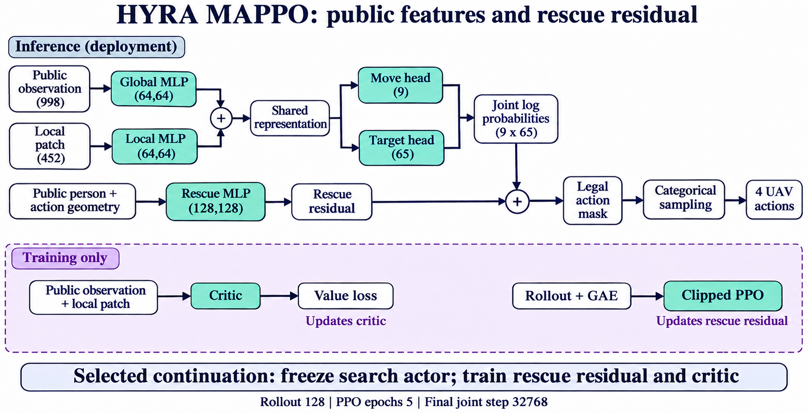
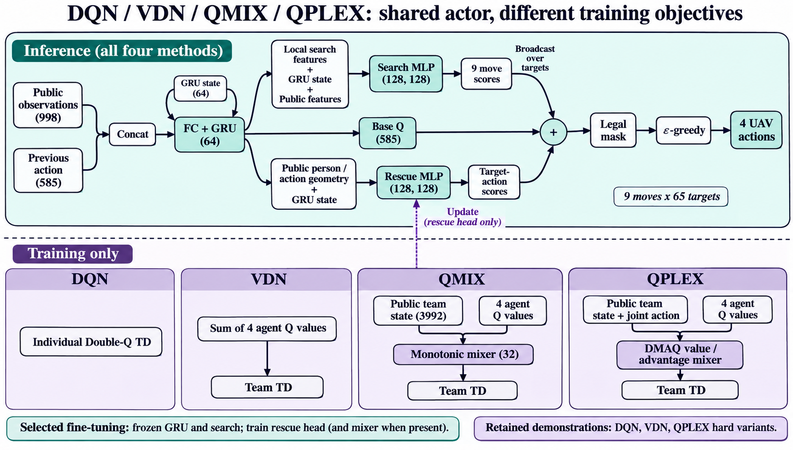
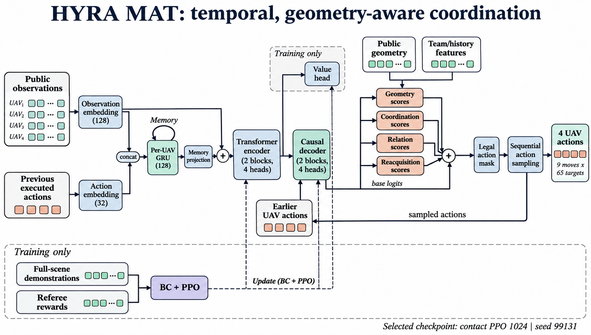
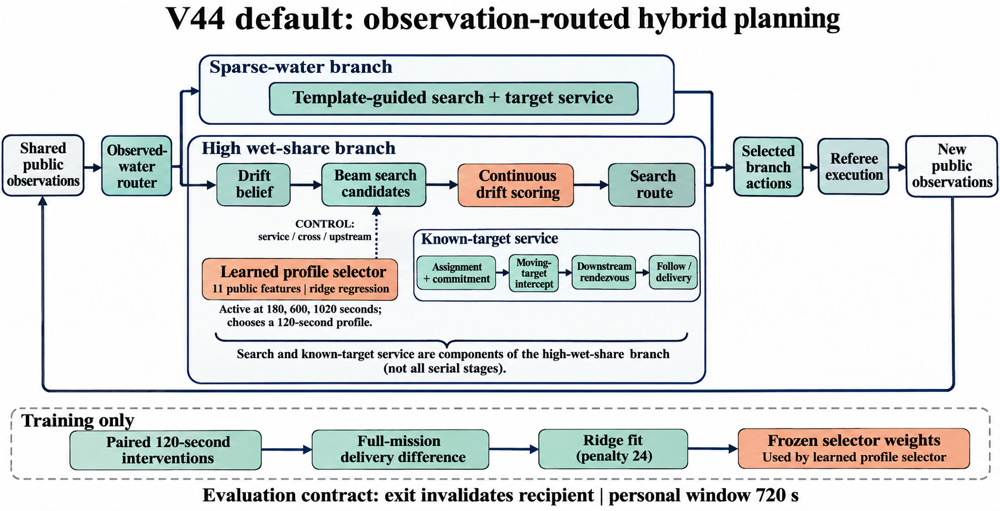
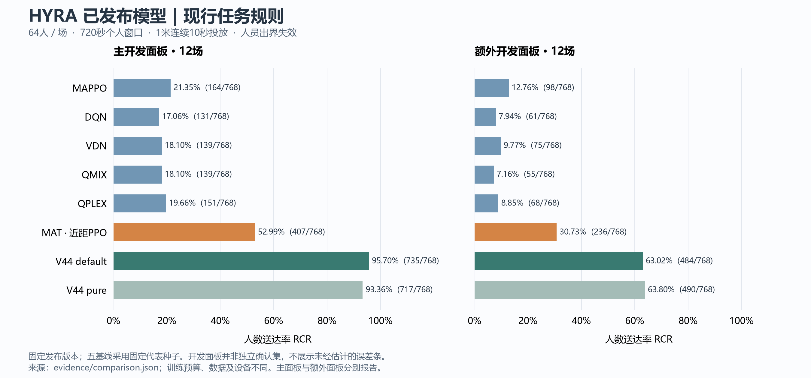

# HYRA 基线模型与训练评测报告

整理日期：2026-11-09。任务规则采用 [2026-11-06 修订的实验协议](HYRA无人机洪水搜救与物资投放实验协议-定稿-20261105.md)，裁判版本为 `HYRA-referee-20261106.1`。本报告汇总已有训练和评测记录，本次仓库整理没有重新训练模型，也没有新增独立测试。

## 1. 当前发布版本与阅读入口

当前最强的工程对照是 V44 default，当前选定的学习策略是 MAT 近距 PPO 1024。MAPPO、DQN、VDN、QMIX、QPLEX 保留各自已经发布的固定版本。DQN、VDN 的新公开目标评分实验另列在第 8 节，其权重与当前目录的默认推理权重不同。

| 方法 | 本报告主表对应版本 | 默认训练种子 | 推理方式 | 定位 |
|---|---|---:|---|---|
| [MAPPO](MAPPO/README.md) | 冻结搜索 actor，救援分支续训至累计 32768 联合步 | 77126 | sampled | 策略梯度对照 |
| [DQN](DQN/README.md) | hard，8192 联合步 | 88126 | epsilon_0.05 | 个体 Double Q 对照 |
| [VDN](VDN/README.md) | hard，8192 联合步 | 88126 | epsilon_0.05 | 团队求和价值对照 |
| [QMIX](QMIX/README.md) | plain，冻结搜索骨干，8192 联合步 | 88126 | epsilon_0.05 | 单调价值混合对照 |
| [QPLEX](QPLEX/README.md) | hard，8192 联合步 | 88126 | epsilon_0.05 | 价值／优势混合对照 |
| [MAT](MAT/README.md) | Temporal + 协调／关系／再观测 + 近距 PPO 1024 | 99131 | sampled | 选定学习策略 |
| [V44 default](V44/README.md) | `load_model()`，连续漂移搜索与既有学习评分 | 不适用单一神经网络种子 | 确定性规划与评分 | 主工程方案 |
| V44 pure | `NoveltyBeam("service")` | 不适用 | 确定性规划 | 强纯规划参照 |

前五种方法的代表种子事先固定，未按主面板成绩选种子。MAT 的最终训练端点用六场验证组选择。V44 default 与 pure 还存在搜索、路由和拦截结构差别，因此两者的差值不是关闭一个学习权重的严格消融。现行协议第 5 节将 MAPPO、QMIX、VDN、DQN 等排除在拟议主创新算法之外；这里保留它们作为比较基线，不将其改称项目主创新。

模型身份、权重 SHA-256 和默认模式见 [版本登记](evidence/model-registry.json)及各目录 `manifest.json`。完整指标见 [比较 CSV](evidence/comparison.csv)，逐场指标与逐人送达时刻见 [case-results.json](evidence/case-results.json)。

## 2. 地图协定、人员运动与信息权限

### 2.1 各方法共用的任务规则

| 项目 | 固定值或规则 |
|---|---|
| 空间 | 1000 × 1000 m；100 × 100 水情网格；格距 10 m；机人与水情格心使用连续水平坐标 |
| 机队与人员 | 4 架无人机，64 人；四机从四角内侧格心出发，朝向中心；所有 64 人均计入分母 |
| 飞行与通信 | 速度上限 10 m/s；八个归一化方向或悬停；理想即时共享合法观测 |
| 视野 | 前向 180°、半径 20 m；仅第 0 秒和每个决策时刻采样，不补记飞行中扫过目标 |
| 时钟 | 每 5 s 联合决策，最长 2400 s，即 480 联合步；水情 481 帧，人员每秒更新 |
| 个人期限 | 首次落水后 720 s，且不超过任务终点；始终站立者可服务至任务结束 |
| 投放 | 同一架机对同一人，连续两个完整 5 s 合格步；每秒检查距离 ≤1 m，共持续 10 s |
| 接近与跟随 | 可见目标的平移动作允许在 0.5 m 内圈截短；接近步不累计服务；跟随仅用步首公开速度 |
| 冲突 | 步内轨迹间距不足 5 m 时安全停止，并记录潜在冲突机对；被阻止的冲突仍计数 |
| 边界 | 飞机在地图边界截停；人员离开半开域 `[0,1000)²` 后失效，仍计分母 |
| 终止 | 全员送达且全部 10000 格心被观测时可提前终止，否则运行至 2400 s |

动作统一编码为 `a = move × 65 + target + 1`，`move=0…8`，`target=-1…63`，共 585 种单机动作；`target=-1` 表示不指定人员。四机在同一决策时刻执行，MAT 内部按 UAV0→UAV3 自回归生成这四个动作。

公开输入包括飞机位姿、当前扇形内水情、已发现人员的位置／速度／观测年龄、公开活跃状态和服务归属。历史记录可以用于预测失联目标。未知人员位置、真实未来轨迹、地图类别标签及未来水情不能进入策略。训练奖励可以用裁判真值判定实际近距接触，部署输入仍限于公开观测。

### 2.2 三类协议地图

普通洪水使用合成河谷二维浅水过程，截取物理 600—3000 s 作为任务段。固定 10 m 网格、封闭边界、曼宁系数 0.035、一阶空间离散、Euler 推进和最大内部步长 2.5 s。来水分配至第 15 行河谷附近五个源格，峰值每图抽取 24—54 m³/s。人员从任务起始已湿格中抽取，优先流速 ≥0.55 m/s 的候选，不足时按协议降低候选门槛；排除机库格和源格，并保持固定名单。

持续高水为空间均匀的合成压力图，湿时水深 2.05—2.80 m、速度 0.35—0.45 m/s，全程有水。反复干湿与其共用父图、流向、起点和随机条件，在约 450、1030、1600 s 加入名义 40 s 干段，起点各独立扰动 −60…+60 s，帧间线性插值。正式压力集需均衡覆盖四个流向。同一压力父图的干湿配对和所有名单必须留在同一数据集合。

水图应检查坐标、单位、481 帧时间对齐、非负有限水深、有限速度以及普通图水量收支。协议规定水量残差阈值为 `max(1e-5 m³, 全事件来水量×1e-9)`，湿格速度 P99≤2 m/s、最大值≤4 m/s。本次主面板来自本地 `local_overbank` 和 `local_rain_river` 开发图，并不是协议规定的三类正式确认集；不能仅因任务裁判相同就称其全部满足普通图生成与质量验收。本次整理未重跑水动力质量检查，原水图和人口哈希保留在证据中。

### 2.3 人员自然过程

64 人在第 0 秒站立入场，首次落水由冻结的深度—流速危险率累计量与每人指数阈值决定。落水后随局部水流推进，浅水可搁浅，重新有水后按协议阈值或随机概率复漂；每图还有 12 个半径 4 m 的实体拦阻物。搁浅和复漂不重置个人期限。成功送达之后的自然运动不撤销成绩。

这些是模拟任务规则，送达表示完成物资投放条件。主任务未加入电量返航、载荷耗尽、通信丢包、建筑禁飞和现场感知误差。完整危险率公式、候选起点规则与水情验收以协议原文为准。

## 3. 实际使用的数据集

### 3.1 发布五基线的训练与评测划分

| 用途 | 构成 | 数量与作用 |
|---|---|---|
| 在线训练 | 41001、41002 两张 `local_overbank`；42002、42004 两张 `local_rain_river`；名单 0 | 4 张固定训练图轮换，不能写成大规模独立洪水样本 |
| 主开发面板 | 41004、41005、41006、41007、51001…51004 共 8 张 overbank；42012、42015、42017、42018 共 4 张 rain_river | 12 图，每图名单 0；每个种子 768 人次 |
| 额外开发面板 | ordinary 父图 72110001、95851001；压力父图 88520001、95861001 各 continuous／rewet；每图名单 0、1 | 6 个场景图、4 个独立父图、12 场；768 人次 |
| 固定单图 | 72110002-ordinary-r0 | 64 人；对 V44 已见，不能统称各方法的盲测 |

MAPPO 主面板有 77126、77127、77128 三个训练种子，Q 系列有 88126、88127、88128；三种子合计是 36 场、2304 人次，仍只有 12 张主面板地图。主表使用固定代表种子，三种子结果单列。

Q 系列先从已有搜索模型学习搜索示范，再拟合局部救援示范，之后进行在线 TD 微调。原救援示范含 512 个局部案例，种子起点 100000，最多 9 步；困难示范另有 512 个非对齐案例，种子起点 300000，最多 16 步。缓存包含原正标签 1569 条、原拒绝标签 97 条、困难正标签 2229 条、困难拒绝标签 269 条。案例数、标签数、在线联合步数属于不同计数单位。hard 更新使用困难正例，但不抽困难拒绝例；原拒绝例使用父模型分布保持损失。

### 3.2 MAT 完整回合数据

MAT 的时间记忆阶段在采集前固定 26 个场景、20 个父图的划分。

| 类型 | 训练场数 | 验证场数 |
|---|---:|---:|
| 本地 overbank | 2 | 0 |
| 本地 rain_river | 2 | 0 |
| dev80 ordinary | 8 | 2 |
| dev80 continuous | 4 | 2 |
| dev80 rewet | 4 | 2 |
| 合计 | **20 场／16 父图** | **6 场／4 父图** |

ordinary 训练父图为 72110003…72110006、95851003…95851006；压力训练父图为 88520002、88520003、95861002、95861003。验证普通父图为 72110007、95851007，验证压力父图为 88520004、95861004。均使用名单 0，完整编号及输入哈希见 [datasets.json](evidence/datasets.json)。

每个场景分别采集 V44 default 与 pure 教师完整回合，不按成功筛选，保留失败轨迹。初始训练为 40 回合，验证为 12 回合，总共 52 回合、24960 联合步；其中训练回合只有 19200 联合步。随后在 20 个训练场景上进行两轮学生状态采集，每轮增加 20 回合，教师在学生实际到达的公开状态给标签，形成最终 80 个训练回合、38400 联合步、153600 个单机动作位置。验证回合不进入训练池。

训练记录包括公开观测、人员特征、动作几何、动作掩码、教师动作、上一拍实际执行动作与阶段标签。最终使用 `HYRA_PUBLIC_INTENT_REFEREE_CLIP_V2`，初始 52 条轨迹的教师动作均可表示，掩码冲突为 0。旧边界特征下的冲突记录不作为现行数据。序列训练按水情族、教师来源、回合采样，回合前缀用于重建隐藏状态，学习窗口内才反向传播。

六场验证组参与选取近距 PPO 的 1024 步端点，因此是选模验证集。主、额外面板也被多轮开发使用；三者都不能改称最终独立确认集。

### 3.3 V44 的数据与学习部分

V44 default 沿用多阶段规划模块及既有权重，不对应一次从零训练的统一神经网络。其 V19 profile selector 用 11 项公开特征拟合两种改换搜索配置相对 service 的终局人数差。源码规定 8 场训练任务 × 3 个干预时刻得到 24 个训练状态，另外 8 场 × 3 时刻得到 24 个验证状态，并检查两组父图编号不交叉。每个状态对 cross、upstream 分别干预 120 s，再恢复 service 跑到终局取得标签。

普通水情分支还沿用早期模板先验；本次未重新复核其所有上游训练阶段，不能把上述 24 个状态称为 V44 的全部训练数据。现行比较核验的是冻结策略来源与完整任务动作带。V44 目录 `runtime/inputs.json` 的 120 场属于后续碰边停留条件下的终局派单研究，包含 32 拟合、16 选型、24 旧普通补测、40 混合复核、8 新普通图，不能当作本报告全部模型共用的数据集。

## 4. 最终模型设计与框架图

### 4.1 MAPPO

公开基础向量为每机 998 维，包含池化后的已观测水情、全队位姿与时间、64 人的公开记录、机号和目标资格。另有 452 维局部搜索特征，即 15×15 两通道局部信息与附加量。两路 MLP 的 64 维输出相加，生成 9 维移动与 65 维目标分布；联合 log 分数再叠加共享救援 MLP 对每个人—方向组合的残差，最后用合法动作掩码构造 585 类分布。

救援 MLP 输入为 19 维人员特征、12 维动作几何与 9 维方向编码，隐藏层为 128、128，输出一个修正分数。发布版搜索骨干没有 GRU。critic 使用公开特征和局部搜索特征估计价值；续训阶段冻结搜索 actor，仅更新救援分支和 critic。推理直接由 actor 采样方向和目标，不接教师规划器。

### 4.2 DQN、VDN、QMIX、QPLEX

四种方法的发布推理网络相同，但权重和训练目标不同。每机 998 维公开向量与上一拍 585 维动作 one-hot 拼接，进入 PyMARL 风格 FC＋GRU64，再输出 585 维基础 Q。搜索 MLP 接收局部特征、隐藏状态和公开向量，产生 9 个移动修正值并广播到目标维；救援 MLP 接收人员、方向、动作几何与 GRU 状态，产生目标—方向修正值。两种残差与基础 Q 相加后施加掩码，以 ε-greedy 选动作。搜索和救援 MLP 均为两层 128 隐藏单元。

原救援残差只对最后观测不超过 30 s、距离不超过 120 m 的公开目标启用；这是残差的作用范围，不是把其他已知活跃目标从合法动作中删除。它解释了后续为何另做全公开目标评分，但不能单凭这条结构判断全部失败原因。

| 方法 | 在线训练目标 | 混合器与训练权限 |
|---|---|---|
| DQN | 单机 Double Q，online 网络在合法动作里选下一动作，target 网络估值；团队奖励用于各机 TD | 无团队混合器；发布轮冻结 GRU 和搜索，只训练救援残差 |
| VDN | 四机所选 Q 求和构成团队 Q；团队奖励每个联合转移使用一次 | 求和无可学习混合参数；冻结 GRU 和搜索 |
| QMIX | 状态条件单调混合四机所选 Q，再计算团队 Double Q TD | team state=4×998=3992；mixing embedding=32，二层 hypernet、隐藏64；训练救援头和 mixer |
| QPLEX | DMAQ 加权 value 与 advantage 分解，使用非负状态／动作相关权重构造团队值 | 10 个 SI kernels、3 层64、weighted_head、minus_one；训练救援头和 mixer |

VDN、QMIX、QPLEX 的团队混合只参与训练，部署使用各机个体网络。主表 QMIX 为 frozen plain，不是另一个更新 GRU 的 joint／attention 实验。DQN、VDN、QPLEX 使用 hard 示范与成功经验，QMIX plain 不使用本轮 hard 保留项；几种方法的资源不完全相同。

### 4.3 MAT 近距 PPO 1024

保留 MAT 编码器和因果动作解码器，编码器／解码器各 2 个 Transformer block、embedding 128、4 个 attention head、4 个智能体、每机 585 动作。公开观测为每机 1450 维，另提供人员与动作几何。上一拍实际动作映射为 32 维嵌入，与 128 维观测嵌入共同进入 GRUCell(160,128)；记忆经过投影相加回编码器输入。回合开始隐藏状态清零。

动作分数包含原因果解码分数与四类修正：几何头利用人员和候选方向的相对几何；协调头利用本拍先前无人机的选择和上一拍承诺；关系头比较已承诺队友与自身距离、可见性及归属；再观测头只在目标短时失联约 5—30 s 时提供修正。几何和协调头为 128、128 隐藏层；关系头输入11、隐藏64、64；再观测头输入18、隐藏64、64、输出1。图中支路概括的是分数贡献，各头的实际特征和触发条件以 `MAT/src/` 为准。

这些分数经掩码后自回归采样，部署不调用教师或 V44。已导出参数总数 1331776，训练 seed 99131。教师用于训练数据生成，裁判真值用于训练奖励；二者均不构成部署时的隐藏输入。模型仍以可训练策略直接生成动作，但完整系统包含确定性的公开特征构造与合法性处理。

### 4.4 V44 default 与纯规划

V44 default 是基于公开观测路由的混合规划系统。累计观测格数达到40或时间达到60 s 时，根据已观测格中湿格占比作一次分支选择，阈值为0.8；分支标签来自实际观测，不读取地图真实类别。稀疏水情分支使用模板引导搜索与目标服务；高湿分支维护漂移人群估计，搜索候选航线，再按连续漂移评分选择路线。已知人员经过分派、承诺保持、运动拦截和必要的下游交会处理后执行接近或跟随。交会是符合条件时的备选，不是每次投放必经的串行步骤。

V19 线性评分器在 180、600、1020 s 估计是否改变搜索配置，基准 service 的选择分数为0.5，cross／upstream 用训练权重评分；选中后保持120 s再恢复。默认 service 搜索 horizon=9、beam width=18、easy=1、tilt=0.6、cross=0、commit=3；配置定义见 V44 `beam16.py`。V44 的连续位移搜索及下游交会属于规划改动，并非本轮新增深度网络。

pure 为 service 纯规划入口。本报告 V44 结果使用官方出界失效轨迹；目录原有 `replay.py` 的研究回放使用碰边停留，不可直接用其结果代替本表。两种用途在 V44 README 分开说明。

## 5. 训练方法、损失与超参数

### 5.1 五基线发布轮

| 参数 | MAPPO 冻结续训 | DQN / VDN / QMIX / QPLEX 发布轮 |
|---|---|---|
| 父模型 | stable PPO 8192 | 各种子搜索与救援 BC 父模型 |
| 本轮预算 | 新增24576，累计32768联合步 | 各8192联合步，固定终点 |
| 优化器 | Adam，actor 1e-4、critic 5e-4，eps 1e-5 | RMSprop，lr 1e-4、alpha .99、eps 1e-5 |
| 折扣 | gamma .99、GAE lambda .95 | gamma .99 |
| 更新 | rollout128；每次5个PPO epoch、1 minibatch | 预热64步；每32步更新；batch32个联合转移 |
| PPO设置 | clip .2、entropy .01；沿用上游 ValueNorm 等配置 | 不适用 |
| 回放／目标网络 | on-policy rollout | 容量8192；每32次有效更新硬拷贝 target |
| 探索 | 从 categorical 策略采样 | ε从 .2 线性降至 .05，调度8192步 |
| 梯度范数上限 | 10 | 10 |
| 种子 | 77126、77127、77128 | 88126、88127、88128 |

基础奖励为 `10×新增送达 + 0.25×新发现 + 0.002×新观测格 −0.1×冲突机对 −0.005`。训练奖励是优化信号，最终评价仍使用实际送达人次。DQN 使用均方 TD，VDN、QMIX、QPLEX 对团队值计算 TD；合法下一动作由 online 网络选择、由 target 网络估值，真正终止时不 bootstrap。

hard 分支每批32个联合经验中，成功缓存可用时抽8个成功相关经验和24个普通经验，否则32个普通经验。成功缓存容量1024，保留送达前最近8步。另抽32个监督样本，比例为8原正例、8困难正例、16原拒绝例；正例动作交叉熵与拒绝例父模型 KL 的混合损失乘5加入 TD。保留示范与额外经验采样都属于训练成本。

这些参数来自预登记配置、既有父模型和稳定续训方案。当前记录不支持把它们称为通过统一大规模超参搜索得到的最优组合。MAPPO 对比过 frozen 与 joint 续训；主表采用冻结搜索的已发布分支。Q 系列本轮固定8192终点，各算法的代表种子固定，不按结果重选种子。

### 5.2 MAT 的训练链

MAT 从 GeometryMAT 的示范初始化与PPO模型继续发展。几何阶段先做1000次BC，lr 3e-4、batch32联合状态，包含全场与局部反事实示范；随后在线PPO，并继续至32768步。局部反事实样本和同图时间块留出不等于独立地图测试。

时间记忆阶段从既有几何模型初始化，40个教师回合做2000次序列BC，再用两轮学生状态纠偏扩大至60、80回合，每轮各做1000次BC更新。BC 的lr为3e-4，batch8序列、window16，按阶段频次加权；每段用完整已发生前缀无梯度重建记忆。随后完成时间模型PPO至32768步。上述阶段各自的步数不能直接称为最终模型从零训练的总预算。

协调改进从 Temporal 99131 继续，新增头lr 3e-4、父模型lr 3e-5，batch8、window16；重复指定、接近和让位辅助项权重各 .2。选用400次模仿端点后做4096联合步PPO，再训练关系头200次和再观测头200次。关系训练lr .01，窗口和batch各4，队友及普通状态KL各1，近／远阈值2／10 m；再观测训练lr .003、batch128、score L2 .05，正负平衡抽样。再观测标签来源于下一帧公开轨迹中的重新可见事件，不是凭空生成的未来真值输入。

| 最终近距 PPO 参数 | 数值 |
|---|---:|
| 起点 | 再观测200检查点 |
| learning rate | 1e-5 |
| rollout / epoch / sequence window | 128 / 5 / 16 |
| gamma / GAE lambda / PPO clip | .99 / .95 / .2 |
| entropy 系数 / 示范保留系数 | .01 / 1 |
| value 项 | 0.5×均方误差；该序列更新不能误写成几何阶段的 Huber 配置 |
| 梯度范数上限 | 10 |
| 新增送达／首次有效1m接触奖励 | +10 / +1 |
| 新发现／新格／每步奖励 | +.25 / +.002 / −.005 |
| 冲突惩罚／首次服务奖励 | −.5 / 0 |
| 最终选定新增联合步／rollout更新次数 | 1024 / 8 |

1024、2048、3072、4096步端点在六场验证组分别送达100、97、72、70人，因此保留1024。训练配置存在父阶段继承字段，例如配置顶层的lr=.003来自再观测阶段；最终PPO实际lr应读嵌套 `contact_ppo.lr=1e-5`。归档见 [training-configs.json](evidence/training-configs.json)。后续增加网络深度和短期接触评分的探索未替换当前版本，具体收益与负结果见 [MAT 改进记录](MAT/IMPROVEMENTS.md)。

### 5.3 V44 的训练参数与选择逻辑

默认V44的V19 profile selector使用标准化11维公开特征、两输出岭回归，标准差下限 .08，岭惩罚24，截距为训练标签均值。标签是120 s干预后继续运行到2400 s的最终送达差，而不是120 s内发现人数。该模块不使用学习率、mini-batch或PPO epoch；参数由闭式线性方程求解。策略路由、波束宽度、搜索深度、承诺步数和交会长度属于规划参数，应与学习参数分别记录。

其余模板先验和早期学习组件的完整成本未在本次材料中统一恢复，故不报告V44的“总训练轮数”或与MAT等预算排名。后续碰边停留研究中的泊松位置预测、机队选项、提前送达和终局派单均为显式候选，不能把这些训练超参数写成default入口实际使用的模型。

## 6. 评价指标与统计方法

| 指标 | 定义与分母 |
|---|---|
| RCR，人数送达率 | 所有场次实际送达人次之和／全部预设人次；包括未发现、从未落水、出界、超时人员 |
| 全员送达率 | 全部64人均获投放的场数／场数；独立于覆盖条件 |
| 发现人数 | 曾在合法观测时刻被机队发现的场内独立人员数 |
| 有效指定→进入1m | 在有效目标指定条件下实际进入1m的人数／有效指定人数；按场内独立人统计，不等于完成10s投放 |
| 覆盖率 | 实际观测格心并集／10000；不能用估计覆盖代替 |
| ST | 实际联合步数的场均值，上限480；一步5s |
| ACC | 先计算每场冲突机对总次数／该场实际步数，再对场次平均；不是碰撞概率 |
| 冲突数、边界事件 | 另外列累计次数，与ACC和人员出界区分 |
| FRT / CRT | 首人／全员送达的联合步数，分别只在事件发生的场次求均值，并给有效场数 |
| 超时率 | timeout场数／总场数；与是否全员送达并非同一指标 |
| 落水前／后送达 | 按实际完成时刻分开统计，不能将全部送达称为落水后救援 |
| 重复指定机步 | 用于诊断多机争抢的动作级计数，不与人员数混用 |

相对规划百分点差为 `100×(RCR_model−RCR_planner)`；相对送达人次增益为 `(D_model−D_planner)/D_planner×100%`。例如85%对70%是15个百分点、约21.4%相对增益。现行协议要求总体送达约85%，学习相对最强纯规划多送达超过15%，稳定超过需配对95%区间下界也超过15%；不是“领先15个百分点”。

正式确认要求冻结权重、输入、统计脚本后使用新地图，默认36张普通图＋12个压力父图的两种条件，每图3份名单，共180场、11520人次。按普通父图／压力父图分层，保持全部名单和干湿配对，进行20000次配对bootstrap。现有开发表没有完成这项确认流程，本报告不补造正式置信区间。CSV已补齐现有记录可计算的ST、ACC、FRT/CRT及有效场数、全员率和超时率。

## 7. 发布模型的现行规则对比

各模型同面板使用相同水图、人员名单和裁判；历史五基线复用经官方重放的动作带，MAT使用已发布选定模型记录，V44为CPU推理。历史设备与随机数流不完全相同，训练预算、数据和辅助模块也不同。这是已完成系统的固定开发场景对比。

| 模型 | 主面板送达／768 | 主RCR | 额外面板送达／768 | 额外RCR | 固定单图／64 | 两面板冲突合计 |
|---|---:|---:|---:|---:|---:|---:|
| MAPPO | 164 | 21.35% | 98 | 12.76% | 3 | 348 |
| DQN | 131 | 17.06% | 61 | 7.94% | 3 | 409 |
| VDN | 139 | 18.10% | 75 | 9.77% | 1 | 189 |
| QMIX | 139 | 18.10% | 55 | 7.16% | 1 | 228 |
| QPLEX | 151 | 19.66% | 68 | 8.85% | 0 | 243 |
| **MAT 近距 PPO 1024** | **407** | **52.99%** | **236** | **30.73%** | **21** | **470** |
| **V44 default** | **735** | **95.70%** | **484** | **63.02%** | **50** | **0** |
| V44 pure | 717 | 93.36% | 490 | 63.80% | 45 | 0 |

主面板与额外面板不能任意合并为协议总成绩：前者为本地两类生成场，后者普通／持续高水／反复干湿各4场，均不具有正式确认集的组别权重。V44 default在额外面板比pure少6人，不能声称每个面板都优于纯规划。MAT两面板643人比旧GeometryMAT的553人增加90人，但各代同时改变数据、训练量和结构，不能当作一个模块的独立贡献。

| 五基线主面板三训练种子汇总 | 送达／2304 | RCR |
|---|---:|---:|
| MAPPO | 488 | 21.18% |
| DQN | 423 | 18.36% |
| VDN | 446 | 19.36% |
| QMIX | 468 | 20.31% |
| QPLEX | 483 | 20.96% |

MAT和V44本表未提供等价的三训练种子统计，因此不将它们补入这张表。逐种子与贪心结果见 [multiseed-main.json](evidence/multiseed-main.json)。

MAT的诊断漏斗按两面板场内独立人次累计：发现938 → 有效指定936 → 在有效指定下进入1m共694 → 最终送达643。有效指定到进入1m为74.15%，仍是明确的损失环节；进入1m并不保证连续10秒完成服务。主面板为561→440，额外面板为375→254，不能把两组不同水情下的失败全部归因于同一种动作错误。这里合并只用于诊断计数，不用于计算协议总体成绩。

## 8. 最新 DQN、VDN 优化候选

11月9日的优化先在CPU同入口重跑旧权重，再做配对。旧DQN的主／额外送达为117／79，旧VDN为135／78；与第7节历史设备记录不同。以下只能按各自CPU起点比较，不能把差额直接接到历史表上。

| CPU配对版本 | 主／768 | 额外／768 | 选模验证／384 | 单图／64 |
|---|---:|---:|---:|---:|
| DQN原发布权重 | 117 | 79 | 44 | 3 |
| DQN公开评分0.2／200 | 175 | 93 | 45 | 3 |
| VDN原发布权重 | 135 | 78 | 43 | 1 |
| VDN公开评分0.2／100 | 139 | 96 | 51 | 0 |

新增共享评分器为 `26→128→128→1`，覆盖全部公开已知、活跃且合法的目标—方向；原Q参数冻结，无目标分数和动作资格不变。它使用位置、观测年龄、速度外推、自机和队友距离、上拍指定等公开信息，直接修正Q值，没有接入外部目标规划器。数据复用MAT最终80个训练回合，153600个动作标签中153275个通过原Q动作掩码；还需检查救援头可表示性。

DQN从原发布权重出发，VDN先做完整示范100次更新。新增评分阶段用Adam、lr3e-4、batch8，风险损失权重 .2、无目标项 .2、参考KL 1，陈旧阈值30 s、距离margin5 m；按救援、无目标、争抢／陈旧风险三类平衡，再在场景、来源和样本内抽样。这一阶段为监督评分训练，损失为教师动作CE、无目标边际NLL、非风险动作边际NLL和参考KL，不是新增TD强化学习。早先近距TD2048实验与该阶段分开记录。

每分支比较50、100、200更新端点，用六场验证组选择。DQN验证送达并列时选冲突更少的200，VDN选100。候选公开面板有收益，VDN单图从1降0；本次只补全候选证据和设计说明，不静默替换发布目录的默认权重。原始训练配置与逐场结果已纳入本报告证据。

## 9. 复现、文件整理与证据边界

五基线的轻量权重只用于推理，完整恢复点另经Release分发，含优化器、目标网络／混合器、经验池、环境和RNG；从父模型重现的是发布轮，不是更早全部搜索训练。使用各模型 `training/README.md` 和 [训练运行时](training_runtime/README.md)，保留输入与checkpoint哈希验证。MAT轻量发布包也不含完整续训状态。

MAT的31场包内复核已记录150个tensor精确匹配、动作带一致及独立官方重放一致。历史六模型150场与V44六组运行的裁判复核见 [official-replay-verification.json](evidence/official-replay-verification.json)。此处复用原验证记录，本次进行的是数据汇总一致性、权重身份、链接和图表检查。

本次删除根目录四份旧Word报告：`MAPPO_QMIX_阶段性实验报告.docx`、`VDN阶段性实验报告.docx`、`六算法与覆盖规划实验报告.docx`、`动态洪水投放与GRU融合实验报告.docx`。前两份使用20人静态任务及10m服务范围；六算法报告还使用100m视野与300步旧成功条件；GRU报告为40人、10m投放、1500s任务和180s个人期限。它们均不能描述当前64人、1m投放任务。

同时移除V44中七份碰边停留／900s窗口研究报告正文，具体路径、旧blob及差异见 [清理登记](evidence/cleanup.json)。原始JSON、权重、代码、事前实验协议和原始输入保留，历史正文可在整理前提交中追溯。保留仍适用720s出界条件的下游交会、连续搜索、干段搜索及航线评分报告；其中未通过的候选仍标明未晋级。

碰边停留候选的负结果在这里保留要点：边缘搜索混合净增13人但一组退化；位置预测混合仅多1人且新压力组仍低于纯规划；机队选项混合比default少17人；提前送达普通补测最终少25人；终局派单三个复核组分别少7、13、2人。这些结果属于变体边界条件，未进入本报告主比较，也没有因清理报告而改写成成功实验。

所有证据由原始记录抽取，来源摘要与SHA-256见 [sources.json](evidence/sources.json)。当前尚无按协议180场独立确认、同预算算法排名或现实救援有效性的结论。后续新增训练必须登记新的权重身份、数据划分、选模规则和同条件对照，再更新本报告。
